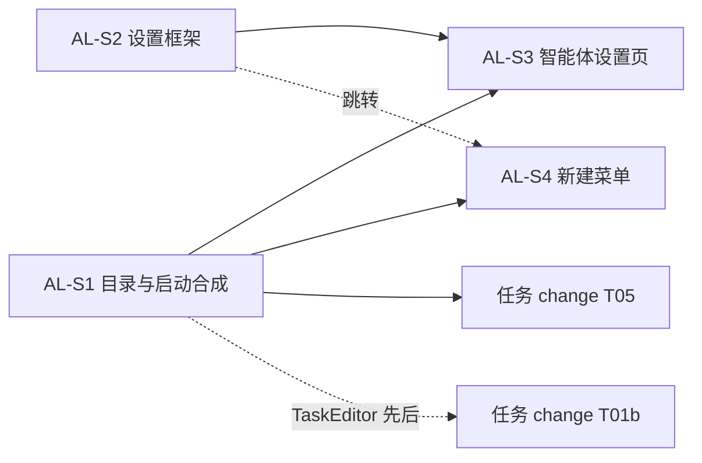

# 实施计划：插件设置页规范化与智能体启动设置

- **目标**：插件设置页随插件启停；智能体目录与启动合成统一；设置页与新建菜单复刻 orca。
- **规格**：[spec.md](spec.md)；需求与事实：[brief.md](brief.md)。
- **下游**：[任务 Issue 化](../../../../changes/2026-11-13-task-issue-automation/plan.md) 的 T05 依赖本计划的 AL-S1。
- **交付点**：合入 `main`。提交、推送、发布需要用户另行授权。**当前授权只到文档，还没有授权写代码。**
- **进度**：开工时创建 `progress.md`，这是唯一记录进度的位置。
- **复核**：2026-11-13 顾问两轮复核后定稿（契约补齐恢复会话与 headless 细节；冲突表按选项拆分；目录改为共享纯数据；写入边界补齐检测消费者、依赖与 e2e）。

## 切片

| 切片 | 完成后的行为 | 真正依赖 | 唯一写入者与边界 | 验收 |
| --- | --- | --- | --- | --- |
| AL-S1 目录与启动合成 | 三个智能体由共享目录驱动；交互会话按设置启动，默认完全访问；Fast 生效；Agent Teams 删除干净；现有自动化仍能找到 CLI | 无 | agent-cli 引擎与 `src/shared/`；agent-cli 清单；`apps/engine/src/boot.ts:295-305`；`TaskEditor.tsx` 与 `RuleEditor.tsx` 中读检测结果的几行；agent-cli 现有 UI 中读旧能力的地方（`AgentSettings.tsx`、`LaunchPanel.tsx`、`AgentCliModule.tsx:68,96-97,241-242,256-264` 中读 `agent.providers.detect` / `agent.providers.prefs.get` 的几行，只做最小适配）；tasks、automations 的 `package.json` 增加对 `@huhu/plugin-agent-cli` 的依赖与 lockfile（UI 只 import `/shared`，oxlint 允许）；versioning `repo.ts` 的 `DEFAULT_GITIGNORE`；Agent Teams 的全部引用；相关单测与 e2e。**不改** automations `worker.ts` | AG-01、AG-02（引擎）、AG-03、AG-10、AG-11、LA-01～LA-08 |
| AL-S2 设置框架 | 设置导航分系统 / 插件两组；插件页随插件启停；跳转带 section；agent-access、safe、versioning 的设置迁入各自插件页 | 无 | `packages/workbench`（`contributions.ts`、`shell/AppShell.tsx`、`settings/`）、`packages/ui` 设置导航样式、`apps/desktop/src/renderer/main.tsx` 的设置注册、`PluginCenterModule.tsx`、`ShellBars.tsx`、`GatewayModule.tsx`、`HealthModule.tsx`；agent-guide 新建 UI 包；safe、versioning 的 UI 注册与设置组件；agent-guide、safe、versioning 三个清单；清单对齐测试 | SF-01～SF-10 |
| AL-S3 智能体设置页 | agent-cli 插件设置页可查看检测结果、编辑每个智能体、预览有效命令行、重启 Core；旧对话框删除 | AL-S1（能力与目录）、AL-S2（贡献点） | agent-cli UI：新增设置页组件；删除 `AgentSettings.tsx` 与 `agent-settings-open` 入口；agent-cli 清单的 `settingsPages` | AG-02（设置页）、AG-04～AG-09、AG-12，以及 SF-01～SF-04 的 agent-cli 版本 |
| AL-S4 新建菜单 | 新建菜单含搜索、新终端、智能体与子菜单、设置入口；Ctrl+T 新终端 | AL-S1；底部“智能体设置…”需要 AL-S2 的跳转 | agent-cli UI：`AgentCliModule.tsx` 菜单区与头部设置按钮、新增菜单组件、删除 `LaunchPanel.tsx`；`shortcuts.ts` | AG-02（菜单）、LA-09、LM-01～LM-08 |

**并行与先后**

- AL-S1 与 AL-S2 可同时进行：前者只动 agent-cli 引擎与检测消费者，后者只动 workbench 与其他插件的 UI。两者都不碰对方的文件。
- AL-S3 与 AL-S4 都改 `AgentCliModule.tsx`（S3 删设置按钮与对话框挂载，S4 改菜单区）。由同一实施者顺序完成，或先合入 S3。
- AL-S4 可以在 AL-S2 合入前开工，底部链接最后接上跳转。
- **与任务 change 的共享文件**：
  - `plugins/tasks/src/ui/TaskEditor.tsx`：AL-S1 只改读检测结果的几行（`:29,38`）；任务 change 的 T01b 重写执行配置区（`:102-160`）。约定 **AL-S1 先合入**，T01b 在其上开工。
  - `worker.ts`：只归任务 change 的 T05，它依赖 AL-S1 的 `agent.launch.resolve`。
  - `agent.run` 权限组由任务 change 的 T02 定义。AL-S1 先合入时，`agent.launch.resolve` 先按现有方式注册为 `exposable: false` 的内置能力，T02 合入时归组。

## AL-S1 目录与启动合成

**当前代码指针**（基线 `8283c5c`，实施时复核）：
- `plugins/agent-cli/src/engine/providers/index.ts:5-143`：Provider 表、`ModelOption`（`:7-12`）、`claudeArgv` / `codexArgv`（恢复会话 `:36`、`:62`，effort 带引号写法 `:64`）、`findOnPath`、版本检测与 10 分钟缓存。
- `prefs.ts:4-39`：`ProviderPrefs`，`.huhu/agent-cli/providers.json`。
- `sessions.ts:133-197`：`agent.sessions.launch`；输入校验 `:145-152`；检测 `:158`；提示词位置参数 `:160`。
- `apps/engine/src/boot.ts:295-305`：`detector.detect()` → `exeFor`（宽松类型断言）。
- `plugins/tasks/src/ui/TaskEditor.tsx:29,38`、`plugins/automations/src/ui/RuleEditor.tsx:49,68`：`agent.providers.detect` 的消费者。
- `plugins/automations/src/engine/worker.ts:54-66`：headless argv 的现状，作为 §3.2 headless 字段的来源（只读，不改）。
- `plugins/versioning/.../repo.ts:23`（`DEFAULT_GITIGNORE`）、`sync.ts:56`（`HUHU_INCLUDE`）。
- 测试：`apps/engine/test/engine.test.ts:227,334`；`tests/e2e/workflows/acceptance.spec.ts:540`（检测）、`:752-778`（读写 providers.json）。
- orca 来源见 [brief.md](brief.md) 与 spec §3。

**实施要点**：
1. 用 `grep` 子代理列出 Agent Teams、Provider 表、`agent.providers.detect`、`providers.json` 的全部引用，作为影响面清单写进 `progress.md`。
2. 写 `src/shared/catalog.ts`（spec §3.1、§3.2）。逐项从 orca 与现有代码复制；与本机 `claude --help`、`codex --help` 不一致处以本机为准并记录。核对 `service_tier=priority` 在本机 codex 上有效，无效就停下报告。
3. 写安装目录表与检测（spec §4.2），能力改名为 `agent.catalog.detect`；改 `boot.ts`、`TaskEditor.tsx`、`RuleEditor.tsx`。
4. 写设置文件与能力（spec §4.1）；删除 `providers.json` 读写；`DEFAULT_GITIGNORE` 加一行。
5. 写 `resolveAgentLaunch`（spec §5）；`agent.sessions.launch` 改用它。
6. 删除 Agent Teams 的全部引用；`AgentSettings.tsx`、`LaunchPanel.tsx` 与 `AgentCliModule.tsx` 中读旧能力的几行改读共享目录与新能力，保证合入时应用可用（前两者在 S3、S4 被删除）。tasks、automations 补对 agent-cli 包的依赖并更新 lockfile。
7. ledger 登记。

**验证**：单元测试覆盖 AG-01、AG-02（引擎）、AG-10、LA-01～LA-08；AG-03 用 `git grep`；更新 `engine.test.ts` 与 `acceptance.spec.ts` 中受影响的用例（AG-11）；`audit` 跑 typecheck、lint、单元测试与 e2e。

## AL-S2 设置框架

**当前代码指针**：
- `packages/workbench/src/contributions.ts:9-15`（`ModuleProps.onNavigate`）、`:55-112`（`ContributionRegistry`、`visible()`）。
- `packages/workbench/src/shell/AppShell.tsx:63-67`（`ModuleIconsContext`）、`:73-76,147-152`（设置导航与 testid）、`:238`（`onNavigate`）。
- `packages/workbench/src/state/ui-store.ts:43-46`（`setSection`、`openModule` 及其切换折叠逻辑）。
- `packages/workbench/src/settings/SettingsModule.tsx:14`（TITLE）、`:52-68`（switch）。
- `apps/desktop/src/renderer/main.tsx:46-52`（`PluginFilter`）、`:159-183`（设置分区）。
- `packages/ui` 的 `system.css:1724`（520 px 断点）。
- `PluginCenterModule.tsx:279-281`；`ShellBars.tsx:65`；`GatewayModule.tsx:217-218`；`HealthModule.tsx:42-44`。
- `plugins/agent-guide/src/ui/index.ts`（空）、`package.json`；`AgentAccessPage.tsx:70-77`。
- `SafeModule.tsx:454-474`；`SyncPage.tsx:55-82,141,165`。
- `packages/contracts/src/plugin-manifest.ts:15-24`。
- e2e：`shell.spec.ts:1006,1585`（`sync-remote`、`sync-save`，迁到设置页后改路径）。

**实施要点**：
1. 加 `settingsPages` 贡献类型；系统页改为注册；删 switch 与 TITLE 表。
2. `AppShell` 按注册表渲染两组导航；通用回退规则；`onNavigate(moduleId, section?)` 与未启用提示。
3. 迁移各跳转入口（spec §2.5 表）。
4. agent-guide 补 UI 包（依赖、`index.tsx`、desktop 依赖与注册、lockfile），迁 agent-access。
5. 迁 safe 锁定设置与 versioning 同步配置；模块内留“设置”按钮。
6. 三个清单更新 `settingsPages`；清单对齐测试（agent-cli 的清单留到 S3，避免 S2 合入时测试失败）。

**验证**：SF-06 单元测试；SF-01～SF-05、SF-07～SF-10 用 `dev-verify` 驱动应用截图（浅色、深色、520 px）；更新并跑 `shell.spec.ts` 中受影响的用例与设置相关 e2e。

## AL-S3 智能体设置页

**实施要点**：
1. 按 spec §7 实现，含 Herdr Core 区（迁 `AgentSettings.tsx:119-132`）。
2. 删除 `AgentSettings.tsx` 与 `agent-settings-open` 入口；agent-cli 清单加 `settingsPages: ["agent-cli"]` 并注册。
3. 引用 `agent-settings-open`、`agent-settings` testid 的 e2e 改为经 `settings-nav-agent-cli` 进入；`acceptance.spec.ts:771`（`agent-core-restart`）保持通过。

**验证**：AG-04～AG-09、AG-12 与 SF-01～SF-04 的 agent-cli 版本用 `dev-verify` 在真实应用中操作并截图；AG-07、AG-09 同时检查 `agents.json` 内容。

## AL-S4 新建菜单

**实施要点**：
1. 按 spec §6 实现菜单、搜索、键盘导航、子菜单（含附加提示词）与无 Space 状态；删除模块头部设置按钮与 `LaunchPanel.tsx`。
2. Ctrl+T 登记到 `shortcuts.ts`，只在 agent-cli 模块激活且焦点不在终端时生效。
3. 更新受影响的 e2e：
   - `shell.spec.ts:447,792,1433,1458,1485,1519`、`perf.spec.ts:237`：菜单文案“新终端（shell）”→“新终端”。
   - `acceptance.spec.ts:72-81`（ACC-AG-11，断言菜单只有 1 个 menuitem）：按新菜单结构重写断言。
   - `acceptance.spec.ts:726-750`（`launch-panel`、“附加提示词”）：改为经子菜单操作。

**验证**：LM-01～LM-08 用 `dev-verify` 驱动；LA-09 在真实终端里检查进程 argv。

## 规格覆盖

| spec 章节 | 切片 |
| --- | --- |
| §2.1～§2.6 设置框架 | AL-S2（§2.5 中 agent-cli 一行由 AL-S3 完成） |
| §3 目录、§3.3 删除 Agent Teams | AL-S1（图标映射在 AL-S3 / AL-S4 使用时加入） |
| §4.1 存储、§4.2 检测 | AL-S1（能力与消费者）、AL-S3（界面） |
| §5 启动合成 | AL-S1；§5.4 中 worker 由任务 change T05 承接 |
| §6 新建菜单 | AL-S4 |
| §7 智能体设置页 | AL-S3 |
| §8 复制与许可 | 各切片在复制时各自登记 |
| §9 验收 | 见上表“验收”列 |

## 完成边界

- 四个切片合入后，用 `audit` 跑 lint、typecheck、单元测试和 e2e，再按 CLAUDE.md 请顾问复核，最后交付。
- AL-S1 合入即可解锁任务 change 的 T05 与 T01b，不需要等全部切片。

## 遗留项

本期不处理，记录在案：
- tasks、ssh、versioning 的清单 `homeWidgets` 与 UI 实际贡献不一致。
- 清单中声明的 `commands` 在 UI 侧都没有注册。
- 外部插件的设置页（JSON schema 表单）。
- codex `service_tier` 的运行时发现与多档下拉（本期只做 Fast 开关）。
