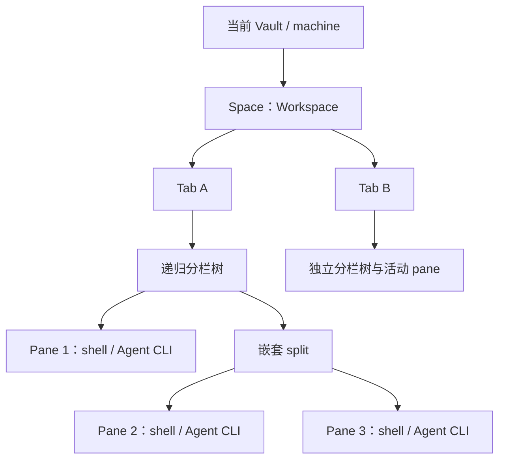
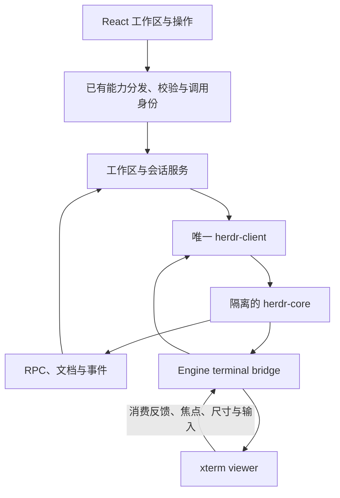

# GitHub Issue #4 [Agent CLI 完整重构] 深度复刻 herdr-app / ORCA：Workspace、四向分栏、CLI 启动、历史会话与 Core 交互

- 原报告 — https://github.com/NAMEWTA/huhu/issues/4
- GitHub 对象 ID — I_kwDOVmq61M8AAAABfU8bow
- 状态 — OPEN
- 作者 — NAMEWTA
- 创建时间 — 2026-11-14T23:17:49Z
- 更新时间 — 2026-11-17T06:36:52Z
- 标签 — 

## 正文

基于用户提供的 `huhu-agent-cli-refactor-issue.md` 完整草稿，结合 **2026-11-15（UTC+8）** 的源码复核整理。保留完整复刻范围、允许直接重构和无兼容要求；修正上游状态、查看权限与实际调用链的描述，并更新固定源码引用。

## 0. 目标与不可妥协的约束

**以 herdr-app 的工作区产品模型、布局和 Core 交互为基准，直接移植 ORCA 的新建、分栏和历史会话相关成熟实现，完整重构 Huhu 的 Agent CLI 插件。配色、主题与宿主组件可以不同，操作含义、布局关系、焦点和业务交互必须与对应上游一致。**

用户已经明确报告：点击 `+` 后新增内容总在左侧；上下/左右分栏不完整；已检测到的本地 CLI 点击后不能正常打开；整体渲染和使用体验存在严重问题。

本次必须满足：

- **复制优先。** 能直接复制的源码、纯函数、组件及测试直接复制；需要跨语言或宿主适配时，机械移植原有行为，不凭个人偏好重新设计。
- **不做兼容。** 当前尚未正式发布，允许修改数据结构、接口和依赖。不要旧/新双栈、兼容壳、迁移框架、双写或“新版体验”开关；所有消费者同步修改。
- **遵守现行项目规范。** 继续使用现有 Engine、能力分发、插件生命周期、公开包入口、Vault 隔离和设计系统。不为复刻再建第二套终端运行时、事件总线、任务系统或通用 UI 插件框架。
- **不以截图相似替代交互等价。** “用了 xterm”“有一个新建按钮”“有 2/4 格子”均不是完成标准。上游功能—源码—本地实现—测试必须逐项对应。

“没有兼容要求”不等于可以清空真实 Vault、擅自删除原生 Agent 历史、重放命令、泄漏环境变量或随意终止后台进程。

## 1. 调查基线、证据边界与关联工作

### 1.1 固定版本

| 对象 | 本次读取的固定基线 | 用途 |
| --- | --- | --- |
| Huhu | `main@913264045cee1818497a37a57715c664aa85a1ae` | 当前实际实现与规范；调查开始及正文整理前复查一致。 |
| herdr-app | `master@5216e6f9f8c0c281a65e09816c66e4319e671784` | Workspace/Tab/Pane、默认界面、命令语义、Core 客户端与布局同步。 |
| herdr-core | `master@c84d6e76156a6c2aac1da20efbe800f10acfe897` | 协议、终端生命周期、事件与文档 API。 |
| ORCA | `main@5c1cedc4f55303505467f0d1c90f218dc44efa0d` | 当前新建入口、目标定位、分栏树、历史 UI 与恢复规则。 |

Huhu 提交为 `chore(release): 0.0.1-rc.4`，时间 **2026-11-14 21:45:51（UTC+8）**。本 Issue 按用户要求采用未正式发布、可直接重构的约束，不因版本号含 `rc` 引入兼容工作。

Huhu 实际二进制锁文件是 **Core `0.1.19`**，见 [herdr.lock.json][h-lock]；[下载脚本][h-fetch] 已有平台目标及 SHA-256 校验。**上表的 Core 源码 SHA 不等于当前安装包已经包含该 SHA 的全部功能。** 必须把实现采用的 Core 发布产物、schema、客户端和各平台校验值一起锁定验证。

本次复核时，Huhu 与 Core 的基线未变。herdr-app 比附件基线新增两项修复：Git 探测暂时失败时保留已知仓库归属，以及 **zoom 同步 pane 焦点**；见 [app 基线差异][app-baseline-diff]。ORCA 本轮锁定到上述最新提交；相对本 Issue 前次基线 `b57fbb5b452d9b8a818d0129962766fcd5627ed1`，新增 2 个提交、变更 7 个文件，涉及 Chat worker 关闭 Dispatch 与 Claude banner 的精确版本匹配，没有修改本 Issue 引用的新建、分栏及历史入口，见 [ORCA 本轮增量][orca-baseline-diff]。这些 Chat 产品改动不扩展本次 Agent CLI 范围；增量文件核对也不代表全仓或全部交互已经验证。

上游 SHA 是本次复现基线，不宣称实施时仍最新。编码前重核默认分支/本地参考副本并整体更新引用，禁止混用 ORCA 旧版 `7041ea0` 路径。

### 1.2 已做与未做

已读取当前关键 UI、布局函数、检测/启动/会话服务、Core 客户端、终端桥、历史面板、现行开发规范，以及上游相关模型、协议和入口源码。以下区分“源码已确认”和“用户报告/待运行复现”。

**没有取得用户本机 `temp/sources` 工作副本；没有运行 Huhu、herdr-app 或 ORCA 的真实桌面界面；没有执行构建、单测、真实 CLI 或安装包 E2E。** 本文不是测试通过报告，也没有证明所有渲染异常或 CLI 打不开只有一个根因。完整 import 闭包、关联测试清单和本机差异必须在 S0 补齐，不能把“找到了入口文件”写成“已读完全部上游实现”。

关联 #1（任务/自动化）、#2（知识库与文件打开）、#3（应用标题栏）。本 Issue 重构 Agent CLI 的工作区与终端交互；保持任务派发、人工接管、评审和文件打开的公共能力可用，不复制三套业务后端，不在插件里再画一套应用窗口标题栏。

遵守 [现行工作台范围 D-36][h-workbench]：本次不增加“在新窗口打开 Vault”等应用级多窗口入口。后文的 window/viewer 身份、共享状态及 CAS 冲突要求，用于既有视图生命周期、重新连接和 Core 客户端并发正确性；浮动 pane/peek 也不等于另开一个 Vault 应用窗口。

## 2. 当前实现的具体问题与可保留基础

### 2.1 源码已确认的差异

| 编号 | 事实与代码 | 影响 / 本次要求 |
| --- | --- | --- |
| F01 | [AgentCliModule][h-module] 将会话列表直接渲染成标签；局部状态主要是一个 Space、一个 active session，以及 split picks。 | 缺少独立 Tab、稳定 Pane 和层级布局实体。一个会话、一个标签、一个屏幕位置被混在一起。 |
| F02 | [split-layout.ts][h-split-model] 的 `Layout` 只有 `1 / 2 / 4`；`fillCells()` 自动队列先放 active，再放其余运行会话，从左到右填空。创建后模块调用 `setActive(s.id)`；[sessions.ts][h-sessions] 列表按创建时间倒序。 | 在自动槽位模式下，新会话会优先进入首个槽位，已有会话位置可能变化。这是“新增往左”的明确代码路径，不能靠调 CSS 的 `order` 修复。手动槽位填满时又可能无法显露新会话。 |
| F03 | [SplitView][h-split-view] 固定两列，4 格才有两行；高度写为 `55vh / 70vh`，没有递归分栏、比例拖动或相对目标的四向插入。 | 不是真正的上下/左右分屏；固定视口高度还可能与宿主剩余空间冲突。需替换模型及渲染，不增加一个“上下两格”枚举应付。 |
| F04 | [AgentCliModule][h-module] 给 launcher 外层设置 `position: static`、普通 margin，放在主区正常布局流中。 | 不是绑定点击按钮的弹出层。新建菜单位置与新建内容位置是两个独立问题，必须分别验收。 |
| F05 | [detect.ts][h-detect] 找到文件后，即使 `probeVersion()` 返回空，也会给 `installed: true`；检测和实际 Core spawn 不是同一运行验证链。 | “发现可执行入口”不等于“已验证可启动”。不能把绿色已安装状态当成启动成功保证；但版本探测失败也不能简单等同于未安装。 |
| F06 | [模块][h-module] 切 Space 时清空 active 与 split；布局模式用全局 `localStorage` 键保存；Space 列表只给当前 Space 显示会话数量。 | 没有按 Workspace 恢复完整工作现场，其他已打开 Space 的 Agent 情况不清楚。 |
| F07 | [Herdr 客户端][h-client] 的 Core attach 连接丢失路径可回调空关闭原因；[terminal-bridge][h-bridge] 统一发送 `type: closed`；[TerminalView][h-terminal] 收到后进入 ended。 | 传输断开可能被 UI 当成程序结束。必须拆开 disconnected/lost、真实 exited/killed 与 Core keep 恢复状态，不能依靠刷新猜测。 |
| F08 | [客户端][h-client] / [桥][h-bridge] 当前主要转发 DATA、RESIZE、CLOSE；桥层流控依据 WebSocket `bufferedAmount`；attach 前输入暂存数组没有在该实现中设置累计上限。 | 与 [Core 协议][core-protocol] / [app hc.rs][app-hc] 的 FOCUS、FACTS、自动回复标记、消费反馈、断线分类等完整链路不等价。需要逐项补齐和压力测试，不声称当前完全没有背压。 |
| F09 | [HistoryPanel][h-history] 只声明 Claude/Codex 历史项；“可恢复”筛选实际是 `!active`；active 项仅禁用恢复按钮，没有提供原 pane 定位动作；恢复回调只有 session ID。 | 不符合原现场定位、真实可恢复性判断与目标 pane 归属。Pi 已在当前启动目录中，历史能力不能无说明地消失。 |
| F10 | [复用台账 R-42][h-ledger] 明写新建/设置只复刻结构，按 Huhu 重写，**未复制源码**。 | 之前的“参考 ORCA”不能证明完整移植已完成。本次要求文件/符号级复用记录与对照证据。 |
| F11 | [客户端 `handleData` / `onMessage` / `hello`][h-client] 在 plain 阶段先把整个读取块转为 UTF-8 字符串；收到 hello 回执时仅 resolve Promise，`framed=true` 在 `await` 恢复后才设置。 | 若 plain hello 回复与后续二进制处于同一读取块，尾字节无法可靠、无损地交给 framed decoder。当前 attach 先等待 hello，尚不能证明用户现场触发过该合包条件；这是需要故障注入验证的协议边界风险，对应 §8.3 / C06。 |
| F12 | [会话启动对账][h-sessions] 在 `terminal.run` 异常后调用 `terminal.list`；对账调用也失败时 `found=null`、`n=-1`，当前落为 `failed`，仅多候选 `n>1` 落为 `unknown`。 | 对账不可用并不能证明进程未启动。保留“不盲目再次 run”的基础，把结果不可判定与确定失败分开，保留 requestId 和找回入口，对应 §8.4 / C10。 |

F02/F04 是两个已确认的错误机制；F11 是有明确触发条件的协议边界风险，尚未运行复现；F12 是已确认的对账状态归类问题。F07 专指 Core attach 断开经桥层进入 ended 的路径，不能与 viewer 自身 WebSocket `onclose` 已有的 lost 状态混同。用户全部渲染异常与每台机器的启动失败仍须运行复现，不把静态风险包装成唯一根因。

### 2.2 不要推倒重做已有可靠能力

[launch.ts][h-launch] 已统一 interactive/headless 参数构造，校验模型、恢复 ID 和环境设置；[sessions.ts][h-sessions] 已有落盘记录、requestId 去重、同请求在途合并、失败后按 label 对账，而不是无条件再启动。应保留和补强，不绕过它另写一个 launcher spawn。

[herdr-core.ts][h-core] 已按 Vault/machine 隔离端点与运行目录；停用默认断开客户端而非停止 Core。现有 [Engine 注册][h-engine] 及 WaitingWatcher 已处理真实 `blocked` 上报、通知和任务评论；不是一切状态都只能轮询。

[TerminalView][h-terminal] 已有 xterm、FitAddon、ResizeObserver、二进制输出、主题响应和清理；现有桥也有观察者约束与发送缓冲检查。重构要修正完整性和语义，不重复实现已经存在的功能，更不能破坏 SSH 等其他消费者。

## 3. 复刻依据与允许的适配边界

### 3.1 各来源负责什么

| 领域 | 权威来源 | 不允许的替代 |
| --- | --- | --- |
| Space / Tab / Pane、关闭/退出/保活、Agents 状态与导航 | herdr-app [默认界面说明][app-defaults]、[model.rs][app-model]、[layout.rs][app-layout] | 用“Space=Agent 类别”“Session 数组=布局”替代。 |
| 默认界面分区、侧栏、标签、pane header、右侧 Files/Changes、状态栏 | [main.json][app-main-layout] 及其引用的默认 mods | 仅仿配色或重新设计一套卡片首页。 |
| 新建终端/Agent、可搜索入口、空 pane、异步目标与焦点 | ORCA [TabBarCreateEntry][orca-create]、[SplitPaneLanding][orca-landing]，对齐 app [new-menu][app-new-menu] | 只抄按钮，丢掉 pending、禁用原因、键盘、返回焦点和目标绑定。 |
| 四向递归分栏的 Web 实现 | ORCA [terminal-tab-types][orca-layout-types]、[terminal-pane-tree][orca-pane-tree]、[terminal-pane-placement][orca-pane-placement] 及真实调用；[layout-tree][orca-layout-tree] 主要负责遍历/裁剪；对照 app 的 split/close/focus 语义 | 固定 1/2/4 网格，或再创造第三套泛化 docking 系统。 |
| 历史浏览、范围、定位、恢复/分支资格 | ORCA [AiVaultPanel][orca-history-panel]、[恢复资格][orca-history-resume]、[原 pane 定位][orca-history-original]、[恢复执行][orca-history-launch] 及 [Provider 参数][orca-resume-argv] | 将“不在运行”直接等同于可恢复，或总是 `resume latest`。 |
| Core 协议及连接时序 | [Core schema 说明][core-protocol]、[生成的 OpenRPC][core-schema]、[app hc.rs][app-hc] | 根据记忆拼 RPC；把上游 app 命令名误当成 Core RPC。 |
| 布局共享与本地视图状态 | [app mirror_sync.rs][app-mirror-sync]、[默认模型说明][app-defaults] | 多份持久化布局各自可写、冲突时静默覆盖。 |
| 配色、目录、权限和宿主基础 | Huhu [现行设计系统][h-design]、[开发资料规范][h-dev]、现有能力与插件生命周期 | 导入上游全站 reset/Tailwind 或让 renderer 直接访问 Node。 |

顺序仍为：**Huhu 已有 → `temp/sources` → 现有成熟依赖 → 指定上游源码 → 小范围适配 → 确无实现才自研**。复用检查不等于必须保留已经不合适的旧布局。

### 3.2 “直接复制”的技术含义

herdr-app 是 Rust/GPUI，默认 mods 使用 gpui-kit 的 JavaScript 描述原生界面，不是 React/DOM；见 [Cargo.toml][app-cargo] 与 [defaults/AGENTS.md][app-defaults]。不能谎称复制一个 `main.js` 就能在 React 内运行，也不为此把整个 Huhu 改成 GPUI。

实施方式：保留上游状态、命令、算法和交互顺序；Rust/GPUI 部分按职责机械移植到当前 TypeScript/React 宿主。ORCA 的 TS 纯函数、组件、相关 hook 与测试，在依赖允许时直接复制，替换 store、宿主 IPC、主题和文字接口。**适配报告必须精确到改动，不允许“技术栈不同”成为另做简化设计的理由。**

复制单位是实际运行所需的 import 闭包、资源和测试，不是孤立 TSX。需要新增/升级依赖可以做，但要说明替换什么旧依赖及真实收益；不得并存第二套 PTY/进程监督体系。

### 3.3 完整范围与宿主差异

本地 Agent 工作区范围内的 Space/Agents 侧栏、标签与分栏、pane 菜单、原终端查看、历史、启动设置、Files/Changes 辅助面板、worktree 新建/打开入口，均进入复刻矩阵，不默认以“以后再做”排除。Files、Changes 与已有评审/知识库/Git 能力集成，不另复制文件数据库或版本管理产品。

上游自带的 Win98 示例布局、面向用户编写任意 GPUI mod 的运行时、另一套应用标题栏，以及 ORCA 浏览器/模拟器/原生聊天产品，不因出现在同一入口源码中就全部搬入 Agent CLI。裁掉这些宿主无关分支，**不能裁掉本地终端、Agent、新建、历史和工作区交互的必要依赖**。上游远程机器分组在 Huhu 有真实远程终端能力时按宿主接入；不得凭复制菜单就声称已支持远程 Agent。

## 4. 产品模型：Workspace 不是 Agent



每个终端 pane 通过 Huhu 会话关联 Core terminal address。Provider / 原生历史会话有独立身份与恢复资料，不是 Space，也不是 Pane。

### 4.1 身份分离

至少明确区分 Vault ID、machine identity、Space ID、Tab ID、Pane/leaf ID、Huhu session ID、Core address、provider + native session ID、一次启动 operation/request ID。它们各自承担不同职责，不以数组 index、显示名称、cwd 字符串或“当前 active”代替稳定身份。

上游的 `TerminalPaneLayoutNode` 与纯树操作优先直接复用。Space/Tab 关系、焦点回退、最近使用顺序、Agent 关注状态来自 app 模型。**一个 Tab 只保留一棵权威 pane 树**，不能同时维护固定 picks 与新 tree，再靠 effect 同步。

ORCA 有两层不同布局：`TabGroupLayoutNode` 是工作区内标签组的树，叶子为 `groupId`；`TerminalPaneLayoutNode` 是单个终端标签内部的终端树，叶子为 `leafId`。本次以 herdr-app 的 Space→Tab→Pane 模型为准，直接复用相应终端树算法，并把 ORCA 的 group 定位、空 pane、新建与拖放行为映射到 Huhu 明确的目标实体；不把两个上游结构混成同一棵树，也不把两套 store/布局所有者一并搬入。见 [终端类型][orca-layout-types] 与 [标签组树][orca-group-tree]。

Core 终端的存活、Agent 工作状态、视图连接状态必须分开。例如 `terminal=live / agent=blocked / view=connected`；`agent=done` 不等于进程退出；断网不等于任务完成。

### 4.2 工作区及左侧导航

复刻 app 默认布局中独立的 **Spaces 与 Agents 两个区域**，不把两者合成一组 provider 卡片。每个打开的 Space 都能看到真实的运行/需要处理情况，切换后能找到属于该 Space 的 Agent CLI。作用域、计数和导航来源一致，不能只当前 Space 有数字。

现有空间选择与编辑能力继续作为公共入口；更换实现时同步任务/自动化消费者。已有 Space 激活只恢复视图，不重启进程；新建 Space 是明确动作，初始 tab/terminal 的创建顺序对齐上游。打开已有目录、重命名、重新打开最近 Space、排序及关闭空间的行为进入矩阵。

Agent 列表根据 Core 真实状态和归属聚合，按上游 `blocked > done > working > idle` 的关注优先级及实际导航规则呈现。未实现上报的 CLI 显示“状态未知/未上报”，不能凭无输出推断 idle 或 blocked。点击 Agent 应定位它的 Space、Tab、Pane 并聚焦原终端，不另开相同 CLI。

Core 子终端/子 Agent 按 `parent` 关系展示与定位；上游 `terminal.peek` 打开可交互的浮动终端视图，加入工作区使用 keep/收纳语义。**peek 不自动等于 `observe:true`**。Huhu 在权限限定、任务观察等确需只读的入口使用 Core observe，并明确标为宿主权限适配；普通 peek 保留上游输入和焦点行为，见 [app window.rs][app-window] 与 [hc.rs][app-hc]。只接纳当前 Vault/隔离 Core 范围内、拥有有效归属的终端，不把其他应用/其他 Vault 的终端自动收编。

### 4.3 cwd 规则

app 的新 tab/split 会继承焦点 pane 的实时工作目录，而不是永远使用 Space 最初 root；参见 [默认模型说明][app-defaults]。Huhu 应复刻此交互，并区分：Space 配置目录、进程实时 cwd、显式指定的启动目录。

显式目录无效必须报错，不偷偷换到 Vault 根或 HOME。只有上游明确允许的“继承目录已失效”回退，才能按其规则使用该机器 HOME，并向用户明确展示最终目录。任务/自动化显式冻结的目录不受当前焦点变化影响，也不能因为终端 `cd` 就改写任务配置。路径校验不是系统级沙箱，不得这样宣传。

## 5. `+` 与新建：目标必须跟随操作，而不是总落到左边

### 5.1 不同入口，同一命令链

| 入口 | 语义 |
| --- | --- |
| Space 区域的新建 | 创建/打开 Workspace；不误当成向任意当前 tab 增加会话。 |
| Tab 条 `+` | 在其所属 Workspace 新建 tab，打开 ORCA 式新建入口。 |
| pane header/右键中的分栏 | 以被操作 pane 为目标，在指定左/右/上/下建立新 leaf。 |
| 空 pane 的 landing | 在这个 leaf 内选择 shell 或 Agent；不能新建到其他 group 或首个空格。 |
| 历史的“恢复到这里” | 使用明确的 Workspace/Tab/Pane 目标；与 tab 菜单共享恢复资格判断。 |
| 快捷键 | 调用同一动作，使用触发时的活动目标；遵循终端焦点与输入法规则。 |

ORCA 的 [SplitPaneLanding][orca-landing] 明确携带 `worktreeId/groupId`。复制 [TabBarCreateEntry][orca-create] 时，一起移植 [创建菜单控制器][orca-create-controller] 的目标传递、[启动参数快照][orca-launch-args]、[新 Agent 创建链][orca-new-agent] 与 [tab 顺序落盘][orca-tab-order]；普通终端对照 [openNewTerminalTabInWorkspace][orca-new-terminal]。本次新建入口和 tab 插入顺序采用 ORCA 的明确目标与顺序处理，保留既有排列，新 tab 按新建入口规则追加；不能让按 session 对账的列表又把它排到索引 0。

`TabBarCreateEntry` 的 pending/submissionId 主要保护异步文件/URL 的 `onOpenEntry`，Agent 分支另走 `onLaunchAgentOption`；不能据此声称它已为全部 CLI 启动提供防重入。键盘、返回焦点和目标快照可复用，Huhu 仍须让下一节的 operation/requestId 和目标代次贯穿完整后端。

### 5.2 弹层与选择交互

新建菜单必须锚定实际触发按钮/目标 pane；适当使用现有 Popover/Menu/Dialog 原语与 portal，提供边缘翻转、滚动约束、外点关闭、Escape 和返回焦点。删除 `position: static` 把菜单挤进终端布局的方式。

覆盖 Terminal、检测到的 Agent、默认 Agent、模型/选项/附加提示、设置/刷新检测、历史入口。检测中、缓存结果刷新、未安装、被禁用、版本未验证、启动失败分别展示；不能无反馈关闭弹层后留下空白。

鼠标和键盘共享选择状态；迟到的检测/搜索结果不能覆盖用户已经移动的高亮，Enter 不能启动一项用户没看见被选中的结果。中文组合输入期间不误执行；嵌套菜单移入/移出、左右键、焦点陷阱和返回焦点按上游处理。

### 5.3 启动意图冻结与并发

开始操作时冻结目标、Space revision、provider、配置快照和 operation ID。字段命名按项目契约统一，不能把本段示意当成已有 API：

```text
目标：vault / space / tab / pane / insertion-direction
内容：shell 或 provider、cwd、模型与选项
执行：稳定 requestId、调用来源、目标代次
```

异步检测、Core 启动或历史读取完成后，必须仍写回原目标。用户切 Space 后不得把结果塞进新 Space，也不得强行抢回焦点。目标已经关闭时丢弃过期视图意图并明确说明；不能偷偷选择左侧第一个 pane。已启动的进程须可对账和找回，不能变成无归属孤儿。

这里的“切换后不抢回焦点”是 Huhu 的目标代次适配要求：ORCA 的 [launch-ai-vault-session-and-reveal][orca-history-reveal] 会在异步完成后主动激活目标 Workspace。迁入时需要保留原目标绑定，并按 Huhu 当前导航代次决定是否激活，不虚称原函数已自动满足这项要求。

一次用户意图的重试复用 requestId；两次真正的新建是两个意图。pending 防重入与后端幂等都保留。失败占位显示可重试原因，只影响本次新 pane；不能清空原 pane 或重排其他终端。

## 6. 分栏、标签、关闭与恢复

### 6.1 四向递归分屏

使用稳定 leaf ID、方向、first/second 子树及 ratio 等上游结构。直接复用 [terminal-pane-tree][orca-pane-tree] 的 `insertLeafBeside`、`removeLayoutLeaf`、`equalizeLayout`，以及 [terminal-pane-placement][orca-pane-placement] 的目标结构；`terminal-pane-layout-tree.ts` 的遍历与裁剪并不包含全部分栏实现。

**这两层 ORCA 树的轴命名确实不同**，必须显式转换“上/下/左/右 → 轴 + 插入先后”，不能直接互传：

| 上游结构 | 左右排列 | 上下排列 |
| --- | --- | --- |
| `TerminalPaneLayoutNode` | `vertical` | `horizontal` |
| `TabGroupLayoutNode` | `horizontal` | `vertical` |

依据为 [insertLeafBeside][orca-pane-tree] 与 [tab-group-layout-tree][orca-group-tree]。app 自身的 `pane.split` 命令主要是 right/down，四边拖放由 pane 移动实现；本次四向显式新建复用 ORCA 树能力，不假设 app 的同名命令已经接受 left/up。

必须支持任意叶子的左右、上下分栏及嵌套组合，不能硬限制为四个；以至少六个不对称嵌套 pane 验收。拖动 divider 改变比例，支持合理最小尺寸、取消拖动、键盘/无障碍分隔符与高 DPI。无法继续分栏时明确提示，不生成零宽/零高 pane。

复刻焦点边框、pane header、标题/程序图标、cwd、关闭/更多、方向导航、最大化/还原、拖放位置提示、tab 重排和目标移动等真实入口。移动是移动现有 pane/session，不是 kill 后重启；相同地址不因移动多启动一次。

新增 pane 只修改目标子树；既有 pane 的身份、相对位置、比例和进程不因 active 排序改变。关闭叶子后折叠无意义父节点；焦点按上游规则回到仍存在的 pane。缩放 pane 是视图状态，退出缩放恢复原结构，不覆盖保存比例。复刻最新 app 的 `Model.toggle_zoom`：放大时将该 pane 设为所在 tab 的焦点，取消放大保留焦点；只有一个 pane 时不缩放。操作非当前 tab 不额外选中它，真正呈现的终端与键盘目标必须一致，见 [模型实现][app-model] 与 [此次修复][app-baseline-diff]。

### 6.2 明确复刻上游的关闭语义

[herdr-app 默认规范][app-defaults] 明确：**关闭终端 pane 会结束该终端；Core 托管的终端进程真正结束后关闭它的 pane；关闭最后一个 tab 会关闭 Space，并保留最近访问记录。关闭应用窗口则不结束 Core 中的终端。** 这些不能混成一个“关闭”按钮。

**Agent CLI 子进程返回与终端 finished 必须分开。** app 的交互 Agent 启动通过 `agent_argv` / `unix_agent_argv` 的 shell wrapper，Agent 返回后继续保留交互 shell；Windows 对应 `-NoExit`。因此不能仅因 Agent `done`、前台进程变化或 CLI 子进程返回就关闭 pane。复刻这条启动与退出流程，只有托管终端本身 finished/killed 才触发对应布局清理，见 [app 启动与生命周期实现][app-window]。

| 动作 | 要求 |
| --- | --- |
| 关闭窗口 / 暂时离开插件 | detach/释放 viewer，按既有宿主生命周期处理；不隐式 kill 会话或停止 Core。 |
| 关闭终端 pane | 复刻 app 的结束终端语义和层级操作；视图关闭与进程已结束分开记录，保留 kill 在途与失败反馈，不把“已发出请求”虚报为进程已退出。app 会先改布局、异步 kill；Huhu 现有任务授权需要的后果说明/确认属于宿主适配，不虚称上游同步等待。 |
| 中断 | 对原终端发送对应中断，不等于 kill，也不自动删除 tab。 |
| 结束 tab/Space | 展示其包含的运行对象与影响；遵循上游层级关闭流程，不把“关闭视图”文案用于偷偷终止整个工作区。 |
| 暂时收起 / park / 仅查看 | 使用与结束不同的名称和操作；按 app 命令实际语义适配，不能把 app 的 `terminal.park` 当作未核实的同名 Core RPC。 |
| 进程 exited/killed | 按上游更新布局，执行结果和可保留的历史记录仍能查看；不自动再次执行 argv。 |
| Core 丢失后的 keep 恢复 | 同一地址可以恢复为 shell；**不是原 Agent 复活**，必须明确展示，详见 §8。 |

**父子终端生命周期必须核对 App 与 Core 的实际组合，不能照搬过时注释。** [app `kill`][app-window] 会递归处理未独立收纳的子 Agent，并跳过带 `herdr.space` 的孩子；但当前 [Core 启动实现][core-parent-run] 在创建时设置 `die_with_parent = parent.is_some() && !outlive_parent`。带 parent 的子终端默认会随父结束，[本地处理][core-parent-notes] 与 [远端处理][core-parent-remote] 都会主动结束符合条件的孩子。

app 的收纳仅调用 `terminal.label` 与 `terminal.keep`；[当前 Core 两个方法][core-keep-label] 均不修改 parent / `die_with_parent`。因此，加入 Tab 或 `keep=true` 本身不保证子 Agent 独立存活，App 自己的 kill 列表跳过它也不足以实现这一承诺。当前 [公开 schema][core-schema] 的 `outlive_parent` 是启动参数，没有修改已有值或重新绑定 parent 的公开方法；不能凭空添加同名 RPC 调用。

S0 必须锁定并验证这项跨上游差异。移植 app 的关闭与独立收纳交互时，采用实际支持该生命周期的上游版本/API 或必要的最小适配，并同步客户端、产物与测试；不得重新启动一个进程冒充原进程被保留。分别覆盖默认子终端、启动时 `outlive_parent:true` 的子终端、已收纳但仍处默认父子生命周期的子终端，在父自然退出和显式 kill 后的真实结果。关闭影响范围需要包含 Core 自动结束的对象，不能仅展示 App 主动发送 kill 的列表。

终端关闭与任务“已完成”不同；不能因此自动关闭任务。GUI detach、程序退出、Space 从界面收起、删除原生历史也必须是四种不同操作。

## 7. 布局与视图状态：直接复用 app 的同步模式

[app 默认模型][app-defaults] 将 Space/Tab/split 结构保存于 Core 文档；本屏幕的焦点、zoom、settled tabs 与最近空间留在本地。Agent 已读和固定状态遵守更具体的 [共享标签协议][app-labels]：`herdr.seen=<turn>` 与 `herdr.pinned` 通过 Core 终端 labels 在客户端间共享；缺少 `herdr.seen` 时才使用本地已读规则，不能把缺失当成 `0`。这些 Agent 状态标签与原生历史列表的 pin 不是同一份数据。

[mirror_sync.rs][app-mirror-sync] 使用 `doc.get/doc.set` 版本 CAS、每台机器一个在途请求、读取/冲突/不可用状态。**本次优先机械移植该模式，不再用一个全局 localStorage 的数字代表布局。**

### 7.1 单一事实来源

采用当前 Vault/machine 隔离 Core 中的 Huhu 专用文档名，例如 `huhu-agent-cli`。不要写入普通 herdr-app 使用的 `herdr-app` 文档，避免影响其他客户端产品。文档保存 Space/Tab/pane 结构、比例及必要稳定归属；实际结构优先采用已移植的上游模型，不维护另一套平行树。

状态路径沿用 [现行工作台规范][h-workbench] 的 `vault.stateDir`，由现有隔离 Core 生命周期推导，不能硬编码 `<Vault>/.huhu`。明确 Core 文档所在状态目录的持久化、备份和重置边界；只读 Vault 的临时状态也遵守现行宿主合同，不能把临时目录里的布局声称为永久保存。

现有 `SpaceStore` / `agent.spaces.*` 改为同一工作区结构的公共 façade；旧 `spaces/*.json` 不再是另一份可独立编辑的真源。所有任务/自动化消费者一次更新。Space 目录配置 revision 与整体布局文档 version 分开，拖一个 divider 不能让任务的目录配置无故过期。

`SessionsService` 继续负责启动记录、requestId、Core address 与原生会话映射，是执行记录，不拥有第二套 pane 排列。终端实时事实及已读/固定标签来自 Core；Provider 原生历史来自对应历史文件；本地视图偏好按 Vault/machine/window 隔离，不存秘密。

复刻上游 seen 写入时机：只有窗口在前台且 Agent 确实可见时标记当前 turn；同一可见 turn 只写一次，避免无人关注的后台视图覆盖别的客户端“标为未读”。`status` 后的 `turn` 事件负责更新轮次判断，pin 取消通过移除对应 label 完成，不另造竞争状态源。

若实施中发现同一权威数据在现有宿主能力中的必要约束，必须先给出精确来源与单一权威映射，再调整适配落点；不能悄悄退回“Core 文档一份、SpaceStore 一份、localStorage 又一份”的双写方案。

### 7.2 同步、冲突与不可用

先订阅事件，再读取文档；重连、`missed` 后重新读取。完整移植镜像同步的 pending、dirty、available、conflict 和错误路径。遵循上游已接受版本规则，不新造 CRDT/操作日志合并系统，不盲重放旧结构命令覆盖另一窗口操作。

结构不可用时禁止伪成功的新建/关闭/拖动，显示实际状态；可呈现最后确认的只读快照，但快照不是第二真源。文档损坏不得当空布局静默写回。Core 文档容量按 schema 限制，终端原始输出/大段 transcript 不塞入布局文档。

关闭窗口前处理在途布局写入；超时/失败明确保留恢复信息，不把“发出请求”当“已经保存”。不为旧格式做兼容；需要重置开发数据时说明范围并保全真实文件、运行记录和原生历史。

## 8. herdr-core 连接与交互：按 app 的真实实现贯通

### 8.1 连接模型



app 使用 **`hc connect` 的 stdin/stdout → plain hello → framed 多路复用**。优先把这条连接生命周期封装进现有客户端与 `HerdrCore`，继续传入当前 Vault/machine 的隔离环境和端点，而不是连接用户全局 daemon。现有 socket/named-pipe 也是 Core 支持的合法传输；**不能把使用 socket 本身说成 bug**。若宿主保留该合法传输，只允许传输层差异，上层握手、通道、流控、事件和错误语义必须等价并通过同一协议测试。

不在 renderer 启动 Core；不让菜单回调自己执行 `child_process`；不为每个按钮建立独立运行引擎。优先复用上游单一 framed 连接的通道调度，不继续散落无统一重连归属的请求连接与终端连接。

### 8.2 命令与协议对照

| 用户/app 层动作 | Core/宿主实现要求 |
| --- | --- |
| 连接 | `hello` 检查锁定协议 generation、需要的方法与 feature；记录实际 Core 版本，保留结构化 error kind/hint。 |
| 新建 shell/Agent | `terminal.run` 使用 resolver 得到的独立 argv、正确 cwd/env/labels、schema 对应初始网格/display；按 app 使用 keep 策略并明确其后果。 |
| 显示原终端 | `terminal.attach` 返回 channel；处理初始屏幕/history、attach 回执先于流、早到帧和消费者注册时序。 |
| 输入 | 用户输入为 DATA；自动终端查询回复按实际来源标记 AUTOMATIC_INPUT，并完成 hello 与 attach 双重能力协商。不能凭字节内容猜来源。 |
| 尺寸/焦点/显示变化 | RESIZE、FOCUS、FACTS 从真实 viewer 生命周期发送；观察者不能输入或抢尺寸。 |
| 输出消费 | DATA 按顺序交给终端；实际消费后 CREDIT，不能只看 socket 已发送。 |
| 断开 viewer | CLOSE/detach 不等于 `terminal.kill`。 |
| 结束程序/中断 | 调用锁定 schema 的对应终端能力；确认真实结果，不重启替代。 |
| 状态刷新 | `events.subscribe` 的原子快照、seq、heartbeat、missed、断线重订阅；按事件类型更新。 |
| 布局读写 | `doc.get` / `doc.set` expected version；冲突读取与不可用处理按 mirror_sync 移植。 |
| app 的 tab/pane/space 命令 | 是上层布局+终端动作组合，不假设 Core 有同名 RPC。 |

字段以选定发布产物的生成 OpenRPC 为准。保留 app 所需 TERM/COLORTERM/TERM_PROGRAM 等环境意图，同时使用 Huhu 品牌与受控 overlay；检测和实际 spawn 的 PATH/解释器必须一致。进程名/终端 name 的合法长度和字符限制继续遵守已有处理，不拿用户中文标题直接当 Core 内部 name。

### 8.3 帧、流控与 WebSocket 适配

Core 帧为 `channel u32 LE + kind u8 + length u32 LE + payload`，协议说明的 payload 上限为 16 MiB；初始 stream credit 为 256 KiB。直接复用上游解析、早到通道缓存、关闭传播与相关测试，校验分片、合包、长度、未知通道、取消和超时。plain→framed 切换不能丢掉同一读块中的剩余二进制；保留原始字节并在确认握手边界后立即移交解码器，不能先将可能含二进制的尾部转为 UTF-8 文本再还原，或只在异步 continuation 中改变模式而遗留旧缓冲。

当前 WebSocket 桥是必要宿主适配，不是重写 Core 协议的借口。补齐 renderer 已消费字节的反馈：xterm 写入队列、网络发送队列与 Core CREDIT 形成有界链路；慢 pane 不阻塞其他 pane 或 channel 0。保留 Core 落后过多时重新绘制的机制，不在前端无界累积整段日志。

attach 前输入队列要有累计字节/等待上限、取消与错误处理；超限不能静默丢输入后假装已送达。自动查询回复不算用户输入，不重置人工静默状态或抢夺尺寸；不要把 xterm 产生的所有 onData 都无条件视作人在打字。

若当前 xterm 公共接口不能区分用户输入与自动回复，S0 必须验证可用的上游适配、版本升级或终端实现，允许必要技术栈调整；不能用字节猜测伪装协议等价。

观察者的真实 grid/repaint 按当前 Core 支持的 resize notification 规则有序应用，不能仅以观察者容器尺寸渲染主控输出。多视图应以 Core 的焦点/活动 viewer 语义为准，不叠加一套互相争夺的客户端所有权模型。默认重复打开活动会话先定位已有 pane；普通 peek 对齐 app 的可交互 attach，只有明确只读入口才使用 observe。SSH 等共享 viewer 的既有权限合同必须一起验证。

### 8.4 断线、重连、保活和未知结果

必须区分：viewer detach、连接丢失、Core 不可达、终端 `lost`、真正 `finished`、被 kill、`spawn_pending`、keep 后 `restarted`。原始 reason、exit code/signal 与可恢复动作都要正确传到 UI。

连接恢复：重新握手/订阅，使用新 snapshot 及本次 Core seq 起点；丢弃旧代次事件，正确处理 missed。处理 created/restarted/removed/status/turn/title/labels/size/foreground 等实际使用事件，不只监听 blocked。

**Core keep 的恢复不是重跑原命令。** 上游在进程丢失后可能给同一地址启动新的 shell；原 Agent 不会自动复活。界面要表明“原进程已丢失，现为恢复 shell”，原任务运行结果可为未知，后续恢复 Agent 必须是用户明确的原生 resume 动作。不要把 server 重启、OS 重启和单纯关闭窗口描述成同一种恢复保证。

run 超时/连接中断不能盲重试。保留当前 request label 对账；无法确认零/一/多终端时保留 unknown/pending 并提供诊断。修正 F12 中 `terminal.list` 失败即归类 failed 的分支：对账不可用与成功查回零候选是不同事实，不能把未知执行结果作为安全重新启动的依据。Core 的 `spawn_pending` 可能已有进程，不能再次生成 requestId 启动另一个。成功只表示已获得真实启动/绑定结果，不能仅凭创建了本地 JSON 就显示 running。

### 8.5 运行版本与错误反馈

按 [下载与锁定脚本][h-fetch] 更新必要的平台产物和校验值；所有必需方法与 feature 在打包产物上验证。最低版本/功能检查是防止运行错误二进制，**不是用户明确不要的旧产品兼容层**。不支持必需能力时清晰拒绝并提示修复，不保留两套长期协议实现。

错误至少能定位阶段：检测、解析、cwd、Core 连接、run、attach、渲染、resume、布局保存。保留 RPC kind/hint，记录关联 request/session/address 及脱敏命令；不要只显示“打开失败”，也不把令牌、环境秘密、完整敏感提示词直接写日志。

## 9. “已识别但打不开”的专项修复

### 9.1 保留统一 resolver，打通真实运行环境

继续使用 [现有 resolver][h-launch] 作为设置预览、手动新建、历史恢复、任务/自动化的同一 CLI 参数来源。交互 Agent 在统一启动层按 [app `agent_argv` / `unix_agent_argv`][app-window] 组合受控 shell wrapper，复刻用户 shell 环境与 CLI 返回后保留 shell 的行为；任务/自动化的 headless 模式保留其明确的完成与退出合同。两种执行模式共用参数解析，不能把交互 wrapper 强行套给应结束的 headless 任务，也不能在 UI 另拼启动命令。

对照 ORCA 现有命令解析与启动依赖，核对 GUI 启动时的 PATH、用户 shell 环境、版本管理器 shim、脚本解释器、Windows `.cmd/.bat`/PowerShell、空格与 Unicode 路径及环境 overlay。找到绝对可执行路径仍可能缺少它需要的 Node/解释器；Windows 检测使用 shell 执行成功，也不能证明 Core 能按相同路径直接 spawn。

优先复制实际对应平台的成熟解析实现与测试；执行保留 argv 边界。上游预定义的 Agent shell wrapper 是交互启动链的一部分：移植其固定脚本、位置参数/平台转义和相关测试，禁止把模型名、提示词、恢复 ID 或路径直接拼成未转义的 `sh -c` / `cmd /c` 文本。用户自定义 shell 命令是另外的显式入口，不与普通 Agent 参数混用。

### 9.2 检测状态与可操作性

显示“未发现 / 已发现但版本未验证 / 入口无效 / 可尝试启动 / 启动中 / 运行 / 失败”等真正有证据支持的信息；具体枚举复用上游和现有契约，不为界面再加一套重复运行状态机。

`--version` 不支持或超时不必然意味着不能启动，因此不要只将失败都改为 `installed:false`。必须保留诊断，让用户修正 executable/环境并重新检测；明确不可执行、目录不存在、Core 缺失等则阻止伪启动。检测刷新不能清空用户已选模型/目标，不静默安装软件或切换 provider。

现有 Claude Code、Codex、Pi 和 shell 是最低真实覆盖集合；已支持 Provider 不能因替换 UI 退化。其他上游 Provider 逐项登记真实支持与所需适配，不因“图标出现在列表里”就宣称支持。权限模式/完全访问默认沿用明确的用户设置并清楚显示，不在恢复或自动化入口偷偷覆盖。

### 9.3 必须产出的诊断证据

对用户失败场景记录：平台与安装方式、App 实际环境中的候选路径及来源、脱敏后的 argv/cwd、Core 实际版本与 endpoint 身份、run/attach 响应、进程退出/连接状态和 UI 目标归属。先复现，再给出修复前后证据。无登录/需认证应进入真实可交互 CLI，而不是空白 pane 或误报“未安装”。

### 9.4 登录与环境配置由 Agent CLI 自己承接

按 #9（2026-11-17 最新产品边界），Safe 仅管理用户的网站/APP 账号密码，不再承担 Agent、SSH、Git 等模块的凭据供应。Agent CLI 不读取 `safe://`、不调用 `secretUse`，启动不以 Safe 初始化/解锁/启用为前提。

- Claude/Codex/Pi 等 CLI 的原生登录继续由对应 CLI 维护；不复制登录状态、不自动把其账号/token 导入保险箱。
- 用户在 Agent 设置或启动参数中主动配置的环境变量由 Agent CLI 管理。普通值与秘密值在配置/输出中明确区分；秘密持久化采用 #9 的轻量本机加密方案，秘密项的预览/列表/日志只返回已配置状态；普通环境值仍可正常查看和编辑。不得把现有明文 `agents.json.env` 描述为已经安全保存。
- 现有 shell `envRefs -> Safe` 路径随本次删除；用所属模块配置或单次启动环境输入完成同一用途，不保留 `safe://` 别名/兼容解析器。#5 自动化规则的专用秘密由 Automations 自己保存，运行时通过同一 launch 合同交付受控环境，不另建共享密码服务。仅支持 shell 的参数不能伪称已适用于全部 Provider。
- 桌面、MCP、CLI 共享配置/启动 handler；普通启动无需先 reveal 明文，也无需回桌面解锁保险箱。工具开放遵守 #6，敏感配置查询与显式秘密读取分离。
- Core `restart_env`、keep/恢复、终端输出与清理风险继续按第 13 节验收；去掉 Safe 依赖不能使环境秘密进入布局、任务快照、普通日志或 Git 同步配置。

## 10. 历史会话：浏览、回到原现场、恢复与分支不是一件事

### 10.1 直接移植 ORCA 相关闭包

迁入 [AiVaultPanel][orca-history-panel] 的 scope/filter、虚拟列表、键盘、刷新/扫描、空/错误状态及行操作闭包。普通 CLI 恢复以 [ai-vault-session-resume][orca-history-resume]、[ai-vault-session-launch-actions][orca-history-actions] 为依据；原现场定位复用 [ai-vault-original-pane-actions][orca-history-original]；恢复执行对照 [launch-ai-vault-session][orca-history-launch] 及 [agent-resume-argv][orca-resume-argv]，把目标与 argv 接入 Huhu 已有 resolver、会话服务和 herdr-core。

[tab-session-history-switch][orca-history-switch] 与 [surface-switch][orca-history-surface] 主要负责 CLI↔原生 Chat 的表面切换资格，只作为共用资格判断的参考，不据此引入原生 Chat 产品或运行时。[ai-vault-session-resume-here][orca-history-resume-here] 也是原生 Chat `/resume` 的原位替换，不能当作“恢复到终端 leaf”的现成 API。Huhu 的指定 Pane 恢复应将上游 `targetGroupId/splitDirection` 机制适配到明确的 Space/Tab/Pane。

ORCA 的 AI Vault 是其历史界面名称，不意味着在 Huhu 再创建一个 Vault 数据库。复用 Huhu 现有 `engine/history/*`、pin 和会话映射，缺失的 provider parser/索引/恢复规则从成熟来源补齐。不要将 ORCA 的浏览器历史检索误当成 Agent 历史。

### 10.2 统一历史身份与作用域

历史 ID 至少绑定 provider、原生 ID、机器/来源与目录归属。当前 Workspace、其他 Workspace/全部等范围按实际迁入的上游入口展示；切范围不会移动历史，也不会自动启动。路径归属要处理规范化、子目录、重叠 Workspace、大小写、符号链接与不存在目录，不能用标题匹配。

列表提供实际来源对应的搜索、排序、分组、固定/取消固定、预览、加载更多、空状态、扫描错误/进度与键盘行为。计数不能把分页已加载量冒充全部；后台结果绑定查询和 Workspace 代次，迟到结果不能覆盖新范围。

Claude/Codex 的现有读取能力必须保留。Pi 等已支持启动的 Provider 要在能力矩阵中明确原生历史浏览/恢复支持：有上游成熟实现则迁入；确实不可用时显示真实原因，不能悄悄省略又宣称完整支持。ORCA 的 [恢复参数实现][orca-resume-argv] 对 Pi 使用 transcript 路径，不能把所有 Provider 都简化成同一个 native ID 字符串。保留各 Provider 的恢复资料类型与真实参数边界；恢复、fork 和原生 Chat/ACP 专属分支分别核对。

### 10.3 行动作必须表达真实含义

| 会话事实 | 行动作 |
| --- | --- |
| 原会话仍运行且可定位 | “前往会话”，激活原 Space/Tab/Pane；不再调用 run。 |
| 允许交互、需临时查看原终端 | “临时查看”，复刻 app peek 的可交互浮窗；不调用 run。 |
| 仅有观察权限或明确只读入口 | “只读查看”，使用 Core observe；不把它与普通 peek 混称。 |
| 已结束且支持恢复 | 使用指定 provider/native ID/cwd 的真实恢复入口，创建到冻结目标。 |
| 上游支持 fork/恢复副本 | 与继续同一会话区分，按 provider 的真实 fork 行为执行；不冒充原会话。 |
| 只能预览 | 只读 transcript，明确不可恢复原因；预览无启动副作用。 |
| CLI 缺失、目录失效或记录损坏 | 显示具体诊断和适用修复入口；不能恢复到“最近一次”无关会话。 |

当前 Huhu 的 `!active` 不是可恢复判断，`active` 也不应只表现成一个禁用按钮。打开历史、Tab 菜单和任务“前往处理”必须共用定位/恢复能力。

恢复前冻结身份和目标，检查是否已被同一次操作恢复，使用同一 requestId 防重入；原生恢复成功后建立新 Huhu session/Core address 与原生 ID 的真实映射。恢复失败保留历史与错误，不改写 Provider 的记录或假装成功。

取消固定/从视图移除，不等于删除原生历史；若复刻删除入口，明确删除范围、确认与原 Provider 文件规则，且不等于 kill 活动终端。只读预览不执行历史中的命令或工具调用；敏感信息不扩散到日志和全局索引。

## 11. UI、排版、渲染与辅助面板

### 11.1 默认布局对齐

以 [herdr-app main.json][app-main-layout] 为结构基准：左侧 Space/Agents，工作区顶部 tab 条，中间 pane 卡片与 header，按需展开的 Files/Changes 面板和状态区域。窄窗口采用上游可用的折叠/收纳模式，不把所有栏永久堆到左边，不让右侧工具挤没终端。

保持上游的视觉层级、信息密度、操作分组和激活状态；字体、色彩、圆角映射 Huhu token。所有按钮、菜单、tooltip、右键、拖放提示、loading/empty/error/disabled/selected/focus/hover 状态都进入组件矩阵，不能只做默认截图。

Files/Changes 使用 Workspace 的实际目录和当前上下文，不误用当前 Vault 根。按最新 app 保留 Git 探测暂时失败前已知的 repo/worktree 分组并重试；只有明确“不是仓库”才清空归属，见 [app 基线差异][app-baseline-diff]。Vault 外部的工作目录仍经受控 Engine 文件/Git 能力访问，不能绕过授权直接从 renderer 读磁盘。文件编辑调用现有工作台资源入口；评审复用 `ReviewPanel`/服务与评论发送链。上游 worktree 新建/打开菜单须绑定真实 Git 行为及失败处理；找不到现成能力时机械移植所需命令适配，不留下空菜单。

### 11.2 修复终端渲染的结构性问题

从宿主容器到 pane body 保持完整的 flex/grid 约束与 `min-width:0 / min-height:0`；使用实际剩余宽高，不再 `55vh/70vh` 硬凑。避免祖先双滚动、菜单挤占终端和 overflow 截断输入行。

terminal viewer 绑定稳定 pane/session 身份，状态刷新、排序、分栏拖动、主题变化不导致反复 dispose/recreate 和 attach。切换不可见 pane、字体就绪、DPI/窗口变化与缩放后，在真实可见尺寸下 fit；不向 Core 连发零网格或使用隐藏容器的尺寸覆盖有效终端。

复用成熟 xterm/上游生命周期：完整处理 ANSI、alternate screen、光标、颜色、Unicode 宽字符、组合字符、emoji、中文输入法、复制/选择/粘贴、鼠标报告、查找、链接和滚动。测试快速输出与分栏同时发生，不能只验收 `echo hello`。

断线重 attach 按权威首屏/replay 规则重建，不把首次绘制叠加到旧屏导致重复行；保持有依据的滚动/选区视图状态，不把重放误作新输出。退出画面是否保留在执行记录中按实际能力呈现，不为了保留画面违背 app 的 pane 退出行为。

### 11.3 设计系统与可访问性

遵守 [现行规范][h-design]：`@layer theme, tokens, base, vendor, components, shell, modules`；Agent 插件使用 `agent-` 类，通用组件 `hu-`。静态 xterm 第三方 CSS 进 vendor，插件样式进 modules。不要导入上游全站 Tailwind/reset，不增加全局无层覆盖或无理由 `!important`。

四套主题的明暗、compact、reduced-motion、长中文标题、窄窗口、100%/125%/150%/200% 缩放都验证。菜单和分隔符支持键盘与可访问名称；真正活动 pane 的焦点可见，快捷键不能同时触发菜单与终端，也不能破坏 TUI 自己的 Ctrl/Alt/功能键。

目标区域按审查后的新布局验收；纯样式迁移及无关页面须保持渲染等价。

## 12. 来源 → 实现落点与目录约束

以下落点中子目录/新文件是**实施建议**，不是声称它们目前都存在。优先在现有职责目录内重构；只提取确有多消费者的共享能力。

| 复制/移植单位 | 上游与当前入口 | Huhu 落点 / 适配 |
| --- | --- | --- |
| Space/Tab/Pane 命令与焦点 | app [model.rs][app-model]、[layout.rs][app-layout]、[defaults 说明][app-defaults] | `plugins/agent-cli/src/shared/workspace/` 的纯模型与规则；Engine 工作区服务拥有操作提交。 |
| 默认界面和命令组合 | app [main.json][app-main-layout]、[new-menu][app-new-menu]，及引用的 `spaces/agents/tabs/pane/workspace-status/files/changes` mods | `ui/workspace/`、`ui/launcher/`、现有 review/files 适配；迁入时补读每个实际引用入口，不把本文列出名称当已完成递归审计。 |
| 递归分栏树 | ORCA [terminal-tab-types][orca-layout-types]、[terminal-pane-tree][orca-pane-tree]、[placement][orca-pane-placement]、[layout-tree][orca-layout-tree] 及 split/drag/close 调用与测试 | `shared/workspace/` + `ui/workspace/PaneLayout.tsx`；直接保留树操作与不变量，删除旧 picks。 |
| 新建与空 pane | ORCA [TabBarCreateEntry][orca-create]、[SplitPaneLanding][orca-landing]、[目标快照][orca-launch-args]、[新 Agent][orca-new-agent]、[普通终端创建][orca-new-terminal] 及其调用闭包 | `ui/launcher/`；Huhu engine capability 替代 Orca store/IPC，只移除宿主不相关产品分支。 |
| 历史 UI 与动作 | ORCA [AiVaultPanel][orca-history-panel]、[恢复资格][orca-history-resume]、[恢复动作][orca-history-actions]、[原 pane 定位][orca-history-original]、[目标创建][orca-history-launch] 与 [Provider argv][orca-resume-argv] | `ui/history/` 与现有 `engine/history/`；统一原现场定位、恢复资格与目标传递。 |
| Core transport / framed channels / events | app [hc.rs][app-hc] + [Core schema][core-schema] / [协议说明][core-protocol] | `packages/herdr-client/src/`；保留对外公开包边界，完善协议和生命周期测试。 |
| Core 布局 CAS 与本地视图分离 | app [mirror_sync.rs][app-mirror-sync]、相关 mirror/model 调用与测试 | `engine/workspace/` + 按 Vault/machine/window 隔离的视图偏好；无并行 Space 真源。 |
| CLI 检测/argv/设置 | Huhu [detect][h-detect]、[launch][h-launch]、[当前设置规范][h-agent-notes]，对照 ORCA 对应平台实现 | 原 `engine/`、`shared/`；复用统一 resolver，补平台环境和诊断。 |
| 终端输出与 viewer | Huhu [TerminalView][h-terminal]、[terminal-bridge][h-bridge] 对照 app attach 生命周期 | 共享 viewer / 现有 Engine 桥接；实际消费 ACK、focus/display/automatic input，所有真实消费者同步更新。 |

建议职责结构：

```text
packages/herdr-client/src/            # 唯一 Core 协议客户端
packages/ui/src/components/TerminalView.tsx
                                     # 通用终端 viewer，不含 Agent 业务
plugins/agent-cli/src/
  shared/workspace/                  # 上游移植的纯模型/树/目标规则
  shared/catalog.ts                 # 已有 Provider 元数据
  engine/
    herdr-core.ts                    # 隔离 Core 生命周期与握手
    workspace/                      # Core 文档、结构命令、CAS/事件投影
    spaces.ts                       # 同一工作区模型的 façade，或合并后删除
    sessions.ts                     # 启动记录/幂等/对账/真实进程映射
    detect.ts / launch.ts           # 统一检测与 argv
    terminal-bridge.ts              # 受控 viewer 传输适配
    history/                        # 既有历史读取与成熟来源补齐
    waiting.ts / review.ts          # 保留并适配已有跨模块能力
  ui/
    AgentCliModule.tsx               # 装配，避免重新成为巨型状态组件
    workspace/                     # Spaces、Agents、Tabs、PaneLayout/header
    launcher/                      # ORCA 新建入口与空 pane
    history/                       # ORCA 历史界面与 Huhu 适配
    agent-cli.css                  # 语义类/主题 token
plugins/agent-cli/test/              # 按当前测试组织放置移植及适配用例
packages/herdr-client/test/          # 按当前包实际测试组织补协议用例
tests/e2e/                          # 真实 Electron 行为
tests/visual/                       # 现有视觉设施
.agents/dev/changes/2026-11-15-agent-cli-parity/
  brief.md / plan.md / reuse.md / tasks.md / acceptance.md / evidence/
```

目录示意不是要求无条件创建所有文件。新增契约进入现有 contracts/公共导出与 schema；不跨包导入私有 `/src`，不从 UI 访问 `node:fs`/`child_process`，不让 Core 适配包依赖 React。动态订阅、请求和 provider 生命周期进入现有作用域清理。

## 13. 任务、自动化、评审与安全不能退化

保持 #1 已落地的统一启动、目录快照、运行记录、waiting、任务评论和“前往处理”。这些入口应使用相同 Space/session/Core 映射；外部派发产生的终端能出现在所属工作区，必要的 tab/pane 收纳按同一结构命令完成，不平行维护一棵后台专属树。

改 Space root 或 Provider 设置不修改活动进程的冻结配置。用户进入等待输入现场只 attach/聚焦原终端；不能再启动一个 CLI 冒充接管。Agent `done`、pane 关闭、Core lost 都不自动把任务设为已完成。

保留统一 Dispatcher 权限和执行授权，内部可调用不等于外部全部 exposable。列表/历史读取不执行命令；点击普通路径/预览不自动批准权限请求。所有终端桥鉴权继续绑定当前 Vault/session；WebSocket 的 terminal ID 不是任意本机进程访问口令。

按 [当前启动规范][h-agent-notes] 审计环境秘密：Core 可能持久化 `restart_env`，带秘密的终端按现有受控流程及时清理记录；不要把包含秘密的完整 env 存进布局、日志或待重放意图。keep 与秘密生命周期冲突必须有明确策略和测试，不能为了恢复方便无限持久化。

关闭/删除/重启 Core 都是不同权限和后果的动作；重启需明确影响，不能把“修复一个空白 pane”实现为停止整个 Vault 的所有任务。临时诊断不得打印令牌，原生历史和 transcript 不得未经授权发送到其他服务。

## 14. 必须删除或替换的旧路径

最终在更新全部实际消费者后清理，而不是只隐藏 UI：

1. 固定 `Layout = 1 | 2 | 4`、`fillCells/choose/reveal` 的自动填格模型、索引 key 和固定视口高度分栏。
2. 会话列表同时充当 tabs/panes 的模型、active-first 自动搬移，以及切 Space 清空现场的行为。
3. 全局 layout 数字偏好、与新结构竞争的旧 Space 持久化真源、无归属的局部 picks。
4. 正常文档流内的静态 launcher、脱离点击目标的新建/恢复回调、重复命令/菜单执行路径。
5. `!active = resumable`、活动历史无“前往原会话”、未验证入口统一显示可用等简化分支。
6. 空关闭原因直接映射 exited、对传输故障盲重启、以本地记录创建冒充 Core running 的路径。
7. 若迁入统一 framed 连接，删除被替换的重复连接/事件实现；保留有明确用途的恢复对账，不机械删除所有轮询。
8. 无消费者的 CSS、旧类型、mock 和文案。更新测试为新语义，不删断言掩盖不通过。
9. shell 的 `envRefs -> secretUse -> Safe` 旧链、相关 Safe 依赖/提示及示例；一次更新 #5 自动化与 #6 工具合同，保留真实环境配置用途。

**不保留旧版兼容开关、历史格式迁移平台或长期双写。** 必须一次更新设置、任务、自动化、SSH viewer 相关合同、demo、文档与测试；破坏性数据重置需明确说明，不能静默执行。

## 15. 实施切片与每阶段交付物

- [ ] **S0：来源与复现冻结。** 核对最新 main、本机 `temp/sources` SHA/dirty；锁定 app/core/ORCA 的相容组合与真实 Core 产物，核验 §6.2 的父子生命周期与收纳语义差异；补齐默认 mods、布局/启动/历史实际 import 闭包和测试清单；录制用户三个核心问题的原始复现。
- [ ] **S1：上游模型与 Core 客户端。** 迁入 Workspace/Tab/Pane 树与纯函数测试、framed/事件/错误分类、Core 文档 CAS；统一身份与 Space 公共消费者。先保证“没有重复启动/双真源”。
- [ ] **S2：真实启动链修复。** 检测/运行环境统一，复用 resolver，接真实 run→attach，暴露可诊断失败与 pending/unknown，对已有三个 CLI 和 shell 做真实验证。
- [ ] **S3：默认工作区与新建入口。** 迁入 Space/Agents/tab/pane 分区，ORCA 新建/landing/焦点/目标规则；替换旧 fixed grid、静态菜单；新增内容不再挪动既有 pane。
- [ ] **S4：四向分屏与完整终端体验。** 递归 split/drag/resize/close/zoom、稳定 viewer、实际消费流控、焦点/display/自动回复、断线/保活/重连与渲染。
- [ ] **S5：历史、辅助面板与跨模块。** 迁入历史 UI/定位/resume/fork 资格，完成 Files/Changes/worktree 的真实宿主适配及任务/自动化/评审接管。
- [ ] **S6：旧链清理与交付证据。** 删除旧模型、更新规范/依赖/来源/测试/示例，完成对照录屏、跨平台安装验收、性能与无关模块回归。

可以并行，但只合成一套模型；不能以菜单完成结案，历史和交互细节不可默认延期。

## 16. 验收矩阵

以下全部是**交付要求，非本次已执行结果**。每项须绑定具体测试/证据和采用的上游来源。

### A. 工作区与新建位置

- [ ] A01：同时打开至少三个 Space，每个包含 shell/Agent；所有 Space 的归属、计数和关注状态正确，切换恢复原 Tab/Pane/比例/焦点，不重启进程。
- [ ] A02：Space、Agent、Tab、Pane、Core address、native session ID 各自独立；同名目录/会话不会串位，普通 shell 不伪装 Agent。
- [ ] A03：在左、右、上、下目标分别发起新建，结果进入对应位置；既有 pane 不因新会话 createdAt/active 改变而搬家。
- [ ] A04：Tab `+`、pane landing、右键分栏、快捷键、历史恢复使用同一目标规则；新建菜单锚定实际按钮，不插入左侧正常文档流。
- [ ] A05：等待启动时切换 Space/关闭目标/关闭菜单，迟到结果不污染新目标、不抢焦点；已产生进程可对账找回。
- [ ] A06：连续点击、网络重试、超时重试不产生重复进程；两个独立新建动作又不会被错误合并。
- [ ] A07：检测/搜索结果迟到不抢用户高亮；键盘、鼠标、子菜单、Escape、外点关闭、返回焦点和 IME 正常。
- [ ] A08：新 tab/split 使用正确的继承 cwd；显式错误目录不静默回退，任务冻结目录不受 UI 焦点影响。

### B. 分栏与生命周期

- [ ] B01：在任意叶子实现四向分栏，至少六 pane 不对称嵌套；无 2/4 格上限，方向与视觉一致。
- [ ] B02：divider 拖动/取消、比例、最小尺寸、键盘操作与持久化正确；窄窗口无零尺寸或被遮住的输入行。
- [ ] B03：新增、移动、重排不重启已有终端；pane 身份稳定，拖动一个 divider 不使其他终端反复 attach。
- [ ] B04：关闭叶子后树正确折叠；焦点回退、zoom/还原、最后 tab/Space 关闭与最近记录符合 app 规则。放大目标 pane 后键盘输入必须进入它，取消放大保留焦点，不出现看 A 输 B。
- [ ] B05：关闭 pane 结束原终端，关闭窗口只释放 viewer；中断、kill、park/收起和查看没有混淆，kill 在途/失败与关闭影响范围明确；以锁定 Core 产物分别验证默认子终端、启动时 outlive_parent 的子终端、收纳后的子终端在父自然退出/显式 kill 后的结果。产品承诺独立保留的对象必须真实存活，不以 keep/标签冒充生命周期解除，不以重新启动冒充保留。
- [ ] B06：进程正常退出、被 kill、传输断开、Core lost、keep→新 shell、spawn_pending 有不同且正确的 UI/记录，不自动重放 Agent。
- [ ] B07：同一活动会话再次打开定位原 pane；普通 peek 可交互，只读 observe 不输入/不抢网格，两者入口与权限清楚，多视图焦点/尺寸符合 Core 规则。
- [ ] B08：布局保存、重连、CAS 冲突、文档不可读/超限均有真实反馈；没有双写、空文档覆盖、另一窗口操作被盲重放覆盖。

### C. 本地 CLI 启动与 Core 协议

- [ ] C01：Claude Code、Codex、Pi、shell 在声明支持的平台真实打开，能显示输出、接收输入并正常结束；未认证时能看到真实认证交互。交互 Agent 返回后保留上游式 shell，托管 shell 退出才关闭 pane；headless 任务完成后正常结束，不被 wrapper 留住。
- [ ] C02：GUI PATH、常见版本管理器 shim、Node shebang、Windows cmd/bat、空格/中文路径均有案例；检测和运行诊断指向真实阶段。
- [ ] C03：版本探测失败不冒充启动已验证，也不一律误判未安装；disabled、缺失 executable、无效 cwd、缺失 Core 的错误不同。
- [ ] C04：预览、手动启动、历史恢复、任务/自动化使用同一 argv resolver；模型、权限模式、附加提示和 env 不漂移。
- [ ] C05：运行二进制、锁文件 SHA-256、协议 generation/schema/feature 一致；不支持必需能力时拒绝而非空白假成功。
- [ ] C06：framed header 分片/合包、plain→framed 剩余字节、早到 channel、attach 回执顺序、取消与连接关闭有协议测试。
- [ ] C07：UTF-8 跨帧与大输出不乱码；输出实际消费与 CREDIT 对应；慢 pane 不堵其他 stream/RPC，队列有界。
- [ ] C08：FOCUS、FACTS、RESIZE、自动终端回复的来源和协商正确；自动回复不当成人工输入，不抢尺寸。
- [ ] C09：事件快照/增量、seq 重置、heartbeat、missed、重连/重新读取文档正确；`herdr.seen`/`herdr.pinned` 共享、缺标签兜底与前台实际可见时的写入正确；状态不依赖纯 5 秒轮询猜测。
- [ ] C10：run 响应丢失、spawn_pending、对账失败与多个候选保留真实 unknown/pending，不创建另一个 requestId 重跑。
- [ ] C11：Core/Engine/viewer 分别重启或断开，不相互混淆；keep 恢复成 shell 时原 Agent 丢失被正确标记。
- [ ] C12：RPC 错误 kind/hint 和 request/session 关联可诊断；秘密不进入 UI 错误、日志、布局或未受控持久化。
- [ ] C13：Safe 未初始化、锁定或停用时，原生已登录 CLI、模块自有环境设置和已授权 shell 启动均能独立工作；无 `safe://` / `secretUse` 调用，MCP/CLI 无需先 reveal 或回桌面；秘密环境的保存、输出与 Core 清理按第 9.4/13 节验证。

### D. 历史与原现场

- [ ] D01：当前 Workspace/其他范围的历史归属、provider 过滤、搜索、排序/分组、固定、加载更多和空/错误状态与 ORCA 对照。
- [ ] D02：活动历史项提供“前往会话”，准确定位原 Space/Tab/Pane，不新建第二个进程。
- [ ] D03：真正可恢复性不等于 `!active`；缺 CLI、坏目录、损坏记录、无原生恢复能力都有具体原因。
- [ ] D04：恢复使用用户点选的 provider/native ID/cwd，进入指定目标；不使用不相关 `latest`，恢复/fork/新建清晰区分。
- [ ] D05：预览只读且无启动副作用；搜索/预览迟到不覆盖新 Workspace，长历史有正确截断/分页提示。
- [ ] D06：相同 provider ID 在不同机器/来源下不会串会话；子目录、重叠 Space、Unicode、大小写及路径变更有用例。
- [ ] D07：现有 Claude/Codex 历史不退化，Pi 历史能力有明确实现/不可用依据；不以图标冒充恢复支持。
- [ ] D08：重复恢复、已在其他 pane 打开的原会话和并发操作不重复执行；取消固定/移除视图/删除历史/kill 后果不同。

### E. 布局、渲染与交互细节

- [ ] E01：Space/Agents 区域、tab 条、pane header、右侧 Files/Changes 和状态区域按固定 app 基线对照，不是任意重新排版。
- [ ] E02：Files/Changes/worktree 的实际目录与目标正确，菜单有真实能力，文件打开/评审复用现有后端，不出现空按钮。
- [ ] E03：长标题、多标签、菜单展开、侧栏开关、窄窗口和各缩放下无裁切、覆盖、额外整页滚动及固定 vh 空白。
- [ ] E04：四套主题明暗、字体切换、DPI/窗口尺寸变化后终端颜色/网格正确，焦点和 tooltip/弹层可读。
- [ ] E05：全屏 TUI/alternate screen、Unicode 宽字符、组合字符、emoji、中文输入法、复制选择粘贴与鼠标报告有真实交互证据。
- [ ] E06：快捷键只执行一次；菜单/历史搜索/终端之间焦点正确，TUI 的键不被未聚焦工作区全局监听偷走。
- [ ] E07：高输出时同时拖 divider、切 Tab/Space、隐藏/显示，画面不持续空白、不重复首屏、不丢输入，不频繁销毁 viewer。
- [ ] E08：反复新建/关闭/切换与重连后，xterm、WS、channel、observer、timer、事件订阅无持续增长。

### F. 集成、清理与来源

- [ ] F01：任务派发、自动化、waiting 请求、任务评论、前往原现场、评审发送使用同一真实会话，任务不会因 Agent done/pane close 自动完成。
- [ ] F02：Vault/machine/window 隔离正确，切 Vault 的迟到消息不串数据；未授权 viewer 不能访问其他 Vault 终端。
- [ ] F03：共享 TerminalView 的 SSH 等消费者通过权限/观察者/生命周期回归；不为 Agent 修复牺牲其他模块。
- [ ] F04：必需上游源码与测试闭包逐项登记，Rust/GPUI 机械移植与宿主差异可审核；没有不明来源重写或平行基础设施。
- [ ] F05：旧 fixed grid、静态菜单、双真源、旧模型分支和无消费者样式清理；契约、设置、任务、自动化、示例与规范同步。
- [ ] F06：真实安装产物、真实 Provider、上游对照视频与性能结果齐备；未验证平台/行为明确列出，不用 mock 通过冒充。

## 17. 测试、来源记录与完成定义

### 17.1 测试组织

纯函数测试覆盖树插入/删除/折叠/移动/ratio/active leaf、不变量、启动目标与历史资格；从固定上游迁入对应测试，而非只写几个 Happy Path。

本次已核对的具体测试来源包括 [SplitPaneLanding.test.tsx][orca-landing-test]（焦点、默认 Agent、键盘打开 picker、Escape、迟到结果与用户高亮保护）和 [TabBarCreateEntry.search.test.tsx][orca-create-search-test]（pending/readOnly、错误无障碍反馈及禁用条件）。这里只记录测试源码来源，没有执行这些测试；迁入所需闭包、替换宿主适配并验证结果属于实施交付。

协议/集成测试覆盖实际 Core run/attach/events/docs、丢包断线、错误响应、幂等对账、版本/feature 检查、消费反馈和取消。fixture Core/mock 用于精确故障注入，**真实 Core 集成不能省略**。

真实 Electron 测试覆盖点击位置、右键/子菜单、拖放、分隔符、焦点、IME、终端网格和不同 DPI。每个用户原始问题至少一条“修复前失败、修复后通过”的回归。真实登录/权限交互的测试要避免自动批准用户没有授权的动作。

对照同一上游提交，以相同目录、相同操作序列录制：打开 Space→新建 shell/Agent→四向嵌套→切 Space→原现场定位→历史恢复→断线重连→关闭 pane/窗口。截图只能证明静态外观，不能证明没有重启进程、没有错位置或没有丢输入。

### 17.2 门禁与证据

沿用 [根脚本][h-package]，执行并保存真实结果：

```sh
pnpm format:check
pnpm lint
pnpm typecheck
pnpm test
pnpm build
pnpm e2e
pnpm e2e:packaged
pnpm knip
pnpm notices
```

按实际变更补 `pnpm bench` 和现有 `pnpm visual:baseline <name>` / `pnpm visual:compare <name>`。性能记录冷启动/热 attach、首屏时间、输入延迟、resize、持续输出、多 pane 和大历史列表的耗时/内存/丢帧；记录机器和样本，不在没有测量时承诺一个漂亮阈值。

macOS、Windows、Linux 按支持的目标/架构验收实际安装包，记录 Huhu SHA、Core 版本/校验、CLI 版本、系统版本、GUI 启动方式、主题/DPI、具体命令、通过/失败/未执行项及截图/录屏。GUI 从桌面启动与从已配置 shell 启动分别测试，避免把开发终端 PATH 的成功误当安装版成功。

### 17.3 来源与许可证记录

更新 [docs/upstream/ledger.md][h-ledger] 与第三方声明，至少记录：源仓库、SHA、原路径/符号、目标路径、直接复制或机械移植、依赖/资源闭包、原声明、具体修改、移入的上游测试和本地验收证据。保留实际源文件要求的版权、许可证与 NOTICE，不把源码大改后只留一句“参考 ORCA”。

来源声明：Huhu 为 GPL-3.0-or-later，herdr-app/Core 为 Apache-2.0，ORCA 为 MIT。复制时仍须逐文件核对版权、许可证和 NOTICE。

对 herdr-app 的原生 UI 移植明确标记“算法/交互机械移植”，不能虚报为 React 源码原样复制。对 ORCA 当前不相关浏览器/模拟器/chat 分支逐项记录裁剪边界，避免误删共用焦点和目标处理。

按 [开发资料导航][h-dev] 把活跃任务放 `changes/`，长期事实更新 `notes/context/` 的 agent-launch、workbench、tasks/automations 等实际受影响内容；归档记录不当现行规范，也不为本次重构篡改历史。复用矩阵和验收矩阵必须在同一 change 内可互相追踪。

### 17.4 完成定义

用户能够连续完成：

**打开多个 Workspace → 清楚看到各自的 Agent → 在正确目标新建终端/Agent → 任意上下左右分屏并拖动比例 → 切工作区恢复现场 → 点击需要处理的 Agent 回到原终端 → 浏览 ORCA 式历史并准确恢复指定会话 → 断线后找回真实现场 → 明确地关闭 pane 或只关闭窗口。**

全部步骤须对照固定上游，差异需有依据。复刻矩阵、全部验收、真实安装/CLI/交互证据和旧链清理完成后方可结案；**只修左对齐、增加固定格子或 mock 启动成功均不算完成。**

<!-- 以下为固定源码链接定义；上文引用均指向固定 SHA。 -->

[h-module]: https://github.com/NAMEWTA/huhu/blob/913264045cee1818497a37a57715c664aa85a1ae/plugins/agent-cli/src/ui/AgentCliModule.tsx
[h-split-model]: https://github.com/NAMEWTA/huhu/blob/913264045cee1818497a37a57715c664aa85a1ae/plugins/agent-cli/src/ui/split-layout.ts
[h-split-view]: https://github.com/NAMEWTA/huhu/blob/913264045cee1818497a37a57715c664aa85a1ae/plugins/agent-cli/src/ui/SplitView.tsx
[h-sessions]: https://github.com/NAMEWTA/huhu/blob/913264045cee1818497a37a57715c664aa85a1ae/plugins/agent-cli/src/engine/sessions.ts
[h-detect]: https://github.com/NAMEWTA/huhu/blob/913264045cee1818497a37a57715c664aa85a1ae/plugins/agent-cli/src/engine/detect.ts
[h-launch]: https://github.com/NAMEWTA/huhu/blob/913264045cee1818497a37a57715c664aa85a1ae/plugins/agent-cli/src/engine/launch.ts
[h-client]: https://github.com/NAMEWTA/huhu/blob/913264045cee1818497a37a57715c664aa85a1ae/packages/herdr-client/src/client.ts
[h-bridge]: https://github.com/NAMEWTA/huhu/blob/913264045cee1818497a37a57715c664aa85a1ae/plugins/agent-cli/src/engine/terminal-bridge.ts
[h-terminal]: https://github.com/NAMEWTA/huhu/blob/913264045cee1818497a37a57715c664aa85a1ae/packages/ui/src/components/TerminalView.tsx
[h-core]: https://github.com/NAMEWTA/huhu/blob/913264045cee1818497a37a57715c664aa85a1ae/plugins/agent-cli/src/engine/herdr-core.ts
[h-history]: https://github.com/NAMEWTA/huhu/blob/913264045cee1818497a37a57715c664aa85a1ae/plugins/agent-cli/src/ui/history/HistoryPanel.tsx
[h-engine]: https://github.com/NAMEWTA/huhu/blob/913264045cee1818497a37a57715c664aa85a1ae/plugins/agent-cli/src/engine/index.ts
[h-ledger]: https://github.com/NAMEWTA/huhu/blob/913264045cee1818497a37a57715c664aa85a1ae/docs/upstream/ledger.md
[h-design]: https://github.com/NAMEWTA/huhu/blob/913264045cee1818497a37a57715c664aa85a1ae/.agents/dev/notes/context/design-system.md
[h-dev]: https://github.com/NAMEWTA/huhu/blob/913264045cee1818497a37a57715c664aa85a1ae/.agents/dev/AGENTS.md
[h-agent-notes]: https://github.com/NAMEWTA/huhu/blob/913264045cee1818497a37a57715c664aa85a1ae/.agents/dev/notes/context/agent-launch.md
[h-package]: https://github.com/NAMEWTA/huhu/blob/913264045cee1818497a37a57715c664aa85a1ae/package.json
[h-lock]: https://github.com/NAMEWTA/huhu/blob/913264045cee1818497a37a57715c664aa85a1ae/scripts/herdr.lock.json
[h-fetch]: https://github.com/NAMEWTA/huhu/blob/913264045cee1818497a37a57715c664aa85a1ae/scripts/fetch-herdr.mjs
[app-defaults]: https://github.com/herdrdev/herdr-app/blob/5216e6f9f8c0c281a65e09816c66e4319e671784/defaults/AGENTS.md
[app-model]: https://github.com/herdrdev/herdr-app/blob/5216e6f9f8c0c281a65e09816c66e4319e671784/src/model.rs
[app-layout]: https://github.com/herdrdev/herdr-app/blob/5216e6f9f8c0c281a65e09816c66e4319e671784/src/layout.rs
[app-main-layout]: https://github.com/herdrdev/herdr-app/blob/5216e6f9f8c0c281a65e09816c66e4319e671784/defaults/layouts/main.json
[app-new-menu]: https://github.com/herdrdev/herdr-app/blob/5216e6f9f8c0c281a65e09816c66e4319e671784/defaults/mods/new-menu/main.js
[app-hc]: https://github.com/herdrdev/herdr-app/blob/5216e6f9f8c0c281a65e09816c66e4319e671784/src/hc.rs
[app-cargo]: https://github.com/herdrdev/herdr-app/blob/5216e6f9f8c0c281a65e09816c66e4319e671784/Cargo.toml
[app-mirror-sync]: https://github.com/herdrdev/herdr-app/blob/5216e6f9f8c0c281a65e09816c66e4319e671784/src/mirror_sync.rs
[core-protocol]: https://github.com/herdrdev/herdr-core/blob/c84d6e76156a6c2aac1da20efbe800f10acfe897/schema/README.md
[core-schema]: https://github.com/herdrdev/herdr-core/blob/c84d6e76156a6c2aac1da20efbe800f10acfe897/schema/hc.openrpc.json
[orca-create]: https://github.com/stablyai/orca/blob/5c1cedc4f55303505467f0d1c90f218dc44efa0d/src/renderer/src/components/tab-bar/TabBarCreateEntry.tsx
[orca-landing]: https://github.com/stablyai/orca/blob/5c1cedc4f55303505467f0d1c90f218dc44efa0d/src/renderer/src/components/tab-group/SplitPaneLanding.tsx
[orca-layout-types]: https://github.com/stablyai/orca/blob/5c1cedc4f55303505467f0d1c90f218dc44efa0d/src/shared/workspace-layout/terminal-tab-types.ts
[orca-layout-tree]: https://github.com/stablyai/orca/blob/5c1cedc4f55303505467f0d1c90f218dc44efa0d/src/shared/workspace-layout/terminal-topology/terminal-pane-layout-tree.ts
[orca-history-panel]: https://github.com/stablyai/orca/blob/5c1cedc4f55303505467f0d1c90f218dc44efa0d/src/renderer/src/components/right-sidebar/ai-vault/panel/AiVaultPanel.tsx
[orca-history-switch]: https://github.com/stablyai/orca/blob/5c1cedc4f55303505467f0d1c90f218dc44efa0d/src/renderer/src/components/tab-bar/tab-session-history-switch.ts
[orca-history-surface]: https://github.com/stablyai/orca/blob/5c1cedc4f55303505467f0d1c90f218dc44efa0d/src/renderer/src/components/right-sidebar/ai-vault/session-actions/ai-vault-session-surface-switch.ts

[h-workbench]: https://github.com/NAMEWTA/huhu/blob/913264045cee1818497a37a57715c664aa85a1ae/.agents/dev/notes/context/workbench.md
[app-labels]: https://github.com/herdrdev/herdr-app/blob/5216e6f9f8c0c281a65e09816c66e4319e671784/docs/labels.md
[app-window]: https://github.com/herdrdev/herdr-app/blob/5216e6f9f8c0c281a65e09816c66e4319e671784/src/window.rs
[app-baseline-diff]: https://github.com/herdrdev/herdr-app/compare/87271d6d7bf636970aef2b23deb96643fba232c5...5216e6f9f8c0c281a65e09816c66e4319e671784

[orca-pane-tree]: https://github.com/stablyai/orca/blob/5c1cedc4f55303505467f0d1c90f218dc44efa0d/src/shared/workspace-layout/terminal-topology/terminal-pane-tree.ts
[orca-pane-placement]: https://github.com/stablyai/orca/blob/5c1cedc4f55303505467f0d1c90f218dc44efa0d/src/shared/workspace-layout/terminal-topology/terminal-pane-placement.ts
[orca-group-tree]: https://github.com/stablyai/orca/blob/5c1cedc4f55303505467f0d1c90f218dc44efa0d/src/shared/workspace-layout/tab-groups/tab-group-layout-tree.ts
[orca-create-controller]: https://github.com/stablyai/orca/blob/5c1cedc4f55303505467f0d1c90f218dc44efa0d/src/renderer/src/components/tab-bar/use-tab-bar-create-menu-controller.ts
[orca-launch-args]: https://github.com/stablyai/orca/blob/5c1cedc4f55303505467f0d1c90f218dc44efa0d/src/renderer/src/lib/agent-session/launch/new-tab/launch-agent-in-new-tab-args.ts
[orca-new-agent]: https://github.com/stablyai/orca/blob/5c1cedc4f55303505467f0d1c90f218dc44efa0d/src/renderer/src/lib/agent-session/launch/new-tab/launch-agent-in-new-tab.ts
[orca-tab-order]: https://github.com/stablyai/orca/blob/5c1cedc4f55303505467f0d1c90f218dc44efa0d/src/renderer/src/lib/agent-session/launch/pane/launch-agent-tab-order.ts
[orca-new-terminal]: https://github.com/stablyai/orca/blob/5c1cedc4f55303505467f0d1c90f218dc44efa0d/src/renderer/src/store/terminals/tabs/creation/terminal-active-workspace-creation.ts
[orca-history-resume]: https://github.com/stablyai/orca/blob/5c1cedc4f55303505467f0d1c90f218dc44efa0d/src/renderer/src/components/right-sidebar/ai-vault/session-actions/ai-vault-session-resume.ts
[orca-history-actions]: https://github.com/stablyai/orca/blob/5c1cedc4f55303505467f0d1c90f218dc44efa0d/src/renderer/src/components/right-sidebar/ai-vault/session-actions/ai-vault-session-launch-actions.ts
[orca-history-original]: https://github.com/stablyai/orca/blob/5c1cedc4f55303505467f0d1c90f218dc44efa0d/src/renderer/src/components/right-sidebar/ai-vault/session-actions/ai-vault-original-pane-actions.ts
[orca-history-launch]: https://github.com/stablyai/orca/blob/5c1cedc4f55303505467f0d1c90f218dc44efa0d/src/renderer/src/lib/agent-session/resume/history/launch-ai-vault-session.ts
[orca-resume-argv]: https://github.com/stablyai/orca/blob/5c1cedc4f55303505467f0d1c90f218dc44efa0d/src/shared/agent-launch/startup/agent-resume-argv.ts
[orca-history-reveal]: https://github.com/stablyai/orca/blob/5c1cedc4f55303505467f0d1c90f218dc44efa0d/src/renderer/src/lib/agent-session/resume/history/launch-ai-vault-session-and-reveal.ts
[orca-history-resume-here]: https://github.com/stablyai/orca/blob/5c1cedc4f55303505467f0d1c90f218dc44efa0d/src/renderer/src/components/right-sidebar/ai-vault/session-actions/ai-vault-session-resume-here.ts

[orca-baseline-diff]: https://github.com/stablyai/orca/compare/b57fbb5b452d9b8a818d0129962766fcd5627ed1...5c1cedc4f55303505467f0d1c90f218dc44efa0d
[orca-landing-test]: https://github.com/stablyai/orca/blob/5c1cedc4f55303505467f0d1c90f218dc44efa0d/src/renderer/src/components/tab-group/SplitPaneLanding.test.tsx
[orca-create-search-test]: https://github.com/stablyai/orca/blob/5c1cedc4f55303505467f0d1c90f218dc44efa0d/src/renderer/src/components/tab-bar/TabBarCreateEntry.search.test.tsx
[core-parent-run]: https://github.com/herdrdev/herdr-core/blob/c84d6e76156a6c2aac1da20efbe800f10acfe897/crates/herdr-core/src/api/run.rs#L121-L153
[core-parent-notes]: https://github.com/herdrdev/herdr-core/blob/c84d6e76156a6c2aac1da20efbe800f10acfe897/crates/herdr-core/src/notes.rs#L208-L225
[core-parent-remote]: https://github.com/herdrdev/herdr-core/blob/c84d6e76156a6c2aac1da20efbe800f10acfe897/crates/herdr-core/src/remote.rs#L749-L768
[core-keep-label]: https://github.com/herdrdev/herdr-core/blob/c84d6e76156a6c2aac1da20efbe800f10acfe897/crates/herdr-core/src/api.rs#L341-L375

## 评论

无评论。
