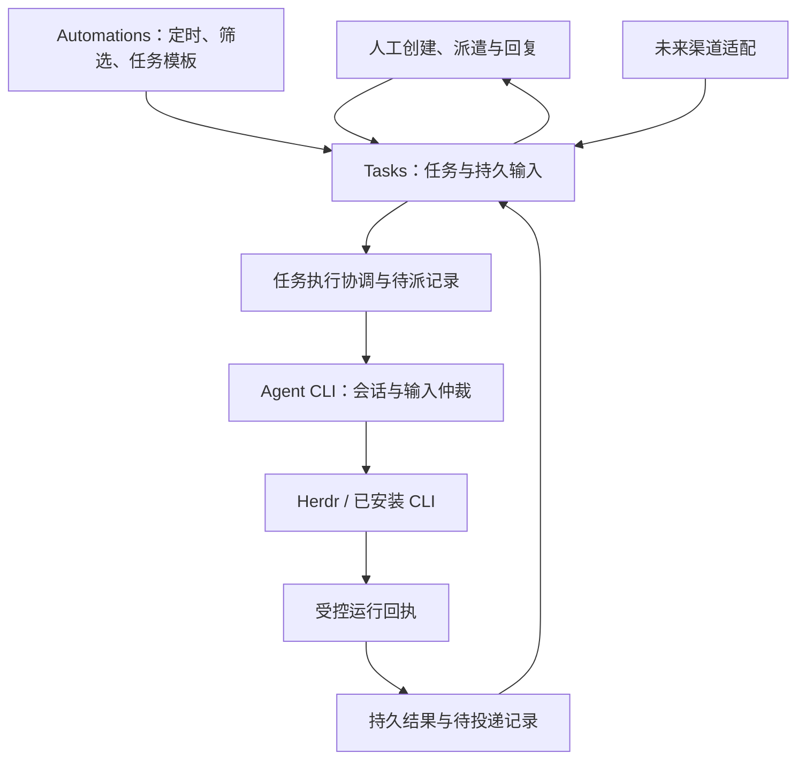

# GitHub Issue #5 [任务与自动化重构] 以 Task 为收发入口，统一持久事件、定时派遣与 Agent CLI 多轮闭环（无兼容）

- 原报告 — https://github.com/NAMEWTA/huhu/issues/5
- GitHub 对象 ID — I_kwDOVmq61M8AAAABfVHh5g
- 状态 — OPEN
- 作者 — NAMEWTA
- 创建时间 — 2026-11-14T23:35:35Z
- 更新时间 — 2026-11-17T06:36:55Z
- 标签 — 

## 正文

# 任务与自动化：以 Task 为收发入口，统一定时派遣、Agent CLI 与多轮交互

## 0. 目标、基线与关联 Issue

**将任务建设成用户与 Agent 协作的统一工作事项：人工或自动化创建任务，自动化按配置筛选到期任务，派遣到指定 Space 的新建或指定 Agent CLI；Agent 的问题、进度与结果回到原任务，用户对问题的回复成为可靠的新输入，继续原任务。**

本 Issue 是根据当前源码形成的完整重构计划。本次已做静态代码、契约、现有测试和项目记录核对，未运行桌面应用或真实 CLI；以下明确区分代码事实与目标设计。

| 对象 | 固定调查基线 |
| --- | --- |
| Huhu | [`main@913264045cee1818497a37a57715c664aa85a1ae`](https://github.com/NAMEWTA/huhu/commit/913264045cee1818497a37a57715c664aa85a1ae)，根包版本 `0.0.1-rc.4` |
| agent-autoloop | [`main@d3a44cac4460f4e0417c3d407baa853de7aa25ff`](https://github.com/KKKKhazix/agent-autoloop/commit/d3a44cac4460f4e0417c3d407baa853de7aa25ff) |
| 文章 | Anthropic / William Hu，[Building always-on agents](https://claude.com/resources/articles/building-always-on-agents)，2026-11-13；用户提供的是其中文转述 |
| 需求整理 | 2026-11-15（Asia/Taipei）；使用仓库 `dev-intake` 的事实、目标、来源区分方式 |

关联工作：

- **#1 任务 Issue 化**：当前已经实现其中的两类型、三状态、任务执行配置、Markdown 评论、三类自动化及部分权限修正。本 Issue 在这些实现上继续重构，不能照抄 #1 的旧缺口或重新开发已完成的部分。
- **#4 Agent CLI 完整重构**：该 Issue 负责 Workspace / Tab / Pane、启动器、历史和 Core 交互。本 Issue 负责工作事项、定时器、派遣、回复、回执及恢复合同。后台创建的 Agent 必须进入 #4 的同一 Space / Session / 终端体系。
- #4 中“保留自动化 headless 合同”的要求，在本次范围内更新为：**保留所需能力和恢复保证，执行权统一到 Agent CLI；不保留 automations 自行 spawn CLI 的旧运行时。** 如确有非交互执行需求，只能是 Agent CLI 内的明确执行模式，不能继续两套运行时。此处是实施协调约定，不代表已经修改或关闭关联 Issue。

### 必须遵守的约束

1. **无兼容重构。** 尚未正式发布，允许调整 schema、能力名、目录与依赖；同步修改全部消费者、示例及测试。删除被替代代码，不做新旧双栈、兼容路由、双写或迁移框架。
2. **复用优先。** 先复用 Huhu 现有能力，再对照实际可获取的参考源码。对 `agent-autoloop` 按文件/函数迁移领域行为，不整仓嵌入。
3. **保持插件边界。** 不新增另一套 Agent、PTY、事件总线、外部调度服务或独立消息中间件。继续使用现有 Engine、Dispatcher、Vault、插件作用域和设计系统。
4. **文件仍是事实来源。** 保留当前 Markdown + JSON、单 Vault 单写者的架构，SQLite 继续作为可重建索引，不在数据库里藏唯一的待派/已发送事实。
5. 本期交付内部闭环与扩展接口；邮箱、Telegram、微信、飞书等真实接入属于后续渠道插件。

## 1. 当前源码已经具备什么

| 当前能力 | 已核对证据 | 本次处理 |
| --- | --- | --- |
| Human / Agent 两类型，未开始 / 进行中 / 已完成三状态 | [Task schema][h-task-model] | 保留业务含义，不把运行失败、等待输入变成新的看板列 |
| 任务内 Space、provider、model、effort、fast | [任务编辑器][h-task-editor]、[Task schema][h-task-model] | 复用并增加明确的新建/既有会话目标策略 |
| `<task>` 输入、`<comments>` 评论、`[[路径]]` 引用 | [regions.ts][h-regions]、[TasksService][h-task-service] | 保留现行文件约定；不退回 #1 早期的双标题章节或另建 Comments 存储 |
| 评论按 ID 去重、区段条件写、任务输入版本 | [TasksService][h-task-service] | 扩展回复关系和投递状态；保留外部编辑及并发保护 |
| Agent 返回结果不自动关闭任务 | [setStatus / markDispatched][h-task-service]、[现行项目记录][h-notes] | 保留，由用户关闭完成；运行完成与业务完成分开 |
| 预览和扫描共用 classify；processingKey；原子 claim | [scan.ts][h-scan]、[claims.ts][h-claims] | 复用筛选和抢占基础，增加时间资格、任务级排他和恢复一致性 |
| Croner、时区、同规则防重叠、错过补一次 | [scheduler.ts][h-scheduler] | 保留调度库，补持久 occurrence 身份及恢复 |
| 终端命令动作已走 Agent CLI / Herdr | [service.ts L375–445][h-terminal-action] | 保留统一终端路径，作为 Agent 动作改造的已有先例 |
| Space、CLI 检测、启动解析、会话、原生历史恢复、等待事件 | [Agent CLI 入口][h-agent-index]、[sessions.ts][h-sessions]、[waiting.ts][h-waiting] | 扩展同一公开合同，不重新造管理器 |
| 内置插件与外部暴露权限已分离 | [Dispatcher L117–126][h-dispatcher] | 不再重复修复 #1 的旧问题；仅调整本次新增能力的精确权限 |
| 原子文件写、多文件操作日志、Vault 写锁 | [write.ts][h-write]、[operations.ts][h-operations]、[vault.ts][h-vault] | 复用并补齐业务对账；不能把操作日志误称为数据库事务 |

## 2. 已定位的问题与重构必要性

以下为静态可核对的断点，不声称已经在实机复现。

### P01：自动化 Agent 与 Agent CLI 是两条执行路径

`automations/index.ts` 只用 `agent.launch.resolve` 取得命令；`worker.ts` 随后通过 `supervised.ts` 自行启动 headless CLI，自己保存 PID、心跳、输出、退出信息。其运行不会因此成为 Agent CLI 中可定位、可接管的同一个 Herdr 会话。[源码][h-worker]

**目标：** 自动化提交任务事件，Agent CLI 负责唯一执行底座；任务能打开实际工作的 Space / Session。

### P02：没有任务“最早可执行时间”，扫描也没有业务时间窗

任务只有日期级 `due`；自动化任务输入仅有 `tags/maxConcurrent`，`SnapshotTask` 与 `classify()` 都没有时间资格。因此“今天创建，明天再交给 Agent”的任务无法按用户期望排除。[Task schema][h-task-model] / [Automation schema][h-automation-model] / [scan.ts][h-scan]

### P03：新 Vault 没有默认扫描自动化

现有测试明确断言不创建内置规则；UI 预设也没有每 15 分钟。这与本次用户要求不同，应改为首次幂等安装一条普通、可编辑、可停用、可删除的规则。[测试][h-auto-tests] / [预设][h-cron-presets]

### P04：任务详情的问题 DTO 存在明确不一致

`TasksService.runs()` 和 `tasks.runs` 输出契约将 `questions` 定义为**数量 number**，`TaskDetail.RunRecords` 却将其当作数组调用 `filter/map`。在 `waiting_input` 分支会发生运行时类型错误风险；历史评论仅凭 `c.ask` 显示“需要你”，也没有查询问题的当前解决状态。[服务 L313–320][h-task-service] / [入口 L218–225][h-task-index] / [界面 L273–346][h-task-detail]

### P05：回复直接续跑，没有持久输入事件

`answerRun()` 保存答案后直接 `drive()`；整条路径没有稳定 reply event，且先写 claim=running，再更新问题/轮次。任务评论、运行页回答和实际发送不是一个可恢复的操作。[L888–930][h-answer]

### P06：结果已保存但评论未送达，可能永久缺失

`completeTaskRun()` 先更新 run/claim，再 `commentRun()`；评论写失败被吞掉。注释声称“对账补写”，但 `reconcile()` 只处理 queued/running claim，不补成功或等待输入的评论。崩溃、任务插件停用或文件冲突会留下问题/结果已存在却用户看不到的状态。[结果与评论][h-completion] / [恢复][h-reconcile]

### P07：一次定时发生没有稳定身份

`activate()` 每次生成随机 activationId；`lastActivatedFor()` 连只有 started 的记录也视为已激活。写 start 后崩溃可能漏动作；重复触发同一时间点又可能重复执行 prompt 或创建提醒任务。任务 claim 不能代替 occurrence 去重。[L336–371][h-activation]

### P08：固定提示词自动化绕开 Task，提问后缺少完整回答通路

`runPromptAction()` 构造假的 TaskDto，只写 automation-run；其 schema 不保存 questions，而 `answerRun()` 只读 task-run。固定提示词的 waiting_input 因而没有同等的任务问答闭环。[L471–518][h-prompt-action] / [AutomationRun schema][h-automation-model]

### P09：busy 粒度与旁路不一致

目前 waiting_input/unknown claim 会占住整个 Space，导致其他独立任务无法工作；prompt 路径又绕过此 claim。Agent CLI 的 WebSocket 单输入控制权只约束视图，其他 RPC 发送并未进入同一仲裁。[scan.ts][h-scan] / [service L253–263][h-auto-service] / [terminal-bridge][h-terminal-bridge] / [sendComments][h-send]

### P10：重启与重试可能把旧执行身份配上新内容

`confirmDispatched()` 对 in_progress 直接通过，对 not_started 使用当前 inputHash/revision；`drive()` 恢复时可能重读当前任务。`retryRun()` 沿用旧 processingKey，却取当前任务配置，且不复用完整的状态、Space busy 和输入预检。[恢复预检][h-confirm] / [retryRun][h-retry]

### P11：Agent CLI 缺完整任务执行合同

现有 session.running 表示进程存活，不是模型忙闲；OSC blocked 是等待信号，不是带 requestId 的结构化问答/审批。启动 requestId 没有 payload 冲突检查，launching/unknown 未被全面对账；启动后查回失败还可能被记录为 failed。[sessions.ts][h-sessions] / [waiting.ts][h-waiting]

### P12：规则编辑存在前后端冲突

RuleEditor 允许任务扫描规则提交补充指令 body，但 service.update 仅允许 prompt 规则保存非空 body。运行详情、查看终端和启停 UI 也需要对齐当前工作台交互。[RuleEditor][h-rule-editor] / [service L226–234][h-auto-service] / [RunsPanel][h-runs-panel]

## 3. 产品模型：任务是收发入口，后台分别记录输入、执行和送达

用户始终围绕同一个 Task 工作，不额外出现一套用户必须理解的收件箱/发件箱页面。这里的后台 event inbox 与现有用于采集资料的 `plugins/inbox` 不是同一个领域，也不复用其 capture 数据结构来假装任务执行事件。

| 概念 | 明确定义 |
| --- | --- |
| Task | 独立业务目标，拥有任务正文、时间、执行配置、评论与多轮运行；稳定 taskId 是协作隔离键 |
| Comment / Message | 用户看见的输入、问题、回复、结果与系统活动；普通评论和要交给 Agent 的消息有明确操作区别 |
| TaskEvent | 需要消费的派遣、回复、跟进等输入事实；有稳定 ID、来源和处理状态 |
| TaskRun | 一次被输入驱动的工作轮次及不可变快照；一个任务可以有多个轮次，完成轮次不等于关闭任务 |
| Request | 需要回答的问题或原生操作请求；关联原 Task、Run、Session，状态独立于 Task |
| Delivery | 某个输出向任务时间线或未来渠道的投递记录；记录“待送达/已送达/失败/未知” |
| Automation | 时间规则、选择条件、任务模板、并发/错过策略；产生输入，不自己执行 Agent |
| Space | Workspace / 工作目录归属，一个 Space 可以存在多个 CLI 实例 |
| Provider / 启动配置 | Claude/Codex/Pi 等 CLI 类型及其参数，不是运行中的 Agent |
| Agent CLI 实例 / Session | 实际可查看、可接管的 CLI；Huhu sessionId、Herdr terminalId、CLI nativeSessionId 分开保存 |

任务业务状态继续只有 `not_started / in_progress / completed`。未开始任务可显示“已排期”“待派遣”；进行中任务可显示“Agent 工作中”“等你回复”“结果待查看”“发送未确认”。这些是执行/注意力信息，不扩展为看板状态。

### 3.1 统一内部生命周期

| 对象 | 目标生命周期及解释 |
| --- | --- |
| TaskEvent | `pending → claimed → handled`；handled 表示对应轮次结果或原生挂起结果已持久接受。已关联轮次的事件沿用原run/dispatch身份恢复；明确未发送的暂时失败可回pending，发送/执行可能发生则进unknown对账，取消/过期保留事实 |
| TaskRun | `queued → launching → running → succeeded / failed / cancelled / unknown`；支持原生暂停时可 `running → suspended → running`。业务上向用户提问可成功结束本轮，并记录 `outcome=needs_input`；Task仍进行中 |
| Request | `open → answer_accepted → processing → resolved`，另有 cancelled/expired/superseded；接受答案不等于Agent已处理，具体变化由消费/原生确认及下一轮回执驱动 |
| Delivery | `pending → sending → delivered`；明确拒绝可退避重试，确认丢失进入 unknown；保留稳定messageId，不因重试生成新消息 |

区分两种“继续”：**普通业务提问**使本轮结束，用户回复生成同任务、同会话的下一轮并记录parentRunId；**原生 deferred 请求**仅在provider明确支持时恢复原run/原request，暂停期间释放可释放的执行容量。旧 `waiting_input` 同时混用两者的方式需要拆开；不能为了让worker一直等用户而占着全局执行槽，也不能在原生请求仍挂起时启动一个并行轮次冒充回答。

## 4. 目标模块边界



### Tasks

- 保留任务 CRUD、三状态、Markdown 评论与关联资料。
- 拥有派遣/回复意图、task-run、任务相关请求与回执、结果投递以及轻量执行协调。
- 人工派遣、回复、重试、恢复、自动扫描命中都进入同一接受/预检/领取流程。
- 从 automations 移入需要的 claim、任务运行记录和问答领域逻辑；不复制一份留在原处。
- 提供独立能力，使自动化停用时仍能人工派遣、查看结果、回复已有问题。

### Automations

- 保留三种用户动作：Agent、终端命令、提醒。
- Agent 的输入方式收敛为“选择已有任务”或“按模板创建任务后派遣”；固定提示词作为任务模板正文，删除无 Task 的 Agent 旁路。
- 负责日程、一次性跟进、扫描条件、预览、稳定 occurrence、扫描统计和默认规则。
- 每次激活在任务事件持久接受后即可结束；通过关联的 task/run 查看后续执行，不等待 Agent 工作完才认为扫描结束。
- 终端命令继续调用 Agent CLI，提醒继续复用通知能力；不借本次重构删掉这两类已有功能。

### Agent CLI

- 唯一负责 CLI 检测、启动配置解析、Space/Session、Herdr、输入仲裁、原生会话恢复、取消及运行回传适配。
- 提供 new / existing / resume 三种明确目标方式，所有后台启动实例进入同一 Agent List。
- 记录任务绑定与 native session，不把屏幕输出当作可靠的业务完成协议。
- Tasks 的待派记录是唯一任务 backlog；Agent CLI 只维护实例容量/输入所有权与发送凭据，不另建第二份任务队列。

### Kernel / Vault

仅提供已有能力分发、生命周期、基础写入、版本和事件通知服务。业务状态不下沉进 kernel；内存事件总线仅唤醒和刷新，持久输入才是恢复依据。

## 5. 任务交互闭环

### 5.1 创建任务

1. 人工创建默认 Human；选择 Agent 后复用已有 Space、CLI 检测、模型/参数设置。
2. 自动化可以由受信能力创建 Agent 任务，来源写入 ruleId/occurrenceId；任务模板生成实际任务后，执行配置在该任务形成明确快照。
3. 新任务默认未开始；保存不直接启动 CLI。普通自动派遣由已启用规则决定。
4. 增加“最早派遣时间”：尽快 / 指定日期时间；保留“截止日期”原有业务意义。
5. 对已有任务，Space、provider、模型和目标策略以任务配置为准，规则不静默覆盖。规则可保存用于**新建任务**的默认模板，以及用于**已有任务**的补充指令。
6. Agent 配置不完整时允许保留可编辑任务，并明确不可派遣原因；不得偷偷改成其他 Space、CLI 或模型。

### 5.2 人工立即派遣

- 详情提供“立即派遣”，返回稳定 dispatch/event ID，展示已接受、等待空闲、已启动或失败原因。
- 与自动扫描共用任务级排他和快照；不创建虚假的 automation rule 来承载人工操作。
- 若任务安排在未来，提供名称明确的“提前派遣”动作，以本次显式操作记录时间覆盖；普通“扫描/立即检查规则”不能绕过未来时间限制。
- 进入待派阶段不等于运行中；实例接受本轮输入后，任务进入进行中，并追加幂等系统评论。
- 用户关闭未发送任务时，取消其待派意图；关闭已开始任务不隐式杀 CLI，提供独立“停止本次运行”。

### 5.3 Agent 回报

- Agent 的问题、结果、必要进度只写回绑定的原任务。
- 有任务绑定的 session 不再额外创建“终端需要操作”的 Human 任务；独立、未绑定的交互终端保留现有兜底处理入口。
- 详细终端日志留在运行现场，任务时间线显示可读的摘要/问题/结果，避免逐 token 或每行日志刷评论。
- Agent 返回成果后任务仍为进行中，用户检查后关闭完成。关闭 Pane、CLI 退出、run 成功均不代替用户关闭任务。
- 已关闭任务收到晚到结果仍可追加记录，不自动重开或再次执行。

### 5.4 评论、回复和发送

| 操作 | 业务语义 |
| --- | --- |
| 发表评论 | 保存讨论；不触发执行、不把 Agent 自己的结果再次变成输入 |
| 回复并发送 | 默认定位**最后一个仍有效、未处理的问题**；保存回复及持久输入，唤醒派遣器 |
| 发送补充信息 | 无待回答问题时的明确发送入口，保存需要处理的消息并排入同任务下一轮 |
| 前往现场处理 | 定位原 Space/Session/请求；适用于当前 provider 不支持结构化回复的登录、权限或交互操作 |
| 关闭完成 | 仅改变任务业务完成事实，不隐式批准操作 |

回复必须带 `taskId + runId + requestId/questionId + requestVersion + sessionBinding + replyId`，上下文包含原问题、用户回答、必要任务摘要与本次明确选入的消息 ID。不能只把一段无来源文字交给“当前活跃终端”。

- 默认定位最后一个有效问题是 UI 便利；服务端以具体 requestId/version 校验。多问题不能被数组最后一项或“最新一条评论”覆盖。
- 回复先持久接受，再发送；界面区分“已保存待发送”“已发送待处理”“发送失败”“送达情况待核实”。
- 重复点击、同 request 重试返回原结果；相同 replyId 不同内容返回冲突。
- 已过期、已解决、会话已更换的请求不得继续执行；可以明确保留为普通评论，不能静默发给另一会话。
- 已关闭任务不再自动续跑；需要继续时先通过明确重开/继续动作，不让晚到回复偷偷重启。
- 回答问题与批准原生敏感操作分开。原生请求没有结构化恢复能力时只提供前往现场，不统一发送 `yes` 或伪造工具批准。

**用户点击回复是即时事件，不必等待下一次 15 分钟扫描。** CLI 忙时才保持待发送；CLI 空闲通知、恢复过程会继续处理它。

## 6. 自动化时间语义与默认规则

### 6.1 四件事必须分别配置

| 时间/策略 | 示例 | 含义 |
| --- | --- | --- |
| trigger / cadence | 每 15 分钟、每天 09:00、自定义 cron | 什么时候检查一次任务 |
| Task `availableAt` | 明天 09:00 | 最早允许把这个任务交给 Agent 的时刻；为空表示尽快 |
| selection window | 今天、本周、本月、未来 7 天、自定义区间 | 这条规则选择哪些计划时间范围的任务 |
| `due` | 周五前完成 | 业务截止日期；不代替最早派遣时间 |

建议新契约以 `availableAt: ISO timestamp | null` 表达最早派遣时间；界面使用现有 DateTimePicker，按用户/规则 IANA 时区解释并保存 UTC 时刻。扫描窗口默认针对 `availableAt`，界面必须标明该字段；任务列表现有按 `due` 的分类不能被静默改成派遣时间。

窗口约定：

- 今天：规则时区当日 `[00:00, 次日00:00)`。
- 本周：规则时区周一至下周一；本月：月初至下月初。
- 未来 7 天：从今日零点到第 7 天零点；自定义范围使用明确的起止日期/时间和半开区间。
- “最近 7 天”和“未来 7 天”不是同一个选项，不使用含糊的“一周内”标题。
- `includeOverdue` 与 `includeUnscheduled` 单独可见；更早的可执行任务是否纳入由配置决定。
- 无论选择哪个窗口，**`availableAt > now` 永远不进入自动派遣。** 宽窗口不是提前执行授权。

候选条件应由同一纯函数用于预览及实际扫描：

```text
type == agent
AND status == not_started
AND (availableAt IS NULL OR availableAt <= now)
AND 匹配规则时间窗、标签/项目等已配置条件
AND 输入和执行目标有效
AND 没有同任务已接受的重复派遣、活动轮次、待回答请求或状态未知执行
AND 具备本次操作所需的内部执行授权
```

资源忙与任务不符合条件应分开：符合条件但指定 CLI 忙，可以接受为待派事件；不是不断创建新 run 或丢弃该任务。预览显示“可接收 / 等待空闲 / 未到时间 / 范围不符 / 需要补配置”等原因，不产生副作用。

### 6.2 默认自动化

首次启用本闭环时，幂等创建一条普通规则：

| 配置 | 默认值 |
| --- | --- |
| 名称 | 处理可执行的 Agent 任务 |
| 动作 | Agent → 选择已有任务 |
| 频率 | 每 15 分钟，`*/15 * * * *` |
| 时区 | 用户当前工作台的 IANA 时区；在规则里可查看和编辑 |
| 时间范围 | 所有已到最早派遣时间的任务，包含此前漏处理和未排期任务 |
| 类型/状态 | Agent + 未开始 |
| 目标 | 使用每个任务自己的执行配置；不自动替用户选 Space/CLI |
| 并发 | 默认 1 个活跃工作轮次；等待用户不占这个执行槽 |
| 补触发 | 恢复后最多补一次扫描，按恢复时的当前任务条件查询 |
| 启用 | 默认启用，清楚展示；无有效 Agent 任务时不创建空 CLI |

使用稳定模板身份和“已初始化/用户已删除”的持久标记。用户修改、停用或删除后都尊重选择，重启/升级不覆盖、不自动复活；显式“恢复默认规则”才重建。

### 6.3 不会提前执行的例子

当前时间为 **2026-11-15 10:00，Asia/Taipei**，每 15 分钟扫描一次：

| 任务 | 最早派遣时间 | 扫描窗口 | 10:00 行为 |
| --- | --- | --- | --- |
| A | 11-15 09:00 | 今天 | 可派遣 |
| B | 11-16 09:00 | 今天 | 排除：未来时间且不在今天 |
| B | 11-16 09:00 | 未来 7 天 | 仍排除：尚未到最早派遣时间 |
| C | 11-14 18:00 | 今天，包含逾期待处理 | 可派遣；关闭包含逾期则排除 |
| D | 尽快 | 默认“所有已可执行” | 可派遣，与创建于哪一天无关 |

### 6.4 一次性跟进与重复日程

- 重复日程属于 Automation；一次性 `followUpAt` 也由 automations 定时器管理，可查看、改期、取消。
- Agent 仅在已授予本任务的跟进能力内请求跟进；到期产生原 taskId 的输入，不新建另一个任务，也不一直占用 CLI 推理。
- timer/occurrence 先形成持久记录，之后交给任务执行协调；不得先推进 nextAt 再只发一次内存事件。
- 同一日程时间点用稳定 `occurrenceId = ruleId + scheduledForUTC` 去重，并保存当时的规则版本与快照；后续编辑规则不改变已经接受的 occurrence。手动“运行一次”用单独 invocationId。
- 默认错过多次只合并一次扫描；固定提示词任务也只补最近一次，禁止重启后批量制造历史副作用。记录 skipped/coalesced 原因。任务关闭或跟进取消后，尚未生效的该任务 follow-up 不再派遣；不得借跟进自动重开任务。
- 应用/Engine 关闭时不宣称还能准时执行；首版按桌面本地后台能力运行，恢复后处理漏扫。

## 7. 轻量待派记录与并发策略

采用 **持久 pending + 本地领取器**。不用 Redis、Kafka、BullMQ，也不提供复杂的队列运维页面；手动派遣也先进入同一记录，然后立即尝试处理。

1. 一任务默认只有一个活跃工作轮次；同任务连续提交的可合并补充消息可以组成下一轮，保留原消息 ID 和顺序。
2. 不同 taskId 永不自动合并为一个 prompt；一个扫描选出十个任务，仍是十个独立协作事项。
3. 一个 session 同时只有一个输入 owner。人工终端、review.send、自动派遣、问题回复全部通过 Agent CLI 的同一仲裁。
4. 指定已有会话忙：保留 pending 和原因；不能插入正在执行的命令、抢走人工控制权，或悄悄另建新会话。
5. 默认新任务使用新会话；复用现有会话必须显式指定并校验绑定。曾处理其他任务的上下文不能被当作空白实例自动复用。
6. 等待用户时释放全局执行槽；原 task/session 绑定和未解决请求仍保留，其他任务不能占用其上下文。
7. Space 是工作区归属，不天然等于单执行槽。共享工作树的写冲突可配置独立的 resource key / 串行策略；只有真实资源冲突才阻止同 Space 的其他会话。
8. `unknown` 不等于失败或空闲。原 task/session/resource 的占用先对账；不能因为超时直接开启第二个 CLI 重做。
9. 待派顺序首版使用可执行时间、接受时间、稳定 ID；不增加调度优先级平台。控制一次领取量与活跃容量，避免扫描批量启动全部实例。
10. 取消待派、停止运行、关闭任务、关闭视图、停用规则分别建模，不互相冒充。

## 8. Agent CLI 的统一执行合同

以下均为**拟新增或扩展的合同**，不是当前已经存在的 API。最终名称在 contracts 中一次确定，并更新所有消费者。

| 入口 | 责任 |
| --- | --- |
| `tasks.dispatch` | 人工/自动输入统一预检，固定输入意图、消息身份和预期版本并持久接受；返回eventId/dispatchId与当前状态 |
| `tasks.reply` | 验证有效问题，持久保存回复+发送意图；任务详情与运行详情共用 |
| `tasks.runs.list/read/retry/cancel` | task-run 的唯一业务入口，替代依赖 automations 的任务问答入口 |
| `agent.targets.list` | 给出指定 Space 的可用实例及 provider 对 new/resume/reply/result 的真实支持情况 |
| `agent.runs.dispatch` | 在指定目标接受本轮输入；返回 accepted/busy/unsupported/unknown，及实例和发送凭据 |
| `agent.runs.inspect/cancel` | 查询真实状态与凭据，取消指定轮次；不得误杀别的任务或人工实例 |
| `agent.runs.report` / 受控回调 | 接收 progress/question/result/failure 等回执，验证 task/run/session 绑定并先持久化 |

`tasks.reply` 最终通过同一个 Agent CLI 输入仲裁进行“继续本轮原生请求”或“在同会话启动下一轮”；不另建直接写终端的回复后门。支持原生 deferred request 的 provider 可以有对应 reply 操作，但与通用消息发送共用发送凭据。

目标采用互斥类型，不能混合使用多个身份：

```ts
type ExecutionTarget =
  | { mode: "new"; spaceId: string; spaceRevision: number; provider: string; launchConfig: LaunchConfigSnapshot }
  | { mode: "existing"; spaceId: string; sessionId: string }
  | { mode: "resume"; spaceId: string; provider: string; nativeSessionId: string };
```

### 必需输入与结果

- 派遣包含 `vaultId/taskId/runId/dispatchId/eventIds/target/inputSnapshotRef/inputHash`，以及去敏后的有效模型、参数和权限快照。
- 绑定包含 `spaceId/huhuSessionId/herdrTerminalId/nativeSessionId`；缺失的原生 ID 必须显式标记，不能用 terminal 地址代替。
- 同 dispatchId/replyId 重发且 payload 相同，返回原凭据；相同 ID 不同 payload 拒绝。
- `accepted` 仅表示受理；终端文本写入成功、模型已接受输入、轮次完成、结果已投递分别记录。
- 新建 session 的 `requestId + labels` 和现有 sendComments 的 `sending/unknown` 语义直接复用并强化。
- 补齐 launching/running/unknown 的启动对账，核对 Vault/Space/session labels；不能仅凭旧 terminal address 找到进程就认领。
- 对 existing 派遣、问题回复及恢复后的继续发送，还须核对本轮 CLI 身份、进程代次与实际可输入状态。Core keep、CLI退出或进程重启后，同一地址和labels可能对应替代Shell；不得仅凭地址或session.running继续输入。原CLI丢失或无法核实时标记unknown/需要恢复，通过支持的原生resume或明确新建重新绑定，禁止把任务正文写成Shell命令。身份/代次来源在S0按实际Core/provider协议确定，无法可靠判断则停止自动发送。
- Space root/revision 改变时，不静默把已有运行或恢复迁到新目录；布局拖动也不能改变执行目录 revision。

### 回执与能力支持

首版采用 `progress / question / result / no_update / failed` 等受控回执；沿用上游 ask/notice/later 的含义，增加绑定和版本。使用 provider 已有结构化输出、hook、或限定到本任务/运行的 MCP/回调适配，按实际 provider 能力选择。

- Agent CLI 的回传入口先持久接收带稳定receiptId的执行回执，再交给Tasks；Tasks停用或写入失败时保留待交付回执，直到Tasks完成持久消费并确认。若执行适配可能在入口不可用时结束，适配层也必须保留结果并重试回交；仅有内存回调或终端屏幕不算可靠回传。
- 回执携带 runId、attempt/轮次、sessionBinding、唯一 receiptId；同 ID 同内容重复提交不重复评论，同 ID 不同内容冲突。
- 不依赖用户是否打开全局对外 MCP 开关来完成内部受信回传；普通外部调用不能冒充本轮 Agent。
- 若 provider 只能报告 blocked，显示“前往现场处理”；不能声称已具备结构化问题回复。
- 当前历史恢复只覆盖 Claude/Codex，不能假定 Pi 已支持。Provider 选择应依据具体能力，而非现有 `installed && headless` 布尔条件。
- 无有效完成回执时显示“运行结束，结果待核实”，不以退出 0、静默若干秒、最后一行屏幕内容推断业务完成。
- 回执格式错误只修复/重新提交回执，不重新执行可能已经完成的业务。
- 验证实际打包的 Herdr 版本和协议；上游 master 支持某 RPC 不等于当前二进制已经支持。

## 9. 持久输入、投递与恢复设计

### 9.1 复用现有存储，补齐领域记录

| 记录 | 权威内容与持久位置原则 |
| --- | --- |
| Task Markdown | 继续保存任务正文、业务状态、执行意图、时间和用户可见评论；区段外字节保留 |
| TaskEvent | 在 `vault.stateDir` 下的 tasks 状态目录保存稳定输入 ID、来源、reply 关联、payload/snapshot 引用、pending/claimed/handled/failed/unknown 等处理事实 |
| TaskRun | 扩展现有 `task-run` 语义实体，保存轮次、触发来源、快照、绑定、结构化请求和回执；ruleId 允许为空，不把人工派遣绑到虚构规则 |
| Claim / 占用 | 复用现有原子 claim 算法，归 Tasks 的执行协调；任务级与 session/resource 级保护明确，不继续让 automations 持有第二份运行真相 |
| Delivery | 持久化待投递 payload、目标、messageId、版本、attempt、nextAttemptAt、确认/错误；内部目标是原 Task 评论 |
| Automation occurrence / timer | 稳定发生 ID、计划时刻、规则快照、已接受任务事件 ID、推进状态；继续归 automations |
| Agent 执行凭据 | 归 Agent CLI，记录输入接受、session绑定、发送确认、恢复线索，以及尚未交给Tasks确认的稳定执行回执；不保存第二份可独立修改的任务业务状态 |

不要求建立一套泛化事件溯源平台。对每种事实只保留一个权威写入者；Task 中的请求卡片是 run/request 的展示，不能另存一套可独立修改的审批状态。

本期只承诺现有单 Vault / 单 Engine 的本地执行模型；记录 machineId 与执行所有者，其他机器遗留的活动/未知执行必须先核实，不能把同步目录中的文件锁或 lease 超时当成可安全跨机接管的证明。

### 9.2 数据先提交，副作用后执行

- 收到派遣/回复，先校验身份、问题版本和基本配置，持久接受输入；进程内通知只负责唤醒。
- 采用一条可重放的接受记录串联跨文件修改：包含operationId/eventId/replyId、输入原文或不可变payload引用、问题版本、目标绑定、预期任务版本及待补齐的评论/run/请求变更。先原子保存这条记录，再按确定ID物化其他记录；中断后继续补齐。不能先把Request标为已答，再尝试写唯一的回复事件；API只有持久接受成功才返回已保存。
- 同一request/version只能有一个已接受回答，即使第二次点击带了新replyId也不能绕过。临界区要检查尚未完全投影的接受记录；恢复先重放该任务未完成意图，再开放新领取。模板创建任务同样在occurrence中固定taskId/创建意图，任务文件已写但派遣未写时复用原任务补齐，不再建一条。
- 领取时在同一任务临界区重新检查状态、活动占用、目标和输入版本，再形成唯一不可变run快照并建立run/claim关联。接受时固定的是输入意图及预期版本；若正文/执行配置已变则记录stale_input并重新接受新输入，不能在旧event/hash下静默读取新版。只改变评论或区段外字节时，按已固定的消息集合与输入身份处理。快照一旦形成，恢复/重试只使用它。
- 预检按事件种类区分：首次扫描只选未开始任务；回复允许原任务在进行中且请求仍有效；同输入重试需确认旧轮次已停止；跟进核对任务未关闭及原timer。复用协调入口不等于让所有事件套用“未开始”筛选。
- 对需要多文件修改的步骤复用 OperationLog；明确其是可恢复操作日志，**不具备跨文件原子事务或跨 CLI 副作用回滚能力**。
- 本地数据提交完成后才调用 Agent CLI。副作用开始后，不因本地回写失败回滚成“从未执行”；改为对账或 unknown。
- 单 Vault 写锁不等于进程内异步调用自动串行。版本读取、校验与写入需要覆盖整个任务临界区；保留 expectedVersion 和冲突重试，不能无条件覆盖外部编辑。
- 临时只读 stateDir 不能承载本次持久派遣。只读 Vault/不可持久化时拒绝接受新执行和发送，已有结果保留并等待恢复。

### 9.3 输出先保存，再幂等投递

1. 收到 Agent 结果/问题，原始受信回执及结构化结果先落盘。
2. 生成稳定 delivery/message ID；写 Task 评论，成功后确认 delivered。
3. 结果成功而评论失败，只重试投递，不重跑 Agent。重启与插件重新启用也扫描待投递记录。
4. 在 run 持久记录中保留可重建 delivery 的回执 ID 与 payload，覆盖“结果提交完成、delivery 尚未建立”的崩溃窗口。
5. 内部评论 ID 去重形成一次可见记录；未来渠道支持幂等 key 时传递相同身份，不支持时明确可能未知，不声称外部 exactly-once。
6. 通知可合并/静默，用户问题与最终结果不可被静默丢弃；提示“需要回复”只基于当前未解决请求，不基于历史评论是否曾有 ask 字段。

Agent CLI在Tasks确认前保留`tasksAcknowledged=false`的receipt；确认丢失时重交同ID，Tasks返回原确认。只有TaskRun和可重建delivery的内容持久完成才确认接收。确认后评论投递归Tasks独占负责，Agent CLI不再另发第二份评论；CLI本地结束运行与结果交给Tasks是两个独立事实。

### 9.4 必须覆盖的故障窗口

| 中断位置 | 恢复行为 |
| --- | --- |
| 输入已接受，尚未领取 | 保持 pending，重新领取；不丢用户回复 |
| 已建 run/claim，尚未创建 CLI | 核对原快照、任务状态、dispatchId 后继续同一请求 |
| CLI 已创建，响应/terminalId 回写丢失 | 按已持久 requestId/labels 认领原实例；查不清则 unknown |
| 回复可能已送达，但确认丢失 | 根据发送凭据/原生 request 状态对账；不能自动再输入一遍 |
| 结果已落盘，评论尚未写入 | 根据回执重建/重试 delivery，原任务出现一次结果 |
| 评论已写入，delivered 尚未标记 | 用同 messageId 重投，评论去重后补确认 |
| 已生成 timer/occurrence，推进计划时崩溃 | 同发生 ID 补齐输入，不能漏一次或造两次 |
| 等待回复时重启/自动化停用 | 请求与绑定仍在，人工回复可继续；不长期占全局 worker |

`inputRevision + inputHash` 继续用于工作输入身份，但不能允许“改一下正文”绕过任务活动锁。业务执行重试默认使用旧不可变快照；按更新后内容再执行必须是新的明确意图。已完成/已删除的任务不得被旧重试入口重新启动。

执行失败、送达失败和状态未知采用不同恢复策略。只对可判定未发生副作用的 transient 错误自动退避重试；发送未知先对账。能力幂等缓存现有 24 小时寿命不能代替任务级长期去重。

## 10. 对 agent-autoloop 的具体迁移清单

当前上游并非早期的 Herdr 插件形态：它是 kernel / host / protocol / worker / plugins 架构，Agent adapter 仍以命令构造与输出解析执行。它也没有 Huhu 这样的独立 Task 状态对象，不能直接整体替换任务模块。

| 上游实现 | 复刻/迁移内容 | Huhu 落点与适配 |
| --- | --- | --- |
| [ingest / enqueue][a-ingest] | 来源 ID 去重、待执行输入合并 | TaskEvent；lane 固定为 taskId，而不是 ruleId 或 Space |
| [claimNext][a-claim] | 可执行时间、领取、并发控制、领取幂等 | Tasks 执行协调 + Agent CLI 输入/实例占用 |
| [jobOf][a-job] | 组装新事件、回答、未解决问题、跟进上下文 | task-run 不可变上下文快照；引用现有任务/资料，不复制整个 Vault |
| [applyReceipt / finish][a-receipt] | 一次结果统一处理 ask、notice、resolve、later；重复回执返回原确认 | Tasks 回执及 delivery；完成 run 不自动完成 Task |
| [answer][a-answer] | 问题回答持久化，再形成下一轮输入 | tasks.reply；本地评论、运行页、未来渠道同入口 |
| [tick][a-timer] / [scheduleReview][a-followup] | occurrence 去重、一次性跟进、日程推进 | 复用 Huhu Croner，只迁移业务发生/跟进语义，不另写 cron parser |
| [nextCard][a-delivery] / [delivered / failed][a-delivery-ack] | 按版本投递、确认、退避和失败可见 | 首期内部 Task 时间线 delivery，后续 ChannelAdapter |
| [worker 结果先存后提交][a-worker-result] | 提交失败保留已完成结果，不重新做业务 | Agent CLI 回执持久化 + Tasks 投递恢复 |
| [Adapter / Turn / Reading][a-adapter] | 输入、原生会话、开始与完成的边界 | 替换成 Huhu Agent CLI 合同，不复制其 spawn 或插件加载器 |
| [store.ts][a-store] | 原子事实提交、最新状态判断的原则 | 使用现有文件/日志的可恢复设计；不搬其 SQLite facts 作为第二权威存储 |

移植时逐项记录源 SHA、文件/函数、本地落点、调整理由和验证案例；更新 `docs/upstream/ledger.md` / `THIRD_PARTY_NOTICES.md`，保留上游 MIT 声明。无需搬其独立 HTTP 主机、worker 分发服务、ACP 体系、GitHub 自动交付或所有渠道插件。

## 11. 上下文与权限

### 11.1 上下文保持克制

每轮输入由任务要求、明确送入的未消费消息、原问题及回答、执行配置快照、简短进度摘要、必要资料引用组成。保留已处理消息 ID 和已报告结果，避免每次把全部评论、系统状态和 Agent 自己输出重新当指令。

沿用 `<task>/<comments>` 文件可读性；单独记录本轮选入的消息 ID 与快照 hash。长任务可保存简短进度，原始文件/运行记录可定位时只存指针。首期不引入全局人格记忆、向量库、自动做梦或另一个 Agent harness。

### 11.2 复用现有权限分发并补齐调用者

- 当前内置插件权限与外部 exposable 已分离，保留该实现。
- 修正 tasks.create/update 中仅 desktop 可配置 Agent 的硬编码：允许明确授予的内置 automation/task 派遣调用；不能简单放开所有 `plugin:*`。
- 外部能创建任务，不等于能授权自动执行；渠道来源、受托身份、目标配置和执行许可必须保留，不能经内置插件中转洗掉来源。
- Agent 输出仅能通过绑定到自己 task/run 的回传能力写入；不能任意伪造另一个任务的 system/agent 评论。
- 自动执行使用用户明确选择的 CLI 权限配置，并冻结到 run；不能从“支持自动化”推导出额外的 full access。
- 不把令牌/密钥写到任务、评论、快照或普通日志；保留现有去敏与终端环境清理能力。按 #9，Safe 仅保存用户的网站/APP 登录资料，Tasks/Automations 不调用 `secretUse`、不要求 Safe 解锁。
- 自动化 terminal 动作当前 `envRefs -> Agent CLI -> Safe` 链路随重构删除。可复用 Agent CLI 配置由 #4 管理；规则专用环境由 Automations 维护，秘密按 #9 的轻量本机加密方案保存。对于秘密环境项，规则普通查询/导出/预览与 run 快照只包含变量名、已配置状态及必要身份，不含明文；规则内不保存 `safe://` 引用。
- 执行时将已解析环境通过 Agent CLI 同一 launch 合同交给进程，不把环境秘密拼入命令、任务提示词或评论，不建立第二个执行器或公共凭据服务。MCP/CLI 按 #6 使用同一规则编辑/运行合同，无需先 reveal 或桌面解锁；未保存的单次秘密与可恢复运行的生命周期要明确，不因失败重试泄露或重复执行。
- 未来邮件/IM 输入输出适配器只消费所属插件的业务能力；邮箱 token、SSH 密码等归对应模块，不因任务派遣而复制到 Tasks 或 Safe。

### 11.3 后续渠道接入边界

首期只实现内部 Task 时间线，预留两类窄适配合同：输入适配器将消息转换为“创建任务 / 追加明确发送的消息 / 回答指定请求”；输出适配器接受已持久化的 delivery 并返回渠道消息引用/确认。输入保留 `channel/account/thread/externalMessageId/replyTo`，以渠道、账户和消息ID去重；既有外部会话与taskId有显式映射，不能每条消息都新建任务。

外部回答必须能定位到本次实际发出的请求和收件身份，不能仅凭文字相同或最后一条消息匹配。未来IM/邮件发送失败只重试对应投递，不触发Agent重新执行。通过现有插件能力注册/停用管理适配器，不另加全局渠道框架或新消息总线。

## 12. UI 与业务交互要求

### 任务模块

- 保留列表、三列看板、任务详情和现有 Markdown 编辑器。
- 详情依次展示任务目标、计划/截止时间、执行目标、当前运行/待处理请求、连续评论、运行记录；减少重复解释性小字。
- 明确“发表评论”“回复并发送”“发送补充信息”“立即派遣”“停止本次运行”“关闭完成”。同一请求只有一个可用回复入口和一个权威状态。
- 正确渲染 questions 数量摘要与 questions 详情：使用共享 DTO，列表可叫 questionCount，详情返回 Question[]；删除本地手写伪类型和强转。
- 最新待处理问题醒目，已解决历史问题保留阅读但不再显示可提交按钮；待发送与未知发送状态可见。
- 查看 Agent 精确跳转 Space/session/run，找不到实例说明原因；不只是导航到 Agent CLI 模块首页。

### 自动化模块

- 规则开关复用统一 Switch；运行/实例点击后打开右侧详情抽屉，保留原列表上下文。
- 编辑器分清频率、时区、任务范围、提前执行限制、标签/项目、补充指令、任务模板、并发和补触发策略。
- 每 15 分钟成为实际 UI 预设；今天/本周/本月/自定义可配置，预览同时显示候选、等待资源和排除原因。
- “运行一次”是执行一次当前规则的筛选，不修改日程；不能借此默认绕过未来时间。
- 创建与编辑均允许保存任务扫描补充指令；规则编辑后是否保持启用采用一个明确行为，文案一致。建议保留用户原启停选择，并显示接下来三次触发时间。
- 扫描结果显示接受了哪些任务、哪些跳过、正在等待什么；Agent 长任务与一次扫描结果分开。
- 使用现有 DateTimePicker、DataTable、Drawer/Dialog、Markdown、主题 tokens 与 CSS 分层；没有新的视觉框架。

### Agent CLI 模块（与 #4 共同完成）

- 同 Space 的 Agent List 显示任务绑定、忙闲/等待/未知状态；手动实例与自动实例可区分来源。
- 后台创建不抢走用户当前焦点；用户点查看再定位对应 pane/session。
- 查看、人工接管、归还控制权、取消及恢复都操作同一真实实例。
- 分栏、移动、收起视图、历史查看不改变运行或输入身份。真正“关闭终端pane”按#4的终止语义处理：明确展示运行影响，并将实际结束反馈到run；不能把终端关闭自动解释为Task已完成，也不能用“只关闭视图”文案隐藏终止行为。

## 13. 无兼容清理与文件级计划

| 位置 | 重构动作 |
| --- | --- |
| `packages/contracts/src/kinds/task.ts`、`dto/task.ts` | 增加 availableAt、目标策略、消息/回复关系、共享 DTO；保留两类型/三状态 |
| `packages/contracts/src/kinds/task-run.ts`、events/capability | 补触发来源、event/dispatch/receipt ID、快照、session 绑定、请求版本和运行回执；人工 ruleId 可空 |
| `packages/contracts/src/kinds/automation.ts` | 加时间窗、任务模板、稳定 occurrence/一次性跟进；移除无 Task 的 Agent prompt 运行模型 |
| `plugins/tasks/src/engine` | 增加任务执行协调/输入接受/投递服务；接管 task-run、claim、回复、重试、取消；维持单一领域写入者 |
| `plugins/tasks/src/ui` | 修 DTO，任务时间设置、问题卡片、回复发送状态、人工派遣、精确跳转 |
| `plugins/automations/src/engine/{scan,scheduler,service,index}.ts` | 复用谓词与 Croner，改为产生持久任务输入，默认规则及 occurrence 恢复；拆掉超长 service 的执行职责 |
| `plugins/automations/src/engine/{worker,supervised}.ts` | 将仍需的 prompt/receipt 纯函数迁到领域/适配位置，删除旧监督进程和自行 spawn 运行时；不保留 fallback |
| `plugins/automations/src/engine/{claims,holds}.ts` | 原子 claim/恢复保护迁到 Tasks 协调；旧路径/调用清理，不保留两份运行占用 |
| `plugins/automations/src/ui` | 时间窗与模板配置、15分钟预设、补充指令更新、开关、右侧详情与统一 run/reply 入口 |
| `plugins/agent-cli/src/engine` | 扩展统一 dispatch/report/inspect、输入仲裁、实例绑定、原生续接与 unknown 对账；复用已有 Sessions/WaitingWatcher/Core |
| `packages/vault`、`packages/kernel` | 只补真实需要的条件写/操作恢复与权限注册，保持业务不下沉；不要新增并行总线 |
| `packages/workbench`、首页、CLI/MCP、各 manifest | 更新消费者、查询失效、权限组、事件与导航参数；删除旧能力引用 |
| 示例 Vault、fixtures、文档、测试、来源台账 | 同步到唯一新模型，清除旧 supervisor/headless 专属说明及失效测试 |

不再保留旧 `automations.runs.answer` 作为兼容包装；全部内部/UI 消费者切到任务业务入口。删除旧 pid/heartbeat/supervisor 产物的使用路径。物理清理只能限于明确的本功能旧生成物；不能把无兼容理解为清空用户 Vault、删除原生 CLI 历史或随意杀进程。已有不支持格式显示明确文件问题，不能静默 reinterpret 成新任务。

项目当前规格已经归档，不能继续往 #1 里已过时的旧 active change 路径写。实施应按现行 `.agents/dev/changes/AGENTS.md` 建立本次 active change，更新 `.agents/dev/notes/context/tasks-and-automations.md` 等当前约束；历史 archive 保留来源身份，不当成另一套现行规格。

## 14. 分阶段实施计划

| 阶段 | 交付物 | 完成条件 |
| --- | --- | --- |
| S0 规格与复用映射 | 本 Issue 到源码的差异表、领域/状态/时间语义、#4 接口协调、上游迁移台账 | 每项已有实现标记保留/迁移/替换；锁定实际 Core/provider 支持 |
| S1 契约与可靠记录 | Task/Run/Event/Request/Delivery/Occurrence 契约，任务级临界区、不可变快照、恢复数据模型 | 输入先落盘；同 ID 冲突、同 task 排他、多文件中断可解释；不启动真实 CLI 也能验领域语义 |
| S2 Agent CLI 统一执行 | targets/dispatch/inspect/report、输入仲裁、new/existing/resume、状态对账 | 用一个真实支持的 CLI 完成接受→问题→回复→结果；所有执行走可定位实例 |
| S3 任务闭环 | 人工派遣、评论、问题卡片、回复待送、结果 delivery、关闭/重开/取消 | automations 停用仍可人工协作；结果投递失败不重跑业务 |
| S4 自动化 | 15分钟默认规则、时间窗、任务模板、occurrence/follow-up、只读预览 | 明天的任务不会提前执行；同发生重复不重复建任务或派遣 |
| S5 收口与清理 | 删除旧 worker/supervisor/DTO/能力，更新所有 UI 与入口，补文档/示例 | 仓库只剩唯一执行路径；现有 terminal/reminder、Human任务和三状态不退化 |
| S6 验收交付 | 有针对性的单测、契约/故障注入集成、关键 E2E、真实 CLI 证据 | 下列验收通过，明确区分 fake/真实 CLI 与已验证平台 |

S1 的领域契约确定后，S2 与 S3 可以并行；S4 接入统一任务入口。切片在开发分支内推进，不为渐进开发引入面向用户的兼容模式。原路径直到替代路径具备恢复和回执能力才删除，最终合入只保留一个版本。

## 15. 验收清单

### A. 业务与界面

- [ ] A01：人工与自动化都能创建独立任务，来源可追踪；保存普通任务不直接启动 CLI。
- [ ] A02：两类型三状态保留；Agent 成功/失败/等待不自动关闭任务或扩展看板列。
- [ ] A03：自动任务只在原 Task 追加问题/结果；绑定任务不会再衍生重复“需要人工”任务。
- [ ] A04：Human 任务、Markdown 外部编辑、区段外内容、`[[路径]]` 引用及完成删除线等已有交互正常。
- [ ] A05：待回复的真实问题可展示，questions number/array 冲突消失；普通业务问答与原生deferred请求生命周期区分，已处理卡片不再可误回复。
- [ ] A06：用户回复最后一个有效问题时，传入明确 request/version/绑定及上下文；普通评论不启动 Agent。
- [ ] A07：任务、自动化运行页共用回复入口；已保存/待发送/送达未知可见；重复点击只产生一次有效输入。
- [ ] A08：运行详情右侧抽屉、启停开关、时间控件和主题统一；查看 Agent 精确定位实际 session。

### B. 时间与自动化

- [ ] B01：默认规则仅安装一次；15分钟在实际 UI 可选；编辑、停用、删除后重启不覆盖或复活。
- [ ] B02：今天创建、明天 availableAt 的任务，无论今天窗口或未来7天窗口，今天均不派遣。
- [ ] B03：到期任务在下一次扫描中只被有效接受一次；今天/本周/本月/自定义与逾期/未排期选项严格按规则时区解释。
- [ ] B04：预览与实际使用同一谓词，包含未来时间、配置缺失、任务已开始、session忙等原因；预览零副作用。
- [ ] B05：两规则+人工派遣竞争同一 task，只产生一个有效输入执行；任务输入更新不能绕过活动锁。
- [ ] B06：同 occurrence 重复到达或重启，不重复扫描副作用、创建模板任务、创建提醒任务或发出 CLI 输入。
- [ ] B07：应用离线后补一次当前扫描，不回放大量历史执行；停用规则不暗中补此前被停用期间的运行。
- [ ] B08：一次性跟进到期只继续原任务；改期/取消有效，不无限创建新任务。
- [ ] B09：任务扫描补充指令可以创建和编辑；固定提示词模板创建的任务也可完整问答。

### C. Agent CLI 与资源

- [ ] C01：new 在指定 Space 创建可见实例，existing 发送给指定实例，resume 只恢复支持且身份匹配的原生会话。
- [ ] C02：忙实例不被插入其他任务输入；人工、审查、回复和自动派遣共享输入仲裁。
- [ ] C03：等待用户释放执行容量；同 Space 中无资源冲突的其他独立 session 能继续工作。
- [ ] C04：不支持 resume/reply/structured-result 的 provider 显示准确能力；不会伪装已完成或静默换目标。
- [ ] C05：launching/unknown/running 恢复覆盖；terminal.run 成功但响应丢失仍绑定原实例，查不清不重建。
- [ ] C06：同 dispatchId 相同 payload 在重启或超过24小时后重试仍不重复；不同 payload 明确冲突。
- [ ] C07：关闭 Pane 不关闭任务，关闭任务不隐式杀人工 CLI；取消未发送事件与中断已运行轮次各自有效。
- [ ] C08：原CLI退出、Core keep恢复Shell、terminal地址复用或进程代次变化后，派遣和回复不会写入替代Shell；实际关闭终端pane的中断正确反映到run，Task不自动完成。

### D. 故障恢复与事实一致性

- [ ] D01：输入接受后、领取前崩溃，重启不丢派遣/回复。
- [ ] D02：任务被编辑后恢复旧 run，使用原快照或明确阻止；不出现旧 hash 配新 prompt。
- [ ] D03：问题答案已接受但发送确认丢失，进入对账/未知；不自动再次输入、不自动批准旧请求。
- [ ] D04：Agent 结果成功但 tasks 暂停/文件写失败，恢复后补送一次评论，Agent 不重新工作。
- [ ] D05：评论已写但确认未落盘，重复投递仍只显示一条。
- [ ] D06：run receipt 回交重试幂等；回执格式失败只修回执；不可解析持久记录不能被当成“没有记录”而重跑。
- [ ] D07：重试同输入与执行新输入区分；已完成/删除任务及仍可能活跃的 unknown 不被旧重试路径重启。
- [ ] D08：规则关闭/删除、tasks停用、agent-cli停用、只读Vault、切换Vault有可解释行为；接受过的输入和未送结果不会丢失。
- [ ] D09：自动化停用不影响人工派遣/回复；Task/Session 绑定跨重启保持，重新启用不会重复消费。
- [ ] D10：模板创建、任务状态联动、run创建、回执及delivery的中间失败均有可恢复记录；没有把跨文件日志宣称为外部 exactly-once。
- [ ] D11：Agent CLI已接到结果、Tasks尚未接收时停用/重启，执行侧保留同receiptId直到业务持久确认；Request已接受答案到评论/event物化之间中断，也能重放接受记录补齐。

### E. 边界与交付

- [ ] E01：Agent任务创建/执行需要受信调用权限；外部创建或普通评论不能升级成任意CLI执行。
- [ ] E02：回执不能写入其他 task/run；问题回复不能越过原生请求身份；权限配置不被自动加大。
- [ ] E03：MCP外露关闭不破坏授权内部互调；agent-cli关闭时执行明确不可用，结果保留。
- [ ] E04：无旧 supervisor、平行Agent运行时、兼容API、重复可写状态；manifest、CLI/MCP、首页、示例、测试全部更新。
- [ ] E05：复用清单精确到固定上游函数与本地文件，许可声明保留；未取得的本地参考源码不记作已检查。
- [ ] E06：至少覆盖新建→提问→任务回复→同会话续接→结果→人工关闭的真实CLI闭环；所有被标为自动执行可用的provider给出支持矩阵与证据，不能仅凭fake CLI通过宣称全支持。
- [ ] E07：Safe 未初始化/锁定/停用不影响任务派遣和 terminal 规则；规则的环境输入、模块内加密保存、运行时注入、MCP/CLI 操作及清理形成闭环；任务正文/评论/run 快照/日志与普通规则查询不含秘密，无遗留 `envRefs -> Safe` 路径。

验证围绕上述行为扩展现有 Vitest/Playwright，不重建庞大CI。故障窗口用确定性替身/注入验证，结构化回传、中文长输入、终端可定位和原生恢复用真实CLI验证；明确实际执行的平台、版本、命令和未覆盖项。

## 16. 完成定义

用户能够实际完成：

**创建一条“明天处理”的 Agent 任务 → 今天的自动化不会提前派遣 → 到期扫描将任务交给指定 Space 的 CLI → 原任务收到问题 → 用户在任务里回复并发送 → 原会话继续工作 → 原任务收到结果 → 用户关闭任务。**

同一个流程支持人工立即派遣、自动创建任务、应用重启和结果补送。未来新增邮箱/IM插件只需把外部消息映射成任务创建/回复输入，并消费相应投递；不改写任务、自动化和Agent CLI的核心闭环。

### 固定源码引用

[h-task-model]: https://github.com/NAMEWTA/huhu/blob/913264045cee1818497a37a57715c664aa85a1ae/packages/contracts/src/kinds/task.ts
[h-task-editor]: https://github.com/NAMEWTA/huhu/blob/913264045cee1818497a37a57715c664aa85a1ae/plugins/tasks/src/ui/TaskEditor.tsx
[h-regions]: https://github.com/NAMEWTA/huhu/blob/913264045cee1818497a37a57715c664aa85a1ae/packages/vault/src/markdown/regions.ts
[h-task-service]: https://github.com/NAMEWTA/huhu/blob/913264045cee1818497a37a57715c664aa85a1ae/plugins/tasks/src/engine/service.ts
[h-task-index]: https://github.com/NAMEWTA/huhu/blob/913264045cee1818497a37a57715c664aa85a1ae/plugins/tasks/src/engine/index.ts
[h-task-detail]: https://github.com/NAMEWTA/huhu/blob/913264045cee1818497a37a57715c664aa85a1ae/plugins/tasks/src/ui/TaskDetail.tsx
[h-notes]: https://github.com/NAMEWTA/huhu/blob/913264045cee1818497a37a57715c664aa85a1ae/.agents/dev/notes/context/tasks-and-automations.md
[h-scan]: https://github.com/NAMEWTA/huhu/blob/913264045cee1818497a37a57715c664aa85a1ae/plugins/automations/src/engine/scan.ts
[h-claims]: https://github.com/NAMEWTA/huhu/blob/913264045cee1818497a37a57715c664aa85a1ae/plugins/automations/src/engine/claims.ts
[h-scheduler]: https://github.com/NAMEWTA/huhu/blob/913264045cee1818497a37a57715c664aa85a1ae/plugins/automations/src/engine/scheduler.ts
[h-terminal-action]: https://github.com/NAMEWTA/huhu/blob/913264045cee1818497a37a57715c664aa85a1ae/plugins/automations/src/engine/service.ts#L375-L445
[h-agent-index]: https://github.com/NAMEWTA/huhu/blob/913264045cee1818497a37a57715c664aa85a1ae/plugins/agent-cli/src/engine/index.ts
[h-sessions]: https://github.com/NAMEWTA/huhu/blob/913264045cee1818497a37a57715c664aa85a1ae/plugins/agent-cli/src/engine/sessions.ts
[h-waiting]: https://github.com/NAMEWTA/huhu/blob/913264045cee1818497a37a57715c664aa85a1ae/plugins/agent-cli/src/engine/waiting.ts
[h-dispatcher]: https://github.com/NAMEWTA/huhu/blob/913264045cee1818497a37a57715c664aa85a1ae/packages/kernel/src/dispatcher.ts#L117-L126
[h-write]: https://github.com/NAMEWTA/huhu/blob/913264045cee1818497a37a57715c664aa85a1ae/packages/vault/src/write.ts
[h-operations]: https://github.com/NAMEWTA/huhu/blob/913264045cee1818497a37a57715c664aa85a1ae/packages/vault/src/operations.ts
[h-vault]: https://github.com/NAMEWTA/huhu/blob/913264045cee1818497a37a57715c664aa85a1ae/packages/vault/src/vault.ts
[h-worker]: https://github.com/NAMEWTA/huhu/blob/913264045cee1818497a37a57715c664aa85a1ae/plugins/automations/src/engine/worker.ts#L112-L198
[h-automation-model]: https://github.com/NAMEWTA/huhu/blob/913264045cee1818497a37a57715c664aa85a1ae/packages/contracts/src/kinds/automation.ts
[h-auto-tests]: https://github.com/NAMEWTA/huhu/blob/913264045cee1818497a37a57715c664aa85a1ae/plugins/automations/test/service.test.ts#L162-L177
[h-cron-presets]: https://github.com/NAMEWTA/huhu/blob/913264045cee1818497a37a57715c664aa85a1ae/plugins/automations/src/ui/cron-presets.ts
[h-answer]: https://github.com/NAMEWTA/huhu/blob/913264045cee1818497a37a57715c664aa85a1ae/plugins/automations/src/engine/service.ts#L888-L930
[h-completion]: https://github.com/NAMEWTA/huhu/blob/913264045cee1818497a37a57715c664aa85a1ae/plugins/automations/src/engine/service.ts#L652-L707
[h-reconcile]: https://github.com/NAMEWTA/huhu/blob/913264045cee1818497a37a57715c664aa85a1ae/plugins/automations/src/engine/service.ts#L717-L819
[h-activation]: https://github.com/NAMEWTA/huhu/blob/913264045cee1818497a37a57715c664aa85a1ae/plugins/automations/src/engine/service.ts#L336-L371
[h-prompt-action]: https://github.com/NAMEWTA/huhu/blob/913264045cee1818497a37a57715c664aa85a1ae/plugins/automations/src/engine/service.ts#L471-L518
[h-auto-service]: https://github.com/NAMEWTA/huhu/blob/913264045cee1818497a37a57715c664aa85a1ae/plugins/automations/src/engine/service.ts
[h-terminal-bridge]: https://github.com/NAMEWTA/huhu/blob/913264045cee1818497a37a57715c664aa85a1ae/plugins/agent-cli/src/engine/terminal-bridge.ts
[h-send]: https://github.com/NAMEWTA/huhu/blob/913264045cee1818497a37a57715c664aa85a1ae/plugins/agent-cli/src/engine/sessions.ts#L407-L449
[h-confirm]: https://github.com/NAMEWTA/huhu/blob/913264045cee1818497a37a57715c664aa85a1ae/plugins/automations/src/engine/service.ts#L672-L693
[h-retry]: https://github.com/NAMEWTA/huhu/blob/913264045cee1818497a37a57715c664aa85a1ae/plugins/automations/src/engine/service.ts#L965-L1004
[h-rule-editor]: https://github.com/NAMEWTA/huhu/blob/913264045cee1818497a37a57715c664aa85a1ae/plugins/automations/src/ui/RuleEditor.tsx
[h-runs-panel]: https://github.com/NAMEWTA/huhu/blob/913264045cee1818497a37a57715c664aa85a1ae/plugins/automations/src/ui/RunsPanel.tsx
[a-ingest]: https://github.com/KKKKhazix/agent-autoloop/blob/d3a44cac4460f4e0417c3d407baa853de7aa25ff/kernel/decide.ts#L183-L253
[a-claim]: https://github.com/KKKKhazix/agent-autoloop/blob/d3a44cac4460f4e0417c3d407baa853de7aa25ff/kernel/decide.ts#L305-L337
[a-job]: https://github.com/KKKKhazix/agent-autoloop/blob/d3a44cac4460f4e0417c3d407baa853de7aa25ff/kernel/query.ts#L130-L186
[a-receipt]: https://github.com/KKKKhazix/agent-autoloop/blob/d3a44cac4460f4e0417c3d407baa853de7aa25ff/kernel/decide.ts#L449-L517
[a-answer]: https://github.com/KKKKhazix/agent-autoloop/blob/d3a44cac4460f4e0417c3d407baa853de7aa25ff/kernel/decide.ts#L519-L554
[a-timer]: https://github.com/KKKKhazix/agent-autoloop/blob/d3a44cac4460f4e0417c3d407baa853de7aa25ff/kernel/decide.ts#L580-L627
[a-followup]: https://github.com/KKKKhazix/agent-autoloop/blob/d3a44cac4460f4e0417c3d407baa853de7aa25ff/kernel/decide.ts#L428-L447
[a-delivery]: https://github.com/KKKKhazix/agent-autoloop/blob/d3a44cac4460f4e0417c3d407baa853de7aa25ff/kernel/decide.ts#L556-L578
[a-delivery-ack]: https://github.com/KKKKhazix/agent-autoloop/blob/d3a44cac4460f4e0417c3d407baa853de7aa25ff/kernel/decide.ts#L817-L842
[a-worker-result]: https://github.com/KKKKhazix/agent-autoloop/blob/d3a44cac4460f4e0417c3d407baa853de7aa25ff/worker/worker.ts#L516-L530
[a-adapter]: https://github.com/KKKKhazix/agent-autoloop/blob/d3a44cac4460f4e0417c3d407baa853de7aa25ff/worker/agents.ts#L14-L63
[a-store]: https://github.com/KKKKhazix/agent-autoloop/blob/d3a44cac4460f4e0417c3d407baa853de7aa25ff/kernel/store.ts#L10-L49

## 评论

无评论。
