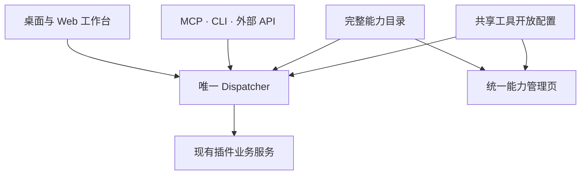

# GitHub Issue #6 [统一工具与 Web 入口重构] 插件全功能可选开放，MCP/CLI 共用权限与批量配置，支持本机及局域网工作台（无兼容）

- 原报告 — https://github.com/NAMEWTA/huhu/issues/6
- GitHub 对象 ID — I_kwDOVmq61M8AAAABfVVOLQ
- 状态 — OPEN
- 作者 — NAMEWTA
- 创建时间 — 2026-11-15T00:00:09Z
- 更新时间 — 2026-11-17T06:36:50Z
- 标签 — 

## 正文

## 目标

**把 HUHU 的所有用户级业务、配置与执行功能整理成完整的公共能力目录，由一份工具权限配置同时控制 MCP、虎虎 CLI 与通用外部 API；补齐按插件、读写类型和高危标签筛选及批量启停，并让桌面开启 Web 服务后直接给出可访问的本机/局域网工作台链接。**

“全部可以开放”是指：用户主动开启后，该功能确实能完成，不再出现“工具有开关，但 Agent 类型仍仅桌面可用”“SSH 永远不可开放”等限制。它不等于安装后默认开启所有工具。高危操作也应可以选择开启，高危是分类与提示，不能继续成为永久拒绝的理由。

当前未正式发布，允许破坏性重构：直接统一新模型、更新所有调用方，删除被替代的接口、配置、条件分支、空壳与测试；不保留旧 API 别名、双份权限表或兼容层。业务数据、已有 SSH 配置、Vault 内容及原生 Agent 会话不因接口重构被删除。

### 用户要求与本 Issue 的明确范围

1. 任务创建、修改、查询、状态、评论、回复及派遣均可由 MCP/CLI 完成，Human 与 Agent 任务不因入口不同受到额外固定限制。
2. Agent CLI 的 Space、会话、新建/复用/派遣、终端操作、历史与恢复能力可授权使用，复用现有 Herdr/Agent CLI 实现。
3. SSH 已保存主机可直接连接，也可创建、编辑、删除配置；连接、命令、交互终端、SFTP、必要的待处理交互都有工具合同。
4. 笔记、知识库、档案、自动化及其他已安装插件的用户操作完整覆盖，不只开放少数 CRUD。
5. 单个工具只有一份开放偏好。任何页面修改后，MCP 与 CLI 同步生效；不能出现 MCP 开、CLI 关的逐工具分叉。
6. 增加按插件、只读/写入/执行/管理、高危与启用状态筛选、搜索、勾选和批量操作；支持“一次只启用只读”“开启某插件全部功能”“全部开启”。
7. 桌面上的 Web 服务开关控制真实服务；开启后显示可点击/复制的普通浏览器地址，支持本机和同一局域网设备。
8. 本轮优先完成功能与一致性；不引入多用户账号、角色矩阵、OAuth 平台、逐次审批工作流或新的安全分类器。沿用已有凭证、参数校验和业务一致性机制即可。

## 1. 分析基线与关联工作

- 源码基线：[main@913264045cee1818497a37a57715c664aa85a1ae][baseline]。分析时主分支指向该提交。
- 本文结论来自当前源码、注册定义、界面与测试的静态核对；未声称已运行真实 SSH、Agent CLI 或局域网浏览器复现。
- #4 负责 Agent CLI 的 Workspace/Tab/Pane、Herdr Core、启动与恢复；本 Issue 负责其能力如何被外部入口完整调用。
- #5 负责任务/自动化的持久收发、派遣、问答、回执及恢复；其拟建 `tasks.dispatch/reply`、`agent.runs.*` 接入本 Issue 的目录和权限，不能另造一套执行服务。
- #2 负责知识库编辑能力；这里要求其用户操作进入同一公共合同，不重写编辑器。
- #9 将 Safe 收敛为网站/APP 的多账号密码管理。SSH、Git 同步、Agent CLI、Automations、Mail 各自维护运行凭据；本 Issue 不再以 Safe 创建/解锁或 `safe://` 作为它们的公共前置步骤。Safe 自身的账号管理操作仍按本 Issue 由用户选择是否开放。
- #1、旧规格和代码注释中的“Agent/SSH 执行永不对外”“仅桌面操作”在本范围内由本 Issue 的最新产品要求取代。#4/#5 中与外部入口有关的消费者应同步更新；不能把尚待实施的 Issue 描述成当前已经具备的代码。

## 2. 当前源码事实：已有共同基础，问题是固定禁用和交互缺口

### 2.1 必须复用的基础

| 现有实现 | 本次处理 |
| --- | --- |
| `Dispatcher` 已统一处理桌面、CLI、MCP、HTTP、插件调用；外部入口共用 `exposureOverride ?? defaultExposed`。[D1] | 保留唯一执行入口，集中计算目录与授权结果。**当前并非两份独立的 MCP/CLI 白名单。** |
| `ExposureStore` 已保存一份 `plugins.json.capabilityExposure`。[D2] | 复用“按能力保存一份偏好”的模型，改为可原子批量更新的单一存储。 |
| `CapabilityDefinition` 已有 name/plugin/scope/input/output/handler；注册器本身没有禁止 write/execute/admin 导出的全局规则。[D3] | 扩充真实描述、风险及静态目录，不重新发明业务路由。 |
| CLI 已有通用 `call <capability>`；MCP stdio/HTTP 共用适配器，stdio 已有工具列表变化通知。[D4] [D5] | 扩展现有适配器与通用命令，不分别实现业务逻辑。 |
| 内置插件互调使用自身权限组，不受外部开放开关影响；插件生命周期、输入校验、错误、幂等与超时 unknown 已有基础。[D1] [D6] | 保留这些边界，避免用户关掉外部工具后，内部自动化也意外停止。 |
| EngineClient/EventStream 已能通过 HTTP/WS 调用、重连及重取状态。[D7] | Web 复用工作台和客户端，不创建第二份 Engine/Vault。 |

### 2.2 已核实的断点

| 编号 | 当前代码行为 | 对用户的影响与必须改变的内容 |
| --- | --- | --- |
| F01 | `gateway.update` 对 `exposable:false` 永久拒绝；界面没有开关并写着“Agent 执行永不对外”。[D8] [D9] | 用户无法按自己选择开放。取消用户业务能力的永久禁用标志与相关文案。 |
| F02 | SSH 的 21 个已注册能力、Agent CLI 的 25 个已注册能力全部不可外露。[D10] [D11] | 连接、配置和会话服务大量已经存在，优先开放并补齐合同，不能从零重写。 |
| F03 | Tasks 的 Agent 创建/修改/复制/评论，Automations 的 Agent/terminal 创建、修改、启用仍有 `caller === desktop` 判断；Notes 对 Automations 路径也有固定入口限制。[D12] [D13] [D14] | 仅改 exposable 仍会“开了却不能用”。移除与统一授权冲突的身份限制，保留版本、状态及资源归属校验。 |
| F04 | MCP 总开关只接到 HTTP `/mcp`，`huhu mcp` stdio 通过普通 HTTP 调用，并未检查同一开关。[D15] [D16] | UI 显示关闭时 stdio 仍可能提供工具；服务启停必须对实际入口生效。 |
| F05 | stdio MCP 的发现依赖可关闭的 `capabilities.list`，HTTP MCP 则直接读 registry。[D17] [D18] | 关闭一个查询工具可能让 stdio 的其他已开工具全部失效。协议发现必须调用共同目录服务，不能依赖某个可关闭业务工具。 |
| F06 | 已停用能力只保留 name→plugin，`includeInactive` 伪造 `scope:read` 且 schema 为 null；管理页面未获取完整停用目录。[D3] [D8] | 无法可靠按类型筛选、预配置停用插件或保留准确状态。静态描述与运行 handler 必须分离。 |
| F07 | 工具表只有名称搜索与逐项开关；`gateway.get` 返回的 exposure 恒为 `{}`。[D8] [D9] | 缺分类、批量与可信配置快照；一次选择需要一次完整提交。 |
| F08 | ExposureStore 直接覆写整个 plugins.json，解析失败静默回空对象；不是原子批量保存。[D2] | 批量操作不能靠循环单项请求完成，写入失败也不能悄悄回到默认开放状态。 |
| F09 | output schema 已定义但 Dispatcher 不校验；MCP 只导出 inputSchema，说明仅拼接名字，成功结果仅 text JSON。[D1] [D5] | 工具多时难以发现、正确调用和消费结果；需真实说明、统一 schema/错误与结构化输出。 |
| F10 | 管理类副作用不在现有幂等集合；CLI 和 HTTP MCP 每次自动生成随机 key，调用方缺稳定重试控制。[D1] [D18] [D19] | 全面开放创建、启动、配置操作后，同一意图重试不能仅靠“已有幂等缓存”宣称不会重复执行。 |
| F11 | 第三方用户命令通过 `plugins.commands.run` 通用代理执行，没有逐命令 schema、风险、归属及开关。[D20] | 插件命令也需要进入统一目录；通用代理不能绕过具体目标工具的开关。 |
| F12 | 服务端页只有写死的回环/Bearer说明；HTTP 固定绑定 127.0.0.1，Host/Origin 仅为现有桌面入口，没有静态工作台路由。[D21] [D22] [D38] | 当前 API/MCP 地址不能当成用户要求的浏览器 Web 工作台链接。 |
| F13 | Renderer 根组件依赖 `window.huhuHost`；终端 WS 只允许 desktop。[D23] [D22] | 直接把桌面 HTML 放到 HTTP 下不足以支持浏览器，必须拆宿主接口并接通终端。 |
| F14 | SSH 连接待确认只靠瞬时事件、connect 成功后才返回 attemptId；shell 读写仅在桌面 WS；SFTP localPath 指 Engine 主机文件。[D10] [D24] [D25] | MCP/CLI/Web 必须能独立完成连接、交互和传输，不能要求先开桌面弹窗，或误用浏览器设备路径。 |

补充：`plugins/mcp` 当前是空导出占位，CLI 在 `apps/cli`，实际管理 UI 在 workbench/gateway；本次应修改真实实现并清理空壳，而不是建设第二个“同名插件后端”。[D26]

## 3. 目标结构与职责



| 层 | 职责 |
| --- | --- |
| 公共能力目录 | 描述每一个用户操作：稳定 ID、插件、说明、scope、risk、输入输出 schema、可用性。插件未运行时也能读取真实描述。 |
| 工具开放配置 | 只保存一份按能力 ID 的 enabled 偏好和 revision；MCP/CLI/外部 API 同读同写。 |
| 调用判定 | 使用同一函数计算身份、入口状态、插件/handler 可用性、工具偏好；用于发现、实际执行和诊断。 |
| Dispatcher | 输入与输出校验、操作身份、执行、错误、取消、幂等及审计，调用现有领域服务。 |
| MCP/CLI 适配器 | 协议、命令行参数、输出格式和流转接；不再分别决定哪些业务能做。 |
| Web 宿主 | 提供静态工作台、浏览器会话、同源 API/WS、浏览器上传下载及宿主差异适配；共享原 Engine。 |

### 3.1 “所有功能”与真正内部方法的边界

所有用户级业务、配置、管理和执行操作都必须可以选择开放，包括删除、终止、插件启停、权限管理、敏感配置的显式查看。不能把现有用户动作重新命名为 internal 来保留永久拒绝。

进程心跳、内部回执提交、自动化标记已派遣、插件生命周期回调等不是用户操作，应归内部服务/受控回传合同，不作为普通工具冒充用户动作。其对应的用户能力必须完整，例如提供“派遣任务/查询运行/重试/取消”，而不是让调用者伪造 `markDispatched` 或替另一个 run 伪造结果。内部边界不应演变成用户功能缺项。

### 3.2 三种开关不得混淆

| 设置 | 含义 | 对其他设置的影响 |
| --- | --- | --- |
| 插件启用 | 该业务模块是否运行 | 停用时所有入口不可执行，但工具描述及用户开放偏好保留。 |
| 工具开放 | 该用户操作是否允许外部工具调用 | 同时控制 MCP、CLI、通用外部 API；不关闭插件，不破坏内置工作流。 |
| 入口服务启用 | MCP 是否服务、Web 是否监听 | 不生成第二份逐工具配置，不清空用户选择。 |

CLI 启动器安装/卸载单独作为分发状态；本轮不增加 CLI 专属总权限开关，CLI 是否可调用由 Engine 可达性、插件可用性与共享工具选择决定。安装/卸载不改工具偏好，也不控制 Engine 生命周期。

桌面与已建立用户会话的 Web 工作台保留用户管理能力，不因“外部只读”而无法编辑自己的任务或重新打开开关；它们复用同一业务 handler。外部工具的身份和入口由已验证连接上下文产生，不能让调用者传 `caller:desktop` 来解决兼容问题。

内置 Tasks→Agent CLI、Automations→Tasks 继续使用内部授权；SSH 直接使用自己管理的主机认证配置，不再通过 Safe/SecretUse。用户开启一个完整业务能力（例如 `tasks.dispatch`）后，它必须能完成声明的业务，不要求用户再逐个开放其内部实现所用的低层工具。通用任意命令代理则必须保留原调用者并重新检查具体目标能力，不能假扮为上述业务委托。

## 4. 能力合同：完整目录、真实分类、单一事实来源

### 4.1 扩充现有定义，删除用户能力的 exposable 永久禁用

建议继续使用现有 `defineCapability`，公共描述至少包含：

| 字段 | 要求 |
| --- | --- |
| name / canonical ID | 全局唯一、稳定；CLI 与 MCP 使用同一业务 ID。 |
| plugin、title、description | 明确归属、中文可读名称、用途与前置条件；description 不能只拼名字。 |
| scope | 保留 read/write/execute/admin 四类，但按真实行为重新核定，不能因来自“管理页”就把纯查询归 admin。 |
| risk | normal/high，独立于 scope；高危可开启。删除、任意命令执行、终止会话、完整秘密读取等可明确标注。 |
| input/output | 复用契约 schema；返回稳定实体/运行/请求/连接标识与版本。 |
| 行为元数据 | 明确 destructive、外部系统交互、幂等/重试语义，供界面与 MCP 注解使用，不能仅按名字猜测。 |
| availability | 插件状态、handler 状态和不可用原因属于运行态，不与用户 enabled 偏好混存。 |

静态 descriptor 与 active handler 分离。内置插件通过同一源声明生成或登记清单，插件停用也保留真实 scope、risk 和 schema；禁止把同一工具的类型分别手写到 manifest、MCP、CLI 和 UI。

第三方插件的用户命令扩充 schema、scope、risk、description 并进入同一 registry/catalog，保留真实 plugin owner；生命周期停用时注销 handler。现有内部调用权限映射应根据目录生成或进行完整性验证，避免“注册了却永远无法授予”的遗漏；不借此把第三方插件权限无条件提升为 builtin。[D6] [D20]

### 4.2 读写与高危分类要能支撑真实筛选

- 只读：列表、查询、搜索、读取、预览；不能因为用户勾选只读就启动 Agent/Core 或执行远端命令。
- 写入：创建、编辑、评论、配置内容与状态变更。
- 执行：启动/连接/派遣/输入/中断/终止及主动运行。
- 管理：改变服务、插件、工具开放策略等控制操作。纯管理信息查询仍应按实际只读行为分类。
- 高危：独立标签，可与上述任何一类交叉；不是第五种互斥 scope，也不是禁止开启的理由。

现有 `agent.core.status` 和 `agent.sessions.output` 路径可能调用 ensure 启动 Core；需拆成真正只读的 peek/read 与显式启动能力。现有 `ssh.sftp.list/read` 被归 execute，但对已连接主机只做读取，应修正分类。状态投影对账与新建进程要区分。[D27] [D37] [D10]

普通配置查询返回明确摘要；完整配置/秘密查看如果用户需要，应有可见、可授权的高危读取操作。SSH 通过 hostId 使用模块自有认证，Agent 使用自身登录/环境配置；调用方不必先读取明文，也不必创建或解锁 Safe。Safe 的个人密码查看独立登记，不再提供跨模块 secretRef 注入。不能将“默认不展示秘密”重新实现成“用户永远无法主动授权查看”。[D10] [D11]

### 4.3 默认值与新增能力

建议首次初始化为“常规只读”：打开 `scope=read && risk=normal` 的当前能力，其他项默认关闭。所有项都显示在管理目录里且可以修改。

默认值只用于生成一次明确的初始配置；新安装插件或后续新增能力标记“新增/未配置”，不因为代码默认值变化而悄悄开放。用户选择“全部开启”作用于当时明确显示的完整集合，后续新增项有独立提示。

## 5. 共享权限与批量配置

### 5.1 单份持久配置

把现有 ExposureStore 整理成一份共享 ToolAccessStore，建议独立保存在 `<vault.stateDir>/gateway/tool-access.json`，避免每次工具设置覆写整个插件配置文件。只保留这一份权限真源，移除旧 `capabilityExposure/defaultExposed` 的运行时回退读取。

建议数据形态：

```json
{
  "schema": 1,
  "revision": 12,
  "choices": {
    "notes.list": true,
    "notes.read": true,
    "tasks.list": true,
    "ssh.hosts.list": true,
    "ssh.hosts.save": false
  }
}
```

首次初始化对当时完整目录的每项能力写入明确 true/false。后续新增但 choices 中不存在的能力标记“未配置”，有效选择为关闭；用户提交选择后写入明确值。这样能区分“用户已关闭”和“从未配置”，重启后仍然正确；插件停用不删除其选择。

- 复用项目已有单写者、原子文件替换与版本校验，不引入数据库/RBAC 平台。
- 工具偏好不绑定 MCP/CLI transport；不创建 `mcpEnabledTools` 与 `cliEnabledTools`。
- 插件未启用时可预配置工具；仅显示“已选择，插件未启用”，不自动启动插件。
- 文件损坏或保存失败显示实际错误，不能静默重置并重新开放默认工具。
- 无需维持旧格式兼容；新格式初始化行为要明确，旧字段/消费者清理干净，不影响业务数据。

### 5.2 建议接口

以下为目标合同示例，实施时可统一命名，但不得拆出第二份策略：

| 合同 | 行为 |
| --- | --- |
| `gateway.tools.catalog` | 返回完整描述、catalog/policy revision、插件状态、selected 与各入口的 effective/reason；可筛选插件、scope、risk、文本与状态。 |
| `gateway.tools.policy.get` | 返回真实当前配置，不再返回假的空 exposure。 |
| `gateway.tools.policy.update` | 接受 expectedRevision、明确的能力 ID 与目标 enabled，原子更新；管理操作本身也可由用户选择开放。 |
| `gateway.tools.check` | 复用真实判定函数，区分“工具未开”“插件停用”“入口未启用”“目标不存在”等；检查不执行业务。 |
| 协议目录读取 | MCP tools/list、CLI discovery 与 HTTP capabilities 共用目录服务，不依赖可关闭的 `capabilities.list` 工具。 |

批量提交示例：

```json
{
  "expectedRevision": 12,
  "changes": [
    {"name": "ssh.hosts.list", "enabled": true},
    {"name": "ssh.hosts.save", "enabled": true},
    {"name": "ssh.exec.run", "enabled": false}
  ]
}
```

必须先验证整批目标与版本，再一次写入、一次提升 revision、一次发布变化；任一项无效或持久化失败，整批不成功。返回实际更新 ID、新 revision 及结果状态。禁止循环调用现有单项接口造成半批完成。

selected 只有一份；effective 按入口状态派生。例如 MCP 服务关闭而 CLI 可连接时，两者有效状态可以不同，但不能因此生成两份逐工具偏好。目录 revision 同时覆盖描述/schema 的变化，不只比较工具名称。

策略提交后，两入口新的发现/调用立即使用新值。MCP 客户端缓存旧工具名时，实际调用仍需检查；已支持的长连接按协议通知目录变化。撤销工具不等于回滚已经接受的业务，不应自动杀掉已有 Agent/SSH 进程；终端通道后续读写控制按对应权限重新判定。

### 5.3 界面

将“能力开放列表”提升为 MCP 与 CLI 共用的“工具权限/对外能力”页。MCP、CLI、服务端各页链接到同一配置视图。

- 搜索 name/title/description，不限能力 ID。
- 插件多选、scope 多选、高危标签、已开启/未开启/插件停用筛选；组合过滤为明确交集。
- 分组行显示“已开启数/总数”，插件组支持全选、取消、部分选中。
- 支持勾选项、当前筛选全部结果；跨分页全选要明确数量，不能只改当前可见页。
- 快捷操作至少有“启用全部只读”“仅保留常规只读”“开启当前插件全部”“开启筛选结果”“关闭筛选结果”“全部开启”“全部关闭”。
- **启用**是添加选择；**仅保留**是替换集合，两者名称及预览需清楚。“全部只读”包含所有 read 项；“常规只读”才明确排除 high，不能暗藏例外。
- 修改前显示本批目标数量、涉及插件与 scope/risk 摘要；用户一次提交后完成，不增加逐项审批。
- 每行显示用户选择与有效状态，插件停用、服务未开、缺运行依赖等分别解释；不再出现“永不开放”。
- 复用项目 DataTable、ChoiceSwitch、筛选与表单组件，避免另造权限表设计系统。
- 测试台显示实际外部判定；现有 desktop 身份试运行不能被当成“MCP/CLI 已验证可用”。若提供真实调用测试，明确所用入口并经过同一策略。[D9] [D28]

## 6. MCP 与 CLI：同一合同，不同交互形式

### 6.1 发现与调用统一

- MCP stdio、MCP HTTP、CLI discovery、通用 HTTP capabilities 必须引用同一目录投影与判定，不重复维护 `visibleTo`/过滤白名单。
- 管理页能看完整目录；面向 MCP 的 tools/list 返回当下实际可调用的用户工具。停用插件的描述保留在管理目录，而不是伪造一个可调用空工具。
- 关闭 `capabilities.list` 这个普通查询操作，不影响协议本身发现其他已开工具。
- MCP 服务总开关真正约束 stdio 和 HTTP；继续使用现有 transport 选择时，选择和已有连接行为必须一致，不能只关闭 `/mcp`。服务关闭不改工具偏好，也不关闭 CLI。
- CLI 安装/卸载是启动器分发状态，不代表工具权限；CLI 调用仍经过 Engine。
- MCP resources/templates/prompts 的目录由共享声明生成，删除 UI 中单独维护的 `MCP_STATIC` 副本；其中读取业务内容仍经过对应能力判定。[D5] [D9]

### 6.2 统一名称、schema 与结果

建议 MCP 直接采用 canonical capability ID（点号名称可由 MCP 规范支持），不再用简单点号替换下划线产生另一套名字；注册时验证名称及唯一性。删除旧名字别名，并更新 prompt、配置示例、文档和测试。[MCP]

MCP 导出真实 title/description、inputSchema，以及所选 SDK/协议版本支持的 outputSchema/structuredContent；readOnlyHint、destructiveHint 等从真实合同映射。注解只描述行为，执行是否允许仍由共同策略判断；支持幂等键不等于同样参数任意重复调用天然幂等，不能据此错误标记 idempotentHint。[MCP]

CLI 保留通用入口并增加可读发现/筛选、完整 schema、JSON 输出、从文件/stdin 提交输入与稳定操作 key，例如：

```text
huhu tools list --plugin tasks --scope read --json
huhu tools describe tasks.create
huhu call tasks.create --input-file task.json --idempotency-key create-task-20261115-01
huhu call ssh.connect --input-file connection.json --idempotency-key connect-host-01
```

以上为目标示例，不宣称是当前已经存在的命令。便捷的 `huhu ssh attach`、Agent 会话命令也只能包装统一工具/流合同，不在 CLI 里另启 SSH 客户端或第二套 Agent runtime。

输入/业务/版本冲突/授权/不可用/超时结果在两入口保留一致的错误 code、retryable、details、operationId，CLI `--json` 不吞掉它们。Dispatcher 使用已有 output schema 验证结果；若业务副作用已经发生但返回不符合 schema，标记结果无效/待查询，禁止把它当成可以盲重做的普通输入错误。

### 6.3 非只读操作、长运行与幂等

- 按真实副作用统一幂等要求，覆盖现有漏掉的管理类变更；纯查询不假装是 mutation。
- CLI/API 允许传入稳定操作 key；MCP 可通过公共调用 envelope 或明确的操作输入字段传递，必须写入 schema/documentation，不能仅为每次重试随机生成新 key。
- 请求 ID、幂等意图 ID、实体/run/session ID 各有含义；相同 key + 相同输入返回原结果，不同输入明确冲突。不得拿固定参数 hash 将用户两次主动执行错误合并。
- 异步连接、长命令、Agent 派遣返回稳定 operation/run/attempt 标识，并有查询/取消入口；HTTP/MCP 请求断开不等于业务已取消。
- 结果 unknown 时优先查询/对账，不把一个外部调用错误变成两次连接、两次任务或两次执行。
- 不要求通用 Dispatcher 提供跨进程 exactly-once 保证；依靠领域已有运行/操作记录承接恢复，复用 #4/#5 的合同。

## 7. 全模块覆盖计划

下表中的“已有/缺口”是当前源码事实；目标要求覆盖每个用户动作，而不止这份示例清单。S0 需形成完整 UI 动作→能力 ID→scope/risk→入口验证表。

| 模块 | 当前基础与缺口 | 本次目标 |
| --- | --- | --- |
| Tasks | 普通 CRUD 可外露，但 Agent 类型与评论有固定入口限制。[D12] | Human/Agent 都可创建、读改、复制、状态与评论；接 #5 的派遣、回复、运行查询/重试/取消。 |
| Automations | 规则 CRUD/预览部分可外露；Agent/terminal 操作仅桌面，runNow、运行查询/问答/取消重试不可外露。[D13] | 创建/编辑/删除/暂停/启用/立即运行/预览/历史查询均完整开放；运行闭环复用 #5。 |
| Agent CLI | 25 个能力全部不可外露。[D11] | Space、目录/设置、启动、新建/指定会话、读输出、交互、控制、历史、恢复、审查及 #5 run 合同全部登记。 |
| SSH | 21 个能力全部不可外露；缺工具式连续交互合同。[D10] | 配置、连接、主机信任、exec、shell、SFTP及状态/取消均可用，详见下一节。 |
| Notes/知识库 | 基础读写及 comments 多数可外露；回收/恢复/永久删除、收藏、日报、目录创建、草稿有缺项。[D14] [D29] | 编辑、附件/文件、搜索、评论、回收站及辅助动作全部有公共操作；与 #2 共用领域服务。 |
| Archives | 由 notes 提供条目 CRUD；类型管理、addFile 不可外露。[D30] | 档案、类型、文件关联都可管理，不另造 Archives 后端。 |
| Inbox | 仅 list/capture 可外露。[D31] | 编辑、转换、忽略、恢复、撤销、删除完整覆盖。 |
| Safe | 旧模型的 status、设置、锁定/解锁、items、明文查看、审计均不可外露。[D32] | 按 #9 登记条目、多账号、彩色标签、锁定/解锁及显式密码查看等用户操作；用户可按功能选择开放，普通列表/搜索不返回密码；删除面向其他插件的 secretRef/secretUse 用途。 |
| Versioning/同步 | 只读历史/Git部分开放，恢复、提交、同步与冲突处理未开放。[D33] | 所有已实现用户操作可配置，保留其业务前置条件；HTTPS 认证由 Versioning 自管，SSH remote 复用系统 Git/SSH 认证，无 Safe 解锁或引用前提。 |
| Agent guide | 主要只开放 status。[D34] | 查看、检查、保留、自定义/内置恢复、备份查询/恢复都有工具。 |
| Kernel/插件中心/网关 | 插件启停、配置、访问设置、管理与扩展命令大多固定不外露。[D8] [D20] | 这些用户级管理动作同样可选择开启；权限管理本身独立列项并展示实际影响。 |

### 7.1 处理旧 caller 守卫与通用代理

不要全局把 CLI/MCP 伪装为 desktop。每个用户操作由统一策略授权，再执行相同业务校验；任务来源、评论作者、run 回执身份仍来自受信上下文。

通用 `plugins.commands.run` 如保留，应解析为具体能力并携带原调用者走 Dispatcher；不能开一个代理就绕过关闭的具体命令。更清晰的方案是让每个扩展命令直接成为公共能力。

Notes 的普通文件操作与 Tasks/Automations 等受管业务文件需要统一归属路由：使用已有语义仓库/KINDS 判断资源归属，外部修改转到相应业务操作，保证版本、状态、事件与工具开关一致；不能仅删掉 Automations 专用禁写后直接写规则文件。无法无损映射的 raw 修改返回能够完成同一操作的具体工具。桌面支持的受管文件原始编辑，也必须有明确、可授权的等价保存能力，由所属领域服务统一处理版本、状态、索引与事件；不能因为暂时无法映射而永久禁止所有外部入口。原始文本中的自报作者/状态不作为可信执行回执。内部业务服务写自己的文件不重复要求外部开放底层工具。这是有限的业务路由，不扩成文件 ACL/OS 沙箱平台。[D35]

### 7.2 Agent CLI 集成边界

- 不复制 Herdr HC，不引入新的 Agent 执行服务；虎虎 CLI/MCP 调用 HUHU 已有 Agent CLI 服务。
- 新建、复用指定会话、历史恢复均使用同一 Space/session/run ID、状态与输入仲裁；不能用 review.send 充当通用任务回复。
- 当前 `envRefs -> Safe` 路径按 #9 与 #4/#5 删除，使用所属模块配置或单次启动环境输入承接其用途。外部调用通过同一授权与 launch/规则 handler，不保留 `caller.startsWith("plugin:")` 对已授权用户功能的固定拒绝。当前 command/envRefs 仅支持 provider=shell 是旧实现事实；新合同仍应准确声明 Provider 支持范围，不能将删除 caller 判断或替换凭据来源说成全 Provider 支持。
- Provider 支持情况真实返回：现有历史恢复只支持 Claude/Codex，不能仅因工具开放就宣称 Pi 也可恢复。
- #4/#5 对会话代次、Core keep 可能恢复成 shell、unknown 对账、真实取消等要求继续有效；开放入口不改变执行语义。
- 控制流与观察输出分别授权，共用既有会话仲裁。用户从 MCP 发输入时，也不能与桌面/CLI 同时抢同一终端输入。[D11] [D36]

## 8. SSH 必须做到“工具可独立完成连接与使用”

### 8.1 已保存配置与新配置

复用 HostStore/SshManager，支持列出、读取、新建、更新、删除配置；更新有版本冲突和严格 hostId 校验。连接使用 hostId 解析已存储的密码/私钥/ssh-agent/跳板配置，调用方无需反复输入密码或重新配置服务器。

主机认证直接由 SSH 保存/更新 handler 管理，按 #7 在新增/编辑连接时维护账号、密码、私钥/口令和代理凭据，不要求选择 Safe 条目。秘密缺失、本机密钥保护不可用、交互输入等待、跳板失败等返回可处理的具体状态；已授权 MCP/CLI 可以直接更新 SSH 认证或回答待处理交互，不强制回桌面，也不以 Safe 初始化/解锁为前提。普通主机列表/配置读取得到摘要，修改密码等使用显式字段更新；省略、替换、清空含义明确，掩码字符串不能被误保存为新密码。

### 8.2 状态与主机信任

将连接启动与等待完成分开：先返回 attempt/operation ID，查询能获得 connecting、awaiting_input、connected、failed、cancelled 等实际状态。

提供连接列表/快照、pending 主机信任请求列表/读取/决定；请求包含 requestId、attemptId、host/hop、指纹、状态和有效动作。MCP/CLI/新打开 Web 页均可读取当前状态，不要求先订阅瞬时事件。现有首次信任与 changed-key 拒绝规则不凭空混为一个“点击继续”；需提供清晰的已知主机管理/重置信任操作供用户明确处理。[D24]

这只补齐现有 SSH 必需交互，不引入通用审批平台。

### 8.3 Exec 与交互 Shell

- 保留 exec 的 stdout/stderr/exitCode，补齐稳定运行句柄、输出/状态查询与取消。
- 复用已有 shell channel、最近输出缓冲、write/resize/detach，不另建 SSH 引擎。
- 增加工具形式的 shell read/write/resize/必要 signal/close；read 带 cursor/nextCursor、截断与 ended 状态，避免每次拉取无限输出。
- MCP 可通过结构化操作完成交互；交互 CLI/Web 通过同一授权的终端流接入。
- 将原 WS controllers 提升为该 shell 的公共输入仲裁点：工具输入、CLI attach、桌面/Web 都参与；观察者不能写入或改 PTY 大小。
- 通道绑定实际 Vault、host/session 和 observe/control 模式；开放变更影响后续输入/读取。网络断开表示 detach，是否结束 shell 由显式关闭/插件生命周期决定，不能误把浏览器刷新当作终止服务器命令。
- SSH 插件停用会按当前业务生命周期断开连接，不照搬 Herdr Core 的独立续存保证。[D10] [D24]

### 8.4 SFTP 与文件传输

保留现有 list/read/write/upload/download/mkdir/rename/delete/cancel 服务，明确两类输入：

1. Engine 主机路径：例如用户主动指定把服务器文件保存到安装 HUHU 的电脑。
2. 调用客户端/浏览器文件：上传文件流或受控临时文件句柄，下载返回可消费内容/下载流。

CLI 本机文件可由适配器上传，Web 选中的文件通过浏览器上传；不能把 `C:\\fakepath` 或远端浏览器路径当作 Engine 本机文件。复用 SFTP 的流与临时文件原子提交；保持进度、取消、覆盖语义。不能仅隐藏文件选择按钮就宣称支持 Web。[D25]

## 9. 桌面开启即可访问的 Web 工作台

### 9.1 一个 Engine，两种宿主

保留现有 loopback 控制监听器供桌面与本机 CLI 使用，增加可启停的 Web listener，复用相同路由处理、Dispatcher、插件实例和 Vault。

Web listener 承载：

- 打包后的工作台 HTML、JS、CSS、字体/图标等静态资源；
- 同源 API 与事件 WS；
- Agent/SSH 终端流；
- 上传/下载路由；
- 必要的浏览器启动信息与会话建立。

无需第二业务后端、第二 Vault 写者、独立数据复制、反向代理服务或 Vite 开发服务器。MCP 协议端点和浏览器页面链接分开标注；浏览器首页应打开工作台，不是 JSON-RPC 错误页。

### 9.2 配置与真实状态

| 项目 | 行为 |
| --- | --- |
| 开关 | 默认关闭；用户开启后真实绑定监听，再显示运行中。失败显示原因，不假装已启用。 |
| 访问范围 | 支持仅本机与局域网；首次开启默认选择局域网，并同时展示本机地址，用户可改为仅本机。 |
| 端口 | 支持明确端口或自动分配；展示实际端口。指定端口冲突时报告失败，不静默生成错误链接。 |
| 状态 | stopped/starting/running/failed，配置与实际状态分开；暴露 read/update/start/stop 类管理合同。 |
| 地址 | 从实际网络接口和监听结果生成：本机 127.0.0.1、可用 LAN IP；多网卡可选择/标注，IPv6 正确加括号。 |
| 打开/复制 | 每个可用 URL 可一键打开与复制；`0.0.0.0` 是监听地址，不展示成用户访问地址。 |
| 生命周期 | Web off 关闭其监听和浏览器连接，不停止内部 Engine/桌面/CLI/MCP；关闭浏览器也不关闭 Engine。 |

本 Issue 首轮固定保留 MCP 原 loopback listener，Web listener 只承载浏览器工作台相关入口。关闭 Web 不影响 MCP；未来若提供 LAN MCP，应作为明确的独立连接配置处理，不在本轮留下可选分支。

Engine 重启、网卡变化和 Vault 切换后重新发布地址/运行状态；浏览器识别当前 Vault 和会话代次，旧缓存/旧连接不能悄悄写入新 Vault。服务运行依赖 HUHU Engine 存活，不把“关掉浏览器仍运行”宣传为已支持应用退出后的独立常驻服务。

### 9.3 SharedApp + DesktopHost + WebHost

将桌面 renderer 中的工作台装配抽成可复用入口：

- DesktopHost 继续使用 preload 完成系统对话框、窗口菜单、外链与宿主操作。
- WebHost 从同源启动接口取得当前 Vault/连接信息，使用浏览器文件选择、上传下载、剪贴板与链接打开。
- 复用 EngineClient/EventStream，HTTP 与 WS 基址从当前服务推导，LAN 页面不得硬编码用户设备的 `localhost` 去访问 Engine。
- 不再在公共根组件直接依赖 `window.huhuHost`；本机 OS 专属动作通过宿主能力状态明确处理。服务端路径与浏览器设备路径在文案和合同上区分。
- 桌面原生窗口的拖拽/最小化等呈现行为不伪造为浏览器业务能力；现有用户业务功能必须有浏览器可用路径，不以缺 preload 为理由隐藏整个模块。
- 沿用现有轻量凭证机制建立浏览器用户会话，生成的访问链接可直接完成启动，无需用户手工拼 API 请求或复制多种 token。静态资源不内嵌整个 Engine descriptor/桌面凭证；本阶段不扩展账号/多租户系统。
- 普通 LAN HTTP 下专门检查 UUID、复制等 API；当前代码直接使用 crypto.randomUUID/navigator.clipboard 的地方需要适当降级，不能只在 localhost 通过。[D7] [D23]
- 打包产物包含资源、正确 MIME、SPA 深链回退；复制任务/笔记链接和刷新页面都应正常打开对应视图。

## 10. 破坏性清理与文档更新

本次不采用“新入口套旧权限、旧入口暂留”的过渡设计。完成后应清理：

1. 用户业务能力的 `exposable:false`、`defaultExposed` 动态回退，以及“Agent/SSH 永不对外”的固定判断/文案/旧测试。
2. 分散的 desktop-only 用户动作守卫，改为共同授权；真正内部回调保留明确内部合同。
3. 被替代的 `gateway.update` 单项旧 API、空 exposure 字段、重复 visibleTo/检查逻辑、MCP UI 静态目录。
4. 旧权限配置读取与新配置双写；不留可把旧默认值带回来的兼容逻辑。
5. MCP 下划线别名及旧示例；所有消费者一次更新 canonical ID。
6. 只有通用代理而没有具体合同的扩展用户命令；不存在实际职责的 `plugins/mcp` 空壳。
7. Desktop renderer 对公共宿主功能的直接依赖；Web 必须有独立构建入口但共享工作台实现。
8. 和 #4/#5 重复的新执行器、任务队列、SSH/Agent 会话状态副本；不得为了外部访问创建第二套业务服务。
9. 旧“读接口会 ensure 启动”的行为，及把所有 SFTP 标成 execute 的不准确分类。
10. 测试中固化旧产品限制的断言；保留业务正确性测试，改写为新的全量可授权行为。

实施文档放入当前 `.agents/dev/changes/` 工作项，更新 `.agents/dev/notes/context/` 的现行约束、接口说明、CLI/MCP 示例、插件开发合同、Web 使用说明。历史归档仅注明被取代，不把旧归档继续当现行安全/产品要求。

## 11. 实施顺序与交付物

| 阶段 | 工作 | 完成标准 |
| --- | --- | --- |
| S0：完整盘点与合同定稿 | 按 UI 用户动作、能力定义、handler、HostBridge、WS、扩展命令建立覆盖表；标明复用/补接口/删除；对齐 #2/#4/#5。 | 每个功能有归属与目标能力，无“以后再接”的隐藏缺口；scope/risk 校正清单完成。 |
| S1：公共目录与统一配置 | 静态 descriptor/active handler 分离；共享 ToolAccessStore、revision、原子批量、共同判定；新默认一次初始化。 | 目录不依赖插件启动；配置一份；关闭/停用/入口不可用原因准确；移除旧回退。 |
| S2：MCP/CLI/HTTP 适配 | 共同发现、总开关、canonical ID、schema/结构化结果、错误、稳定操作 key；第三方命令登记。 | 两入口同选择、同合同、同结果；禁用 capabilities.list 不破坏协议发现。 |
| S3：业务功能打通 | 删除入口硬限制；补 SSH 状态/信任/交互/传输；Agent 和任务/自动化接 #4/#5；其余模块补全。 | 表中所有用户操作可选开放且真实可完成，不只是工具名出现。 |
| S4：统一管理 UI | 共享权限页、插件/类型/风险筛选、全选/批量、准确状态、真实诊断。 | 一次修改同时影响 MCP/CLI；大目录与跨页全选可用，保存失败无半批状态。 |
| S5：Web 工作台 | 可启停 listener、静态构建、共享 App/Host、同源 API/WS、实际 URL、浏览器文件流。 | 本机和第二台 LAN 设备能直接打开并完成主要闭环，与桌面同数据。 |
| S6：清理与验收 | 删除旧接口/配置/空壳/文案/测试，更新说明，运行针对性跨入口和故障测试。 | 不存在双权限/双业务运行时；给出实际执行的测试、真机/网络验证记录与剩余限制。 |

建议按上述边界拆 PR，但每个 PR 都更新所有受影响消费者，不靠长期兼容分支维持双轨。#4/#5 尚未落地的合同可与对应 PR 联合交付，不能先保留旧永久禁用再宣布本 Issue 完成。

## 12. 验收清单

### A. 全量目录与统一开关

- [ ] A01：每个插件及 kernel 的用户业务/配置/执行动作都有公共能力或明确流合同；有完整覆盖表，无永久不可选的用户功能。
- [ ] A02：在对应入口运行且插件可用时，CLI 调用、MCP stdio、MCP HTTP 和通用外部 API 使用同一工具 enabled 配置；关闭后旧缓存工具也拒绝新调用。
- [ ] A03：只开只读工具时，写入/执行未开启；实际读取不会隐式启动 Core/Agent 或执行命令，分类与副作用相符。
- [ ] A04：高危工具可由用户主动开启；“全部开启”覆盖包括 SSH、Agent、删除、终止、管理在内的当前全部用户能力，不隐藏例外。
- [ ] A05：插件停用后完整元数据和偏好保留，显示具体原因；重新启用恢复用户选择；批量配置不隐式启用插件。
- [ ] A06：内置自动化/任务/秘密引用不依赖 MCP/CLI 外部开关；高层业务能力只需自身授权即可使用内部依赖。
- [ ] A07：通用命令代理及受管业务文件路由不绕过目标工具和领域校验；未把调用者伪装为 desktop。

### B. 批量管理与持久化

- [ ] B01：插件、scope、risk、名称/说明、状态支持组合筛选；全选、部分选中和跨页结果数量正确。
- [ ] B02：“启用只读”“仅保留常规只读”“启用插件全部”“全部开启/关闭”等动作语义明确，只修改本批明确 ID。
- [ ] B03：一次批量提交只有一次原子状态更新；模拟落盘失败、非法 ID、版本冲突不出现半批成功。
- [ ] B04：重启后配置不丢；配置损坏显示错误，不静默回默认开放；新增能力进入明确的未配置状态。
- [ ] B05：两个管理客户端并发修改能发现 revision 冲突，不覆盖对方选择；界面、目录、真实判定最终一致。

### C. MCP/CLI 合同与运行行为

- [ ] C01：关闭 MCP 服务后 stdio 与 HTTP 均不可继续提供/调用工具；不误关 CLI，也不清空共享偏好。
- [ ] C02：关闭 capabilities.list 普通查询工具后，其他已开工具仍可被 MCP/CLI 的协议发现和正常调用。
- [ ] C03：名称唯一；MCP 与 CLI 使用共同 canonical ID、输入输出语义和错误结构；资源/prompt 描述不再双份维护。
- [ ] C04：MCP 输出符合声明 schema；CLI JSON 保留完整错误和运行 ID；已发生副作用的输出错误不会诱发盲重试。
- [ ] C05：创建/启动/管理操作允许稳定幂等 key；相同意图重试不重复，不同输入冲突；unknown 能查询结果。
- [ ] C06：插件用户命令按具体 ID 配置与调用，插件停用时 handler 注销、描述仍可查看，通用代理不能绕过关闭项。
- [ ] C07：工具目录变化可被客户端重新发现，现有支持的长连接收到变化通知；服务状态与工具偏好没有两套真源。

### D. 实际业务闭环

- [ ] D01：仅使用 MCP 完成 Agent 任务创建→编辑→派遣→查询→回答→结果查看；仅使用 CLI 能完成等价流程，对齐 #5。
- [ ] D02：自动化 Agent/terminal 规则创建、编辑、启停、立即执行、历史/取消均可经已授权工具完成，不再只允许桌面。
- [ ] D03：授权工具可在指定 Space 新建或操作指定 Agent 会话，复用 #4/#5；不支持的 provider 能力准确返回，不伪造成功。
- [ ] D04：SSH 可列出现有配置并连接；可新增、修改、删除配置，复用 jumpHost 与 SSH 自有认证；密码/私钥可通过同一 handler 新建和更新，版本冲突/交互等待清晰，Safe 关闭不影响连接。
- [ ] D05：首次主机信任待处理可由新接入的 MCP/CLI 查询并处理，不依赖桌面瞬时事件；重开 Web 页能看到当前连接快照。
- [ ] D06：SSH exec 的输出/状态/取消完整；MCP 可读写 shell；CLI/Web/桌面共享输入控制权，不重复抢占输入。
- [ ] D07：SFTP 读写、上传下载、覆盖、取消可用；明确浏览器/客户端文件与 Engine 主机路径。
- [ ] D08：笔记/评论/目录/回收站、档案/类型/文件、Inbox 转换、Safe 及版本同步的覆盖表逐项验证，不能只验证五个示例功能。
- [ ] D09：外部工具创建/编辑的数据在桌面和 Web 正常刷新，不出现只有数据库/文件变了但 UI 不更新。
- [ ] D10：仅通过已授权 MCP 或 CLI，完成 SSH 主机新增/认证更新→连接，或所属模块环境配置→shell 启动；无需 Safe 初始化/解锁、先 reveal 明文或回桌面。另行验证 Safe 自身条目/多账号/标签管理与锁定/解锁合同；用户显式开启的密码/完整配置读取可用，普通列表不泄露秘密。

### E. Web 服务

- [ ] E01：桌面点击开启后显示真实运行状态；仅本机模式显示本机 URL，局域网模式同时显示本机和实际可用 LAN URL，无网卡时说明原因。普通浏览器点击即可进入工作台，无 window.huhuHost 也能启动。
- [ ] E02：第二台局域网设备可访问，创建/编辑任务与笔记和桌面同步，确认共享同一 Engine/Vault。
- [ ] E03：Web 可使用 Agent/SSH 终端、状态与必要交互，工具开放状态和浏览器用户工作台权限不混淆。
- [ ] E04：浏览器上传下载实际作用于浏览器设备；普通 LAN HTTP 的复制、UUID、文件选择与终端有验证记录。
- [ ] E05：构建后的桌面包能独立提供静态资源、正确 MIME、SPA 深链与刷新，不依赖开发服务器。
- [ ] E06：端口占用、资源包缺失、网卡变化、Engine 重启和 Vault 切换均反映真实状态；不展示 0.0.0.0 或过期地址为可用链接。
- [ ] E07：关闭 Web 不停止内部 Engine/CLI/MCP，不清空工具配置；关闭浏览器不终止后台业务；旧 Vault 页面不会误写新 Vault。

### F. 清理与证据

- [ ] F01：没有旧 exposable 永久禁用、旧配置回退、MCP/CLI 双权限表、旧名称兼容别名、重复业务执行器。
- [ ] F02：现行文档/示例/插件合同与测试一致；旧“永不对外”规范已明确被取代。
- [ ] F03：以现有测试设施增加有意义的跨入口合同测试、批量保存故障测试、真实 SSH/支持的 Agent CLI 与 LAN 浏览器闭环记录；明确已运行与未运行项目，不以静态分析代替实机验证。

## 13. 主要代码落点

- `packages/contracts/src/capability.ts`：共同定义、调用上下文与结果合同。
- `packages/kernel/src/capabilities/define.ts`、`dispatcher.ts`、`exposure.ts`、`permissions.ts`：目录、权限、原子策略与共同判定。
- `packages/kernel/src/capabilities/system.ts`、`external-plugins.ts`、`plugins/*`：管理接口与扩展命令注册。
- `packages/kernel/src/mcp.ts`、`server/http-app.ts`、`server/ingress.ts`、`gateway-tokens.ts`：传输、发现、服务启停、Web路由及会话。
- `apps/cli/src/main.ts`、`mcp.ts`、`commands/call.ts`、`connect.ts`：CLI/MCP适配与稳定操作身份。
- `apps/engine/src/boot.ts`：真实服务组装与生命周期。
- `packages/workbench/src/gateway/*`、`engine-client/*`：统一能力管理、服务状态、浏览器连接。
- `apps/desktop/src/renderer/main.tsx`、桌面 preload/构建配置、拟建 Web 入口：宿主分离与静态产物。
- `plugins/{tasks,automations,agent-cli,ssh,notes,inbox,safe,versioning,agent-guide}/src/engine/*`：开放用户操作、校正 scope、补连续交互合同。
- 对应 manifest/shared DTO/UI调用、查询失效映射、测试与当前开发资料同步更新。

---

### 固定基线源码引用

[baseline]: https://github.com/NAMEWTA/huhu/commit/913264045cee1818497a37a57715c664aa85a1ae
[D1]: https://github.com/NAMEWTA/huhu/blob/913264045cee1818497a37a57715c664aa85a1ae/packages/kernel/src/dispatcher.ts#L25-L165
[D2]: https://github.com/NAMEWTA/huhu/blob/913264045cee1818497a37a57715c664aa85a1ae/packages/kernel/src/exposure.ts#L4-L43
[D3]: https://github.com/NAMEWTA/huhu/blob/913264045cee1818497a37a57715c664aa85a1ae/packages/kernel/src/capabilities/define.ts#L11-L65
[D4]: https://github.com/NAMEWTA/huhu/blob/913264045cee1818497a37a57715c664aa85a1ae/apps/cli/src/main.ts#L25-L97
[D5]: https://github.com/NAMEWTA/huhu/blob/913264045cee1818497a37a57715c664aa85a1ae/packages/kernel/src/mcp.ts#L23-L128
[D6]: https://github.com/NAMEWTA/huhu/blob/913264045cee1818497a37a57715c664aa85a1ae/packages/kernel/src/permissions.ts#L7-L47
[D7]: https://github.com/NAMEWTA/huhu/blob/913264045cee1818497a37a57715c664aa85a1ae/packages/workbench/src/engine-client/client.ts#L20-L116
[D8]: https://github.com/NAMEWTA/huhu/blob/913264045cee1818497a37a57715c664aa85a1ae/packages/kernel/src/capabilities/system.ts#L83-L235
[D9]: https://github.com/NAMEWTA/huhu/blob/913264045cee1818497a37a57715c664aa85a1ae/packages/workbench/src/gateway/GatewayModule.tsx#L390-L468
[D10]: https://github.com/NAMEWTA/huhu/blob/913264045cee1818497a37a57715c664aa85a1ae/plugins/ssh/src/engine/index.ts#L25-L255
[D11]: https://github.com/NAMEWTA/huhu/blob/913264045cee1818497a37a57715c664aa85a1ae/plugins/agent-cli/src/engine/index.ts#L93-L516
[D12]: https://github.com/NAMEWTA/huhu/blob/913264045cee1818497a37a57715c664aa85a1ae/plugins/tasks/src/engine/index.ts#L35-L225
[D13]: https://github.com/NAMEWTA/huhu/blob/913264045cee1818497a37a57715c664aa85a1ae/plugins/automations/src/engine/index.ts#L19-L370
[D14]: https://github.com/NAMEWTA/huhu/blob/913264045cee1818497a37a57715c664aa85a1ae/plugins/notes/src/engine/index.ts#L15-L113
[D15]: https://github.com/NAMEWTA/huhu/blob/913264045cee1818497a37a57715c664aa85a1ae/apps/engine/src/boot.ts#L360-L385
[D16]: https://github.com/NAMEWTA/huhu/blob/913264045cee1818497a37a57715c664aa85a1ae/apps/cli/src/main.ts#L152-L162
[D17]: https://github.com/NAMEWTA/huhu/blob/913264045cee1818497a37a57715c664aa85a1ae/apps/cli/src/mcp.ts#L13-L26
[D18]: https://github.com/NAMEWTA/huhu/blob/913264045cee1818497a37a57715c664aa85a1ae/packages/kernel/src/server/http-app.ts#L129-L188
[D19]: https://github.com/NAMEWTA/huhu/blob/913264045cee1818497a37a57715c664aa85a1ae/apps/cli/src/commands/call.ts#L1-L29
[D20]: https://github.com/NAMEWTA/huhu/blob/913264045cee1818497a37a57715c664aa85a1ae/packages/kernel/src/capabilities/external-plugins.ts#L77-L95
[D21]: https://github.com/NAMEWTA/huhu/blob/913264045cee1818497a37a57715c664aa85a1ae/packages/workbench/src/gateway/GatewayModule.tsx#L233-L245
[D22]: https://github.com/NAMEWTA/huhu/blob/913264045cee1818497a37a57715c664aa85a1ae/packages/kernel/src/server/http-app.ts#L210-L260
[D23]: https://github.com/NAMEWTA/huhu/blob/913264045cee1818497a37a57715c664aa85a1ae/apps/desktop/src/renderer/main.tsx#L64-L282
[D24]: https://github.com/NAMEWTA/huhu/blob/913264045cee1818497a37a57715c664aa85a1ae/plugins/ssh/src/engine/manager.ts#L93-L293
[D25]: https://github.com/NAMEWTA/huhu/blob/913264045cee1818497a37a57715c664aa85a1ae/plugins/ssh/src/engine/sftp.ts#L158-L198
[D26]: https://github.com/NAMEWTA/huhu/blob/913264045cee1818497a37a57715c664aa85a1ae/plugins/mcp/src/engine/index.ts
[D27]: https://github.com/NAMEWTA/huhu/blob/913264045cee1818497a37a57715c664aa85a1ae/plugins/agent-cli/src/engine/herdr-core.ts#L111-L118
[D28]: https://github.com/NAMEWTA/huhu/blob/913264045cee1818497a37a57715c664aa85a1ae/packages/workbench/src/gateway/GatewayModule.tsx#L179-L194
[D29]: https://github.com/NAMEWTA/huhu/blob/913264045cee1818497a37a57715c664aa85a1ae/plugins/notes/src/engine/index.ts#L171-L372
[D30]: https://github.com/NAMEWTA/huhu/blob/913264045cee1818497a37a57715c664aa85a1ae/plugins/notes/src/engine/archives/capabilities.ts#L11-L60
[D31]: https://github.com/NAMEWTA/huhu/blob/913264045cee1818497a37a57715c664aa85a1ae/plugins/inbox/src/engine/index.ts#L46-L96
[D32]: https://github.com/NAMEWTA/huhu/blob/913264045cee1818497a37a57715c664aa85a1ae/plugins/safe/src/engine/index.ts#L23-L101
[D33]: https://github.com/NAMEWTA/huhu/blob/913264045cee1818497a37a57715c664aa85a1ae/plugins/versioning/src/engine/index.ts#L78-L394
[D34]: https://github.com/NAMEWTA/huhu/blob/913264045cee1818497a37a57715c664aa85a1ae/plugins/agent-guide/src/engine/index.ts#L18-L36
[D35]: https://github.com/NAMEWTA/huhu/blob/913264045cee1818497a37a57715c664aa85a1ae/plugins/notes/src/engine/service.ts#L379-L383
[D36]: https://github.com/NAMEWTA/huhu/blob/913264045cee1818497a37a57715c664aa85a1ae/plugins/agent-cli/src/engine/terminal-bridge.ts
[D37]: https://github.com/NAMEWTA/huhu/blob/913264045cee1818497a37a57715c664aa85a1ae/plugins/agent-cli/src/engine/sessions.ts#L253-L257
[D38]: https://github.com/NAMEWTA/huhu/blob/913264045cee1818497a37a57715c664aa85a1ae/packages/kernel/src/server/ingress.ts#L9-L17
[MCP]: https://modelcontextprotocol.io/specification/2025-11-25/server/tools

## 评论

无评论。
