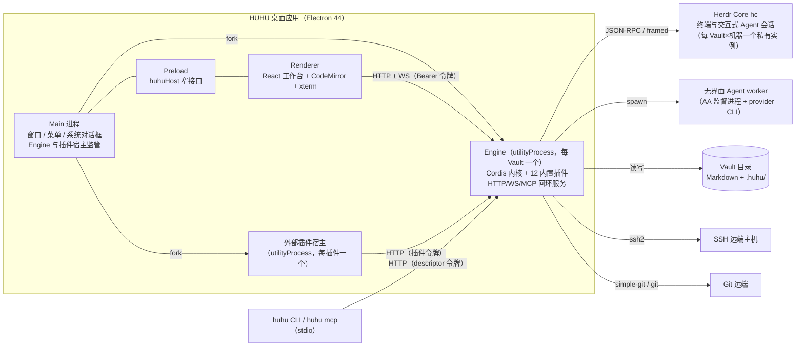
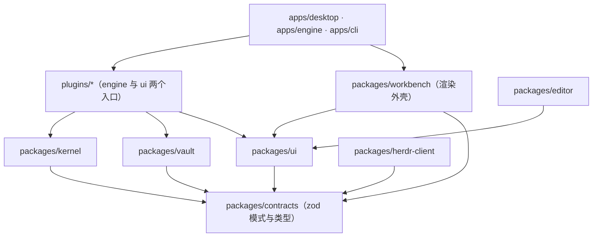

# 系统架构

本文件是技术栈、进程模型、模块边界和插件体系的唯一权威定义。数据格式见 [data-model](data-model.md)，接口协议见 [interfaces](interfaces.md)，目录与规范见 [engineering](engineering.md)，选型理由见 [decisions](decisions.md)。

## 1. 总体结构

所有业务能力只在 Engine 内实现。Renderer、CLI、MCP 客户端与外部插件都是同一组能力的调用者（D-03、D-04）。

## 2. 技术栈（最终）

版本为基线：W01 建立锁文件时安装同一主版本的最新补丁并在 `pnpm-lock.yaml` 固定。“证据”列是参考项目中实际使用该依赖的位置。

| 层 | 选择 | 证据 |
| --- | --- | --- |
| 语言 | TypeScript 7.0（strict），ESM | Orca `package.json` `typescript ^7.0.2` |
| 开发运行时 | Node 24 LTS（CI 与本地）；Engine 使用 Electron 内置 Node | agent-autoloop 要求 Node ≥ 24 |
| 包管理 | pnpm workspace | OK、Orca、DSH 均为 pnpm workspace |
| 桌面 | Electron 44.9.1、electron-vite 6、Vite 8、electron-builder 26 | OK `packages/desktop/package.json` |
| UI | React 19.2、Tailwind CSS 4.3、shadcn/ui（new-york-v4，radix-ui 1.x）、lucide-react 0.577、sonner 2、cmdk 1.1、react-resizable-panels 4、@dnd-kit | Orca `components.json`、`package.json`；OK `packages/app/package.json` |
| 数据获取 | @tanstack/react-query 5（服务端状态）、zustand 5（仅界面状态） | OK app、Orca |
| 列表/表格 | @tanstack/react-virtual 3、@tanstack/react-table 8 | Orca 使用 react-virtual；react-table 为 TanStack 同族成熟库 |
| 日期 | date-fns 4、react-day-picker 9（shadcn Calendar）、Croner 11（cron + IANA 时区） | 原型 `package.json`；OK `components/ui/calendar.tsx` |
| 编辑器 | CodeMirror 6（@codemirror/state 6.7+、view 6.43+、lang-markdown 等），Atomic Editor inline-preview 扩展（vendored） | OK app 依赖；原型 `vendor/atomic` |
| 阅读渲染 | react-markdown 10、remark-gfm、remark-math、remark-frontmatter、rehype-sanitize、rehype-katex、KaTeX、Mermaid 11 | Orca `components/sidebar/CommentMarkdown.tsx` |
| 差异 | @pierre/diffs 1.3.6、diff 8、OK frontmatter-diff | OK `ActivityPanelDiffView.tsx` |
| 文件树 | @pierre/trees 1.0.0-beta.4 | OK `components/FileTree.tsx` |
| 终端 | @xterm/xterm 6 + addon-fit/search/web-links；Herdr Core 0.1.19 | 原型；herdr-core `schema/hc.openrpc.json` |
| 插件运行时 | Cordis 4.1.0 + cosmokit（vendored） | DSH `vendor/cordis` |
| 服务端 | Node `http` + Hono 4 + @hono/node-server 2 + ws 8；@modelcontextprotocol/sdk 1.x；commander 14 | OK `packages/server`、`packages/cli` |
| 校验/格式 | zod 4.6、yaml 2.9（CST 局部改写） | OK `core/src/frontmatter/yaml-codec.ts` |
| 文件 | write-file-atomic 7、proper-lockfile 4.1.2、@parcel/watcher 2.5（chokidar 5 回退）、fflate（数据包 zip） | 原型、OK、Orca |
| 搜索 | @orama/orama 3（内存全文索引） | OK `packages/core` |
| Git | 系统 git + simple-git 3.36 | OK `packages/server` |
| SSH | ssh2 1.17 | Orca `package.json`、`main/ssh` |
| 日志 | pino 10 | OK |
| 测试 | Vitest 5、@testing-library/react 16、happy-dom、Playwright（Electron） | Orca |
| 静态检查 | oxlint 1.9x、oxfmt、knip | Orca |

不引入：SQLite、Tiptap/ProseMirror、Yjs/Hocuspocus、node-pty、Monaco、系统钥匙串库、自动更新器。

## 3. 进程职责

| 进程 | 负责 | 不负责 |
| --- | --- | --- |
| Main | 单实例锁；窗口创建与关闭；系统对话框（选目录/文件、保存位置）；外部链接与“在文件管理器中显示”；为每个窗口 fork Engine 并监管崩溃；fork 外部插件宿主；应用菜单 | 任何 Vault 读写或业务规则 |
| Preload | 通过 `contextBridge` 暴露 `huhuHost`（见 [interfaces](interfaces.md) §6）；校验调用来源 frame | 业务调用 |
| Renderer | React 工作台；CodeMirror 文档编辑；xterm 显示；通过 Engine 客户端发起能力调用并订阅事件 | Node API、文件、子进程、秘密明文持久化 |
| Engine | Vault 生命周期、写者锁、语义 Markdown 仓储、索引、Cordis 插件、能力 Dispatcher、HTTP/WS/MCP 服务、调度器、Herdr 客户端、无界面 Agent worker、ssh2 连接、Git、保险箱解锁会话 | 窗口与系统对话框 |
| Herdr Core | 交互式终端与 Agent CLI 进程的生命周期、屏幕状态、attach/detach | HUHU 业务、Space 概念 |
| Agent worker | 一次无界面 Agent 运行（监督进程保存输出与退出码） | 决定是否运行、写 Task |
| 外部插件宿主 | 运行一个外部插件的 `activate()`，提供受限能力客户端 | 直接访问 Engine 内部对象 |
| huhu CLI | 解析命令；连接已运行 Engine，或以无界面模式启动 Engine | 自己的业务实现 |

### Engine 实例与端点

- Engine 以 `apps/engine/src/main.ts` 为入口。桌面模式由 Main 通过 `utilityProcess.fork` 启动（复制 OK `desktop/src/main/index.ts` 中 fork 与环境构造方式）；无界面模式由 `huhu engine --vault <path>` 以普通 Node 进程启动（使用 Electron 二进制的 `ELECTRON_RUN_AS_NODE=1`，保证 CLI 不需要额外 Node）。
- Engine 监听 `127.0.0.1` 随机端口，生成 32 字节随机 Bearer 令牌，并写入端点描述 `.huhu/runtime/<machineId>/engine.json`（权限 0600；Windows 由用户目录 ACL 保护）。CLI 读取该文件连接。
- 写者锁：Engine 启动时对 `.huhu/runtime/<machineId>/writer.lock` 获取 proper-lockfile 锁。获取失败且描述文件中的 Engine 可连通时，CLI 连接该 Engine；桌面打开同一 Vault 时激活已有窗口；不可连通的陈旧锁由 proper-lockfile 的 stale 机制回收。

### 启动顺序（Engine）

1. 校验根目录：存在、可写、realpath 规范化；读取或创建 `.huhu/vault.json`。
2. 获取写者锁；失败按上节处理。
3. 恢复未完成操作：扫描 `.huhu/operations/`，对 `prepared` 状态按日志回滚或完成（[data-model](data-model.md) §7）。
4. 构建内存索引：遍历 Vault（忽略规则见 data-model §2），解析语义 Markdown，建立 Orama 全文索引。
5. 启动 Cordis 根 Context，按 `plugins.json` 启用插件（依赖拓扑序）；每个插件注册能力、事件、后台服务。
6. 启动 HTTP/WS 服务并写端点描述；通知 Main “ready”。
7. 启动文件监听、调度器、Herdr Core 连接（按需），对未知状态的运行执行对账。

任一步失败，Engine 以结构化错误通知 Main；Main 在启动页显示原因与可执行恢复动作（只读打开、重试、选择其他 Vault），不进入空白工作台。

### 关闭顺序

1. 停止接受新的写调用（返回 `ENGINE_CLOSING`）。
2. Renderer 冻结编辑器输入并提交最终快照；等待保存回执（上限 10 秒，超时则保留草稿）。
3. 停止调度器与监听；按 Cordis 作用域逆序释放插件资源。
4. Herdr Core 不结束：交互会话继续运行，下次打开同一 Vault 重新连接（D-10）。无界面 Agent worker 由监督进程继续运行至结束，结果在下次启动时对账。
5. 释放写者锁，删除端点描述，退出。

## 4. 代码分层与依赖方向

规则（由 oxlint `no-restricted-imports` 与各包 `exports` 强制，见 [engineering](engineering.md) §3）：

- `contracts` 只依赖 zod，可被所有包引用；不含任何运行时副作用。
- 插件的 `src/engine/*` 只能依赖 `kernel`、`vault`、`contracts`、`herdr-client`、本插件代码和第三方库；不得导入其他插件的内部文件。跨插件只通过能力调用或 kernel 注册的服务接口（例如 `tasks` 提供的 `TaskQuery`）。
- 插件的 `src/ui/*` 只能依赖 `ui`、`workbench` 的公开导出、`editor`、`contracts`；不得导入任何 `engine` 代码或 Node 模块。
- `workbench` 不知道具体插件；插件 UI 通过贡献注册表接入。
- 业务规则写在插件的 `engine` 或 `shared`（纯函数），不写在 React 组件里。

## 5. 插件体系

### 内置插件与模块的关系

| 工作台模块（rail） | 提供者 |
| --- | --- |
| 工作台（首页） | workbench 外壳；卡片由各插件贡献 |
| 知识库 | notes |
| 任务 | tasks |
| 档案 | archives |
| 收件箱 | inbox |
| Agent CLI | agent-cli |
| 远程连接 | ssh |
| 自动化 | automations |
| 插件中心 | kernel（插件管理器）+ workbench 页面 |
| 能力网关 | kernel（网关服务）+ mcp 插件 |
| 保险箱 | safe |
| 版本历史 | versioning |
| 健康中心 | health |
| 设置 | workbench；“Agent 接入”页由 agent-guide 贡献 |

插件清单（`plugins/<id>/huhu-plugin.json`，schema 在 `contracts/plugin-manifest.ts`）：`id`、`title`、`description`、`version`、`origin`（builtin/external）、`dependsOn`（硬依赖）、`optionalDeps`、`permissions`（能力授予范围，见 interfaces §4）、`activation`（`vault-open` | `on-demand`）、`contributes`（`modules`、`settingsPages`、`homeWidgets`、`commands`、`capabilities`、`fileKinds`）。

### 生命周期

- 每个插件的 engine 入口导出一个 Cordis 插件：`export function apply(ctx: HuhuContext, config)`。在 `apply` 中注册的能力、事件监听、定时器、文件监听、子进程句柄都挂在该插件作用域，停用时 Cordis 自动按逆序释放（复制 DSH `vendor/cordis/src/fiber.ts`、`registry.ts` 的作用域语义）。
- 启用：检查 `dependsOn` 均已启用 → `ctx.plugin(apply)` → 状态 `active`；`apply` 抛错则状态 `failed`，作用域已注册内容全部回滚，错误进入健康中心。
- 停用：先在 Dispatcher 拒绝该插件能力（`PLUGIN_DISABLED`），再释放作用域；依赖它的插件先被停用（UI 先列出将被一起停用的插件并确认）。数据文件不删除。
- 内置插件不可卸载；外部插件卸载默认保留数据目录，擦除数据是单独的确认操作。
- 插件 UI 入口 `src/ui/index.ts` 导出 `contributions`；工作台按插件启用状态（经事件 `plugin.stateChanged`）挂载或移除贡献，不刷新页面。

### 外部插件

- 安装来源：本地文件夹或 `.zip`（复制到 `.huhu/plugins/external/<id>/<version>/`）。安装前展示清单、权限、依赖，用户确认后写入 `plugins.json`。
- 运行：Main 为每个启用的外部插件 fork 一个 `utilityProcess`，入口 `apps/desktop/src/plugin-host/main.ts` 加载插件包 `main` 并调用 `activate(api)`；`api.call(capability, input)` 通过 HTTP 访问 Engine，使用只包含其已授权权限的插件令牌。
- 外部插件可贡献：命令（命令面板与插件详情中可运行）、设置项（JSON schema 表单）。不允许贡献 React 组件。
- 安全边界写入 [security](security.md) §6：外部插件进程拥有与用户相同的操作系统权限；HUHU 只保证其 HUHU 能力调用受权限约束，安装时明确提示。
- 随应用提供三个示例外部插件（`examples/plugins/daily-review`、`quick-clip`、`portable-export`），对应原型 `plugins-v3.jsx` 的 `EXTERNAL_DEMOS`。

## 6. 后台服务所有权

| 服务 | 所属 | 资源释放 |
| --- | --- | --- |
| 文件监听 | kernel（vault 包） | Engine 关闭 |
| 内存索引与 Orama | kernel | Engine 关闭 |
| 调度器（Croner 作业） | automations | 插件作用域 |
| 提醒投递 | tasks（到点产生通知） | 插件作用域 |
| 站内通知存储与 `notify` 服务 | kernel（health 插件停用时仍可用） | Engine 关闭 |
| Herdr Core 连接 | agent-cli | 插件作用域（不结束 Core） |
| 无界面 Agent worker | automations 发起，agent-cli 的 provider 适配器构造 argv | 监督进程独立存活；Engine 只持有句柄 |
| ssh2 连接 | ssh | 插件作用域（断开所有连接） |
| Git 同步定时器 | versioning | 插件作用域 |
| 保险箱解锁会话 | safe | 锁定、超时或插件停用 |
| 专注计时 | workbench 首页（Renderer 内计时，状态持久化到 `.huhu/home/focus.json`） | 窗口关闭时持久化剩余时间并暂停 |

## 7. 状态管理

| 状态 | 位置 | 规则 |
| --- | --- | --- |
| 业务数据（Task、笔记列表、规则…） | Engine | Renderer 用 React Query 读取；查询键必含 `vaultId`；Engine 事件使相关查询失效 |
| 文档正文 | Renderer 的 CodeMirror EditorState（每个打开文档一个） | 保存时提交完整源码与 `baseRevision`；见 [modules/knowledge](modules/knowledge.md) §5 |
| 界面状态（选中项、筛选、面板宽度、打开的标签） | zustand store，按 Vault 分片 | 持久化到 `.huhu/ui/state.json`（可删除），切换 Vault 时整体替换 |
| 表单输入 | 组件本地受控状态；提交前用 `contracts` 中同一 zod 模式校验，字段错误就近显示 | 提交失败保留输入；不引入表单库 |

禁止在 zustand 中复制业务实体作为第二真相；列表、看板、日历都是同一查询的投影。

## 8. 错误、日志与可观测

- 错误模型：所有能力返回 `{ ok: true, data }` 或 `{ ok: false, error: { code, message, retryable, details?, recovery? } }`；错误码表见 [interfaces](interfaces.md) §3。Renderer 只根据 `code` 决定展示，不解析 `message`。
- 日志：Engine 用 pino 写 `.huhu/runtime/<machineId>/logs/engine.log`（按 10 MB × 5 轮转），字段含 `opId`、`capability`、`plugin`、`durationMs`；禁止记录秘密值、笔记正文、完整环境变量（由 pino `redact` 配置强制）。Main 日志写同目录 `main.log`。
- 事件日志：面向用户的事件（插件启停、同步、自动化运行、错误）写 `.huhu/diagnostics/events.ndjson`，保留最近 5000 条，供健康中心“事件日志”展示。
- 崩溃：Engine 退出码非 0 时 Main 显示“工作台引擎已停止”，提供“重启引擎”；未保存编辑在 Renderer 内存中保留，可导出。

## 9. 平台差异的处理位置

所有平台分支集中在 `packages/vault/src/platform/` 与 `apps/desktop/src/main/platform/`，业务代码不出现 `process.platform`。

| 事项 | Windows x64 | macOS arm64 | Linux x64 |
| --- | --- | --- | --- |
| 路径 | 内部统一 POSIX 风格 Vault 相对路径，进出文件系统时转换；大小写不敏感比较 | 大小写不敏感（默认 APFS），NFD 文件名归一为 NFC | 大小写敏感 |
| 可执行程序发现 | `where.exe` + PATHEXT；复制 AA `host/command.ts` 的 `findOnPath` | 登录 shell 的 PATH（复制 OK `desktop/src/main/path-install.ts` 读取方式） | 同 macOS |
| Herdr Core | `herdr-core.exe` + ConPTY，命名管道端点 | Unix socket | Unix socket |
| 进程结束 | 进程树：AA `worker/run.ts` 的 PowerShell job 监督方式 | 进程组 `kill(-pgid)` | 同 macOS |
| 文件权限 | 依赖用户目录 ACL | 秘密文件 0600 | 秘密文件 0600 |
| 机器标识 | `sha256(hostname + username + platform)` 前 12 位，见 data-model §2 | 同 | 同 |
