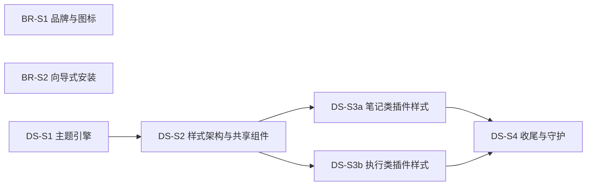

# 实施计划：品牌资产替换、设计系统重构与 Windows 向导式安装

- **目标**：
  - 三平台的图标和界面品牌位都换成虎虎。
  - 整个项目的外观重构为四套可切换主题（Claude、Apple、Notion、Vercel），样式架构整洁，并有规则守护。
  - Windows 安装包改为向导式，用户可以选择安装范围和目录。
- **规格**：品牌与安装器见 [spec.md](spec.md)；设计系统见 [design-system.md](design-system.md)。
- **交付点**：合入 `main`，由下一个 rc 的 Release 工作流产出安装包。提交、推送、发布需要用户另行授权。**当前授权只到文档，还没有授权写代码。**
- **进度**：开工时创建 `progress.md`，这是唯一记录进度的位置。

## 切片总表

| 切片 | 完成后的行为 | 真正依赖 | 唯一写入者与边界 | 验证 |
| --- | --- | --- | --- | --- |
| BR-S1 品牌与图标 | 仓库内有品牌来源；三平台应用图标和窗口图标为虎虎；三处品牌位已替换 | 无 | `assets/brand/`、`.gitattributes`、`electron-builder.yml` 顶层 `icon`、`apps/desktop/src/main/index.ts`、workbench 的三个组件与 `assets.d.ts`、品牌位样式 | BR-01～05，BR-11 的图标部分 |
| BR-S2 向导式安装 | 安装器可以选择范围和目录，界面为中文；从 rc 版升级不会留下重复安装 | 无 | `electron-builder.yml` 的 `nsis` 块 | BR-07～11 |
| DS-S1 主题引擎与四套主题 | 外观页可以在四套主题 × 明暗之间切换；跟随系统实时生效；首帧没有闪烁；字体换为 Fontsource；旧主题与旧字体删除 | 无 | `packages/ui/src/themes/`（新增）、`theme.ts`、`styles/tokens.css`、`styles/themes.generated.css`（新增）；删除 proto 中的全局变量定义块（`style.css:2-104`、`refinement.css:9-149`，以及其他文件中的 `:root` / `[data-theme]` 变量块）与 `proto/fonts.css`；`contracts/settings.ts`；`SettingsModule.tsx` 外观页与 `ShellBars.tsx`；`main.tsx` 的应用流程；`scripts/gen-notices.mjs` 的字体一节；`package.json` 的 `gen:themes`；`theme.test.ts`；主题相关 e2e | DS-01（四张卡）、DS-03～08、DS-12、DS-14、BR-06 |
| DS-S2 样式架构与共享组件 | 新的 `styles/` 目录与 `@layer` 顺序（含 vendor 层）生效；共享组件改用 `hu-` 类名，样式只使用 token；workbench 的全部界面（外壳、设置、启动页、插件中心、网关、健康、命令面板等）迁出 proto；stylelint 上线（已迁移目录启用全部规则） | DS-S1 | `packages/ui/src/styles/`（`index.css`、`base.css`、`components/*.css`）、`packages/ui/src/components/` 与 `proto/*.tsx`（类名）、`packages/workbench/src/**/*.css` 与组件类名；删除 proto 中的共享文件（style、refinement、controls、feedback、motion、design-system-v4、v2、v4、v9-layer、terminal-surface、review 等，以实际选择器归属为准）与 `components.css`；stylelint 配置与 `check-ui-colors.mjs` | DS-09（已迁移目录）、DS-13、shell 相关 e2e |
| DS-S3a 模块样式迁入插件（内容类） | notes、archives、inbox、safe 的样式迁到各插件的 `src/ui/<id>.css`，只使用 token 与共享组件 | DS-S2 | 上述插件的 UI 与 CSS（`packages/editor` 的编辑器样式也在这里）；删除对应的 proto 文件（knowledge、editor、inline-preview、vault-resource-picker 等，以 DS-S2 的归属表为准）。archives：若 [AR change](../../archive/changes/implemented/feature_2026-11-13-archives-as-folder-notes/plan.md) 已删除该插件就跳过，否则照常迁移 | 各插件 e2e、截图 |
| DS-S3b 模块样式迁入插件（执行类） | tasks、automations、agent-cli、ssh、versioning、agent-guide 的样式迁入各自插件 | DS-S2 | 上述插件的 UI 与 CSS；删除对应的 proto 文件（task-workbench、execution、agent-cli、ssh-console、version-workbench、git-v4、builtin-guide-v5 等） | 各插件 e2e、截图 |
| DS-S4 收尾与守护 | `proto/` 目录不存在；stylelint 与颜色检查覆盖全仓库；PurgeCSS 报告为空；设计规范写入 notes | DS-S3a、DS-S3b | 删除剩余 proto 文件与目录、`packages/ui/package.json` 的 `./proto.css` 导出；stylelint 去掉迁移期的排除；`.agents/dev/notes/context/design-system.md`（新的现行规范，取代归档 design-system.md 中被替代的部分） | DS-02、DS-09～11、DS-15 |

**并行与先后**

- BR-S1、BR-S2、DS-S1 三者互不依赖，可以同时进行。
  - BR-S1 与 BR-S2 都改 `electron-builder.yml`，但修改的键不重叠：BR-S1 改顶层 `icon`，BR-S2 新增 `nsis` 块。由同一实施者依次提交，或者先合入 BR-S1。
  - BR-S1 的品牌位样式：先于 DS-S2 合入就写在现有规则中，由 DS-S2 迁移；晚于 DS-S2 合入就直接写在新目录中。
- DS-S3a 与 DS-S3b 按插件划分写入边界，可以并行；它们都只读 DS-S2 冻结的共享组件类和 token，不修改 `packages/ui/src/styles/`。如果需要新增共享组件，先停下来，由 DS-S2 的负责人补上。
- **迁移期的中间状态**：DS-S1 合入后，旧的 proto 规则仍在使用，只是全局变量改由主题生成。约 238 处硬编码颜色在 DS-S2、DS-S3 完成之前不会跟随主题，这是允许的中间状态，不对外发布 rc。**DS-S4 是必须整体通过验证的整合点**，之后才能发布。
- 与其他 change 的共享文件：
  - [agent-launch-settings](../../archive/changes/implemented/feature_2026-11-13-agent-launch-settings/plan.md) 的 AL-S2 也改 `SettingsModule.tsx`（系统页改为注册）和 `ShellBars.tsx`（快捷键入口改为跳转）。约定如下：
    - DS-S1 把外观页抽成独立组件 `AppearancePage.tsx`，只改这个组件，以及 `ShellBars.tsx` 中的 `ThemeToggle`。
    - AL-S2 负责注册这个组件，并改 `ShellBars.tsx` 中的快捷键图标。
    - 两边改的是同一文件中不同的函数，后合入的一方负责合并。建议 AL-S2 先合入。
  - 档案视图样式见 [archives change](../../archive/changes/implemented/feature_2026-11-13-archives-as-folder-notes/plan.md) 的约定。
  - 任务、智能体设置等新界面：在 DS-S2 之后开发的，直接按新规则写；在 DS-S2 之前合入的，由 DS-S3 一并迁移。

## BR-S1 品牌与图标

**当前代码指针**（基线 `8283c5c`）：
- `apps/desktop/src/main/index.ts:65-78`：`createWindow`。`icon` 加在 `:71` 之后。macOS 开发模式下，在 `app.whenReady` 中调用 `app.dock.setIcon`。
- `apps/desktop/tsconfig.json`：`types: ["node"]`。
- `apps/desktop/electron-builder.yml:1-39`。
- `packages/workbench/src/shell/AppShell.tsx:109-114`。
- `packages/workbench/src/launch/LaunchPage.tsx:51-68`。
- `packages/workbench/src/settings/AboutPage.tsx:37-48`。
- 样式：`packages/ui/src/styles/proto/style.css:295-309`、`refinement.css:436-442`、`system.css:1043,1667,1801`、`vault.css:1-22`。
- `.gitattributes`。

**实施要点**：
- 复制品牌目录，写 README。
- 设置 `icon`，主进程用 `?asset` 导入图标。
- 三处品牌位用 mask 或 img 实现，logo 通过 `[data-mode]` 切换。
- 写 `assets.d.ts`。

**验收**：

| 编号 | 动作 → 判据 | 入口 |
| --- | --- | --- |
| BR-01 | `diff -r` 只有 README 一处差异；`git ls-files --eol assets/brand` 显示没有换行转换 | 命令 |
| BR-02、BR-03（Linux） | 运行 `pnpm --filter @huhu/desktop exec electron-builder --linux AppImage`，解包后检查 `.DirIcon` 和 `.desktop` 中的图标。启动 AppImage，窗口和任务栏显示虎虎。X11 下用 `xprop _NET_WM_ICON` 验证 `electron-vite dev` | 本机命令 + 截图 |
| BR-02（Win/mac） | 下载 Release 工作流的产物，检查图标 | CI + 下载检查；没有实机时记为“仅产物检查” |
| BR-04 | 在 `dev-verify` 中驱动应用，截图顶栏、启动页、关于页，分别在浅色、深色、760 px、520 px 下（DS-S1 合入后再加四套主题）；运行 `shell.spec.ts` | `dev-verify` + e2e |
| BR-05 | 读取渲染进程控制台，确认没有图片错误；`git diff` 显示 `index.html` 没有改动 | `dev-verify` |

## BR-S2 向导式安装

**当前代码指针**：
- `apps/desktop/electron-builder.yml:26-28`：win target。
- `.github/workflows/release.yml:38,60,94-96`。
- electron-builder 的相关模板：`app-builder-lib@26.18.0/templates/nsis/{installer.nsi,multiUser.nsh,multiUserUi.nsh,installSection.nsh,include/installUtil.nsh}`（只读，用于核对行为）。

**实施要点**：
- 按 spec §4.3 增加 `nsis` 块。
- 构建：本机有 wine 时可以在 Linux 上构建 NSIS 产物；否则推一个 rc 标签，或手动触发 Release 工作流的 Windows 任务（推送和打标签需要用户授权）。

**验收**：

| 编号 | 动作 → 判据 | 入口 |
| --- | --- | --- |
| BR-07～BR-10 | 按 spec §5 逐条在 Windows 实机上操作，每一页都截图 | Windows 实机；没有实机时，交付报告中标为“未验证” |
| BR-10（升级） | 先安装 rc.2 的一键安装版，在 Vault 中建一篇笔记；再运行新安装包 → 默认沿用旧的范围和目录；装完后“设置 → 应用”里只有一个 HUHU；笔记仍然存在 | Windows 实机 |
| BR-11 | 三平台 Release 工作流全部成功，产物名与校验和符合预期 | CI |

## DS-S1 主题引擎与四套主题

**当前代码指针**：
- `packages/ui/src/theme.ts:1-40`；`packages/contracts/src/settings.ts:5-14`。
- `packages/ui/src/styles/tokens.css:1-44`。
- `proto/style.css:2-104`、`refinement.css:9-149`（重复的变量定义）；`proto/fonts.css`。
- `packages/workbench/src/settings/SettingsModule.tsx:31-37,80-83,109-200`；`ShellBars.tsx:14-35`。
- `apps/desktop/src/renderer/main.tsx:1-3,189,207-218,274`。
- `packages/ui/src/components/TerminalView.tsx:29`（xterm 主题）。
- 测试：`packages/ui/test/theme.test.ts`、`packages/kernel/test/notifications.test.ts:57-76`、`tests/e2e/shell.spec.ts:410-431,700-710,1175`、`screenshots.spec.ts:34-60`。
- 复用参考（只读）：open-knowledge `packages/app/scripts/gen-color-themes.ts` 及其漂移测试，`packages/core/src/theme/base16.ts:56`（最低对比度）。实施时先核对 open-knowledge 的许可；复制代码就登记 ledger，只借鉴思路则不登记。

**实施要点**：
1. 引入 `culori` 与 Fontsource 包。
2. 写 schema、四个主题文件、生成器、`gen:themes` 脚本与生成文件。
3. 重写 `tokens.css`（只保留共享 token），删除 proto 中所有全局变量定义块与 `fonts.css`。
   - 别名与旧变量（CSS 与 TS 中共约 300 处，例如 `MarkdownEditor.tsx:141-147` 的 `var(--font)`、`--editor-size`、`--mono`）在本切片中全部替换为公开 token。
   - 先由 `grep` 子代理统计每个旧变量的出现次数，再按下面的映射表替换。映射表的完整版写进 `progress.md`。

   | 旧 | 新 |
   | --- | --- |
   | `--font`、`--ui-font` | `--font-ui` |
   | `--mono` | `--font-mono` |
   | `--blue` / `--blue-bg` | `--info` / `--info-bg`（作文字时用 `--info-text`） |
   | `--violet` / `--violet-bg` | `--tag-4` / `--tag-4-bg`（作文字时用 `--tag-4-text`） |
   | `--focus-color` | `--focus` |
   | `--focus-ring`（旧的多处定义） | `--focus-ring`（§4.3 的统一定义） |
   | `--shadow` | `--shadow-dialog` |
   | `--shadow-sm` | `--shadow-card` |
   | `--radius` | `--radius-control` |
   | `--editor-size` | `--fs-editor` |
   | `--ui-list-font`、`--ui-meta-font` | `--fs-list`、`--fs-meta` |
   | `--v9-*`、`--atomic-editor-*` 中的颜色 | 对应的公开 token |
   | 作文字的 `--success` / `--warning` / `--danger` | `--success-text` / `--warning-text` / `--danger-text` |
   | 作背景、上面有文字的 `--accent` | `--accent-strong` |
4. 重写 `theme.ts`，加入 `matchMedia` 监听与 localStorage 首帧缓存。
5. 改写 settings schema 与外观页（预览卡用局部 `data-theme`）；ThemeToggle 保留。
6. xterm 读取 `--term-*` 变量，并在主题变化时更新。
7. gen-notices 加入字体一节，并在 `ALLOWED`（`gen-notices.mjs:8`）中加入 `OFL-1.1`。
8. 主进程窗口改为 `show: false` 加 `ready-to-show`，底色按 `nativeTheme` 取值；建立 `AppearanceController`，把所有 `applyAppearance` 调用收拢到它；Mermaid 跟随明暗。
9. 测试：
   - 重写 `theme.test.ts`（表驱动对比度、schema、id 对应、漂移、夹具主题）。
   - e2e 中的 SuliWorld 改为新主题，`theme-pearl` 等 testid 改为新的 id。

**验证**：`audit` 跑单元测试与 e2e；用 `dev-verify` 驱动应用，截图四套主题 × 明暗的外观页、首页与终端；验证 DS-06、DS-07 的真实行为。

## DS-S2 样式架构与共享组件

**实施要点**：
1. 建立 `styles/index.css` 与 `@layer` 顺序。`apps/desktop` 的入口只导入 `@huhu/ui/styles.css`（取代现有的三条导入）。
2. 用 `grep` 子代理逐个确认 proto 共享文件中选择器的使用位置，按“共享组件 / 外壳 / 某插件”分类，结果写进 `progress.md`。这张归属表也是 DS-S3a、DS-S3b 的输入。
3. 共享组件逐个重写为 `components/<name>.css`，统一 `hu-` 类名并改 TSX；删除 `.btn` 等重复类。
4. workbench 的全部界面样式（外壳、设置、启动页、插件中心、网关、健康、命令面板、通知）迁入 `packages/workbench`。
5. sonner、xterm、katex 的样式改为在 `index.css` 中按 `layer(vendor)` 导入。
6. 加入 stylelint 配置与 `check-ui-colors.mjs`，并接入 `pnpm lint`。迁移期间对 `proto/` 与尚未迁移的插件做目录级排除，排除表写在配置中，DS-S4 删除。
7. 删除 `data-compact` 死选择器，密度只用 `data-density`。

**验证**：stylelint 与颜色检查通过；`audit` 跑全部 e2e；`dev-verify` 截图四套主题下的对话框、菜单、表格、按钮、表单。

## DS-S3a / DS-S3b 模块样式迁入插件

**实施要点**（两个切片相同）：
1. 按 DS-S2 的归属表，为每个插件新建 `src/ui/<id>.css`，由插件 UI 入口导入；类名加上插件前缀。
2. 硬编码颜色全部换成 token（例如 inline-preview 中约 69 处、execution 中约 56 处）。找不到合适 token 时，先停下来评估是否需要新增公开 token（改 design-system.md §4 与生成器），不在插件内硬编码。
3. 删除迁移完成的 proto 文件，并从 stylelint 排除表中移除对应插件。

**验证**：各插件 e2e；`dev-verify` 截图各模块在四套主题 × 明暗下的样子。

## DS-S4 收尾与守护

**实施要点**：
1. 删除 `proto/` 目录与导出；stylelint 去掉所有排除。
2. 运行 PurgeCSS 生成 rejected 报告并逐条核查：没用的规则删除，动态类名写进 safelist 并注明出处，核查记录写进 `progress.md`。
3. 写 `.agents/dev/notes/context/design-system.md`，作为现行设计规范（token、主题扩展方法、类名规则、守护规则），并在 `notes/context/workbench.md` 中把 D-18（Pearl 等主题）标为被取代。

**验证**：DS-02 全量截图（8 个界面 × 4 套主题 × 明暗）；DS-09～11；`audit` 跑全部测试；顾问复核。

## 完成边界

- 品牌（BR-S1、BR-S2）可以单独交付。设计系统在 DS-S4 通过后才算完成；DS-S1～S3 的中间状态不发布 rc。
- 全部切片合入后，用 `audit` 跑 lint、typecheck、单元测试和 e2e，然后按 CLAUDE.md 请顾问复核，再交付。
- Windows 实机验收依赖用户的环境。没有环境时，实现部分可以完成，但交付报告中要写明“安装器交互未经实机验证”。
