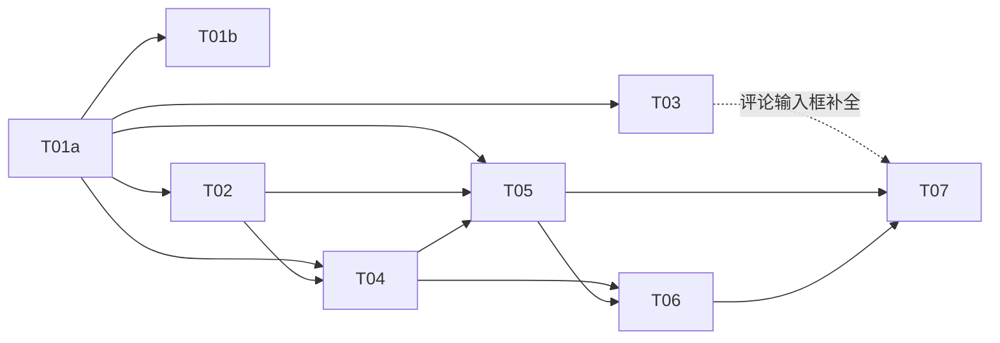

# 实施计划：任务 Issue 化、三类自动化与统一能力复用

- **目标**：用户可以在真实应用中走完 Issue §14 的闭环；三类自动化、内外统一的能力授权、运行中等待人工都满足 [spec.md §11](spec.md#11-验收清单) 的验收。
- **规格**：[spec.md](spec.md)（唯一权威）；S0 事实：[s0-findings.md](s0-findings.md)；复用：[reuse.md](reuse.md)。
- **交付点**：合入 `main`，由下一个 rc 发布。提交、推送、发布都需要用户另行授权。**当前授权只到文档，尚未授权写代码**。
- **进度**：当前进度只记录在 `progress.md`（开工时创建），其他文件只链接它，不重复记录。

## S0（已完成，2026-11-13）

复用核对、事实核实、使用方清单、对照归档决定，已写入 s0-findings、reuse 和 spec。spec 中已没有待 S0 核实的占位。

## 切片

| 切片 | 完成后的行为 | 真正依赖 | 唯一写入者与边界 | 验证 |
| --- | --- | --- | --- | --- |
| [T01a](tasks/T01a-task-model.md) 任务模型（整合） | schema 2 + `<task>` 区段，三态与最低限度的三列看板，标签字段；schema 1 报错；外部调用方无法创建 agent 任务 | 无 | contracts、tasks，所有 `completed` / `resources` 的使用方，versioning、CLI；`codeRanges()` 的唯一实现；automations 只做最小适配 | A01、A03、A05（human 部分）、A06、A07（结构部分）、A09、E01 |
| [T01b](tasks/T01b-task-ui.md) 任务界面 | 标签筛选、看板交互、选择本地目录建 Space、按能力显示 effort/fast | T01a；agent-launch-settings AL-S1（`TaskEditor.tsx` 先后） | 只改 tasks 的 UI 和 `shared/` | A01（交互）、A02、E02 |
| [T02](tasks/T02-permissions.md) 权限 | 内置插件可以调用不对外暴露的能力，第三方插件仍按外部处理；外部调用方只能写 human 任务；委托链；各插件的权限授予表 | T01a（Dispatcher 部分无依赖） | kernel 的权限与 Dispatcher，tasks 引擎的 handler 守卫，4 处只看 caller 的判断，各插件清单的 `permissions` | D02、D03 |
| [T03](tasks/T03-references-editor.md) 引用 | `@` 补全、可点击的双链、改名后联动更新 | T01a（补全扩展可以提前开发） | editor、旧 `stripCode`/`codeRanges` 的迁移、notes 的改写与 `openWiki`、任务内容编辑器 | A10 |
| [T04](tasks/T04-comments.md) 评论 | 任务文件内的时间线、请求卡片、回复并继续，以及人工流转的系统评论、`attention` | T01a、T02 | `tasks.comments.add`、时间线 UI | B01、B03、B06、B09、B10、A06 与 A07（评论部分）、§4.1 人工部分 |
| [T05](tasks/T05-automations.md) 自动化 | 三类动作、逐条派发、进入进行中、事件回写评论、终端命令、提醒 | T01a、T02、T04；[agent-launch-settings](../../archive/changes/implemented/feature_2026-11-13-agent-launch-settings/plan.md) 的 AL-S1（`resolveAgentLaunch`） | automations、`markDispatched`、`activeFor`、agent-cli 的偏好与 launch 扩展、versioning 改为能力调用 | A04、A05（agent 部分）、A08、B01（快照）、B02、B06（脱敏）、B07、B08、C01–C09、D01、D04、E03 |
| [T06](tasks/T06-live-waiting.md) 运行中等待 | Herdr 上报 blocked 后 ≤ 3 s 提示，可前往处理 | T04、T05 | herdr-client 订阅、agent-cli 的 watcher | B04a/b/c、B05、B07（会话） |
| [T07](tasks/T07-integration.md) 整合交付 | 闭环可用，旧实现无残留，文档同步 | T01a–T06 | 只做整合与清理 | D05、D06、全量回归 |

## 顺序与并行

- **起点**：只有 T01a 可以开工。T02 的 Dispatcher 部分和 T03 的 `@` 补全扩展可以并行开发，但不能改 T01a 涉及的文件。
- **T01a 合入后**，T01b、T02、T03 三者并行，写入边界如下：
  - T01b：只改 tasks 的 UI 和 `shared/`。
  - T02：kernel、tasks 引擎的 handler、各插件清单。
  - T03：editor、vault 的迁移、notes 的 `service.ts` 和 `links-rewrite`，以及任务内容编辑器组件。T01b 不碰这个组件。
  - T02 和 T03 都会改 notes：T02 只改 `notes/engine/index.ts`，T03 只改 `notes/engine/service.ts`，文件不重叠。
- **共享对象的唯一负责人**：
  - `codeRanges()`：T01a 建立，T03 只负责迁移旧调用。
  - tasks 引擎的 `index.ts`：T01a → T02 → T04 → T05 依次修改，不并行。
  - `redactSecrets`：T05 提取。
- **T05 最大**，可以按依赖顺序拆成两次合入：
  - T05a：契约、派发、评论回写。
  - T05b：终端命令、提醒、删除脚本。T05b 依赖 T05a 的派发互斥和 Space 活动判定（终端命令要用到它）。
- **整合分支**：T01a 必须一次改完所有使用方，中间提交不保证可运行；合入 `main` 前，T01a 的整合点必须完整通过 `audit`。其他切片各自合入时，都要求主干可构建、e2e 通过。
- **发布窗口**：T01a 合入后、T05a 合入前的过渡期，派发成功后任务仍保持未开始（见 T01a 实施要点 8），不符合 A04。**这一窗口内不发 rc。**

## 规格覆盖

| 规格要求 | 实现 | 验证 |
| --- | --- | --- |
| §2 任务模型、标签 | T01a（模型）、T01b（UI） | T01a（A01、A03、A09、E01）、T01b（A02、E02） |
| §3.1–3.3 区段、转义、条件写 | T01a（`<task>`、`codeRanges`）、T04（`<comments>`） | T01a（A06、A07 的结构部分）、T04（A06、A07 的评论部分，B09、B10） |
| §3.4 引用与改写 | T03 | T03（A10） |
| §3.5 快照、提示词、权限参数 | T05 | T05（C02、A08） |
| §4 状态流转、派发一致性、活动运行 | T01a（human 任务流转、守卫、agent 任务不能手动进入进行中）、T04（人工系统评论）、T05（派发、对账、`activeFor`、“已派发”评论） | T01a（A05 的 human 部分）、T04（§4.1）、T05（A04、A05 的 agent 部分、B08、C04、C06） |
| §5 评论时间线 | T04（能力、UI、`attention`）、T05（运行事件回写、快照、脱敏） | T04（B01、B03、B06）、T05（B01 快照、B02、B06 脱敏） |
| §6 三类自动化 | T05 | T05（C01–C09、E03） |
| §7 运行中等待 | T06 | T06（B04、B05、B07） |
| §8 授权与能力复用 | T02（权限、守卫）、T05（改为能力调用） | T02（D02、D03）、T05（D01、D04） |
| §10 保留的归档行为 | T01a（分类、月历、提醒、versioning 的保留与拒绝）、T05（holds、宽限、立即运行、重试） | 各自的回归项 |
| Issue §14 闭环 | T01a–T06 | T07 |

## 完成边界

- 全部切片勾选完，不等于需求完成。T07 必须在真实应用中走通闭环，并逐条标注验证状态。
- B04c 和“真实 CLI 闭环”依赖本机环境，没有环境时记为未验证，不阻塞交付，但必须在交付报告中写明。
- 交付前按 CLAUDE.md：先跑 `audit`，再请顾问复核，最后告诉用户完成。

## 风险

| 风险 | 应对 |
| --- | --- |
| T01a 改动面很大（约 105 + 75 处） | 作为整合切片，一次改完；用残留 grep 作为完成判据 |
| 评论写入频繁改变任务文件版本 | 按区段做条件写并重试；用 B09 的并发用例覆盖 |
| yolo 模式下 Agent 改写任务文件 | 威胁模型见 spec §8.6；派发闸门依赖状态和 claim；Space 包含 Vault 时提示 |
| `vault/write.ts` 的检查与写入之间没有锁 | 本期写入都在单个 Engine 内串行完成；记入 reuse.md 风险 |
| 真实 CLI 不上报 OSC 7501 | 验收已分级；后续可参考 orca 的 hooks 方案 |
| Windows 下 claim 硬链接、Herdr 的差异 | 沿用三平台 CI；参见 `notes/errors/electron-e2e-and-ui-pitfalls.md` |
